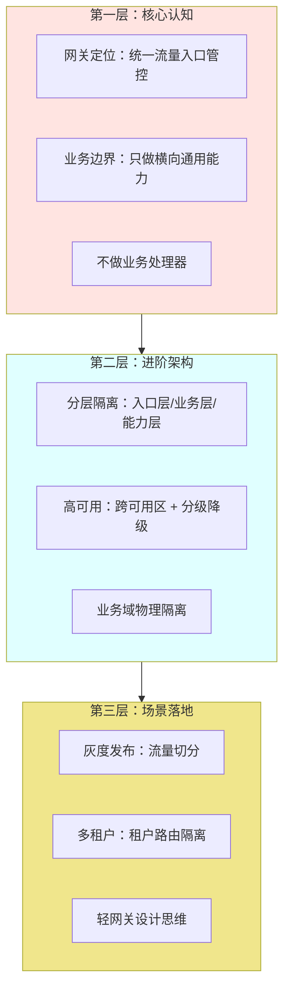
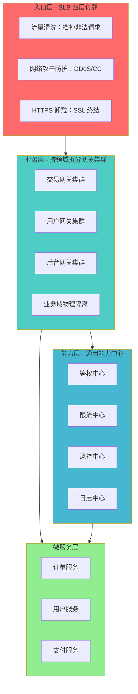
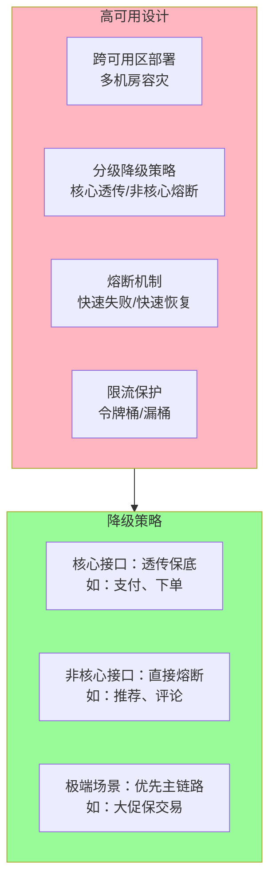
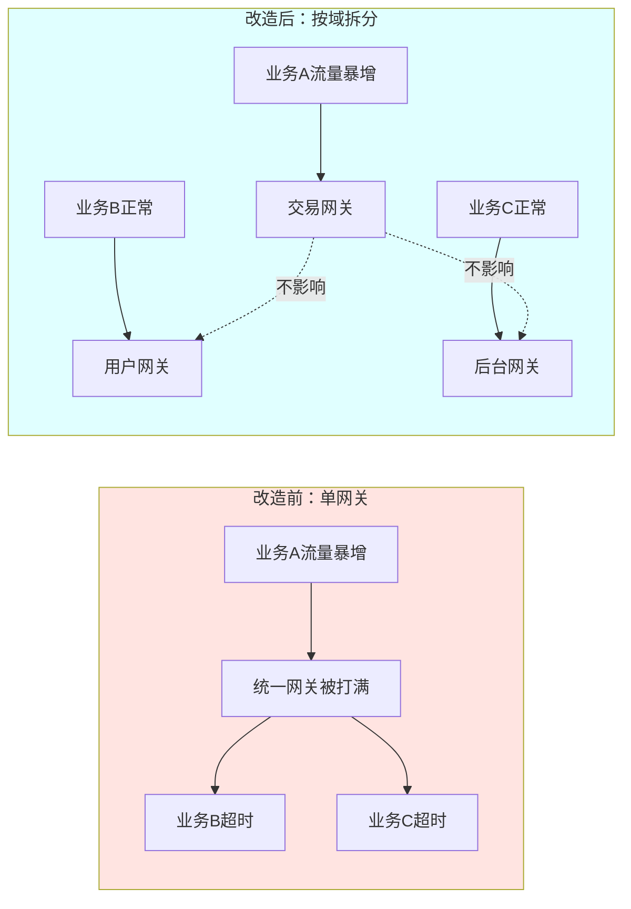
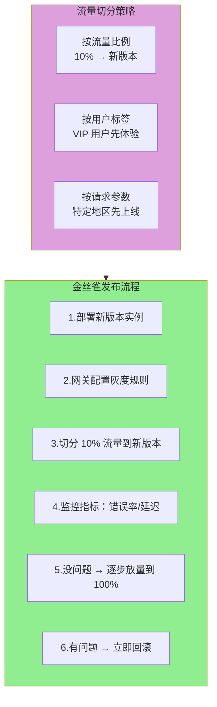
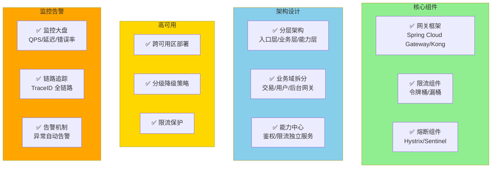
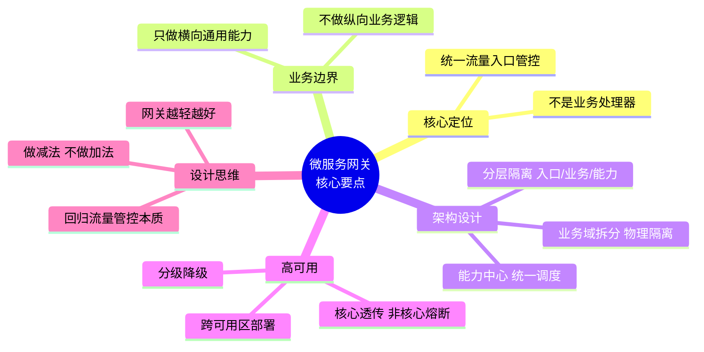

# 微服务网关架构设计

---

## 🎯 场景引入

**微服务网关解决什么问题？**
```
把散落在各个微服务的"门卫工作"（鉴权、限流、日志、路由）
集中到一个"总门卫"身上
```

**生活化比喻**：
就像大型商场的**总服务台**——你进商场先经过总服务台（网关），它负责：验证你的会员卡（鉴权）、限制同一时间进场人数（限流）、给你商场导览图（路由转发）。但它**不卖东西**（不做业务逻辑），卖东西的是各个专柜（微服务）。

**核心特点**：只做横向通用能力，不做纵向业务逻辑。

---

## 💎 核心设计要点速览

### 核心观点（5 个关键点）

**1. 网关定位：流量管控器，不是业务处理器**
```
❌ 错误认知：网关 = 路由转发 + 鉴权 + 限流（三板斧）
✅ 正确认知：网关 = 统一流量入口管控
   - 只做所有服务通用的"横向能力"
   - 不做某个业务的"纵向逻辑"
```

**2. 业务边界：只做减法，不做加法**
```
✅ 适合放网关：鉴权、限流、日志、协议转换（所有服务通用）
❌ 不能放网关：订单校验、用户信息补全（业务逻辑）
   - 放了 → 网关越来越臃肿 → 性能瓶颈 + 跨业务耦合
```

**3. 分层架构：不是单集群扛所有**
```
入口层：SLB 四层负载 + 流量清洗（挡非法请求）
业务层：按领域拆分网关集群（交易网关/用户网关/后台网关）
能力层：鉴权/限流/风控做成独立中心（网关调用，而非重复实现）
```

**4. 高可用：跨可用区 + 分级降级**
```
- 网关集群跨可用区部署
- 核心接口透传保底（不能挂）
- 非核心接口直接熔断（可以挂）
- 极端场景优先保证主链路
```

**5. 设计思维：网关越轻越好，不是越强越好**
```
网关越复杂 → 故障风险越高 + 性能损耗越大
优秀后端做网关设计 = 做减法 → 让网关回归流量管控本质
```

---

## 🚀 一句话精华

> **微服务网关 = 统一流量入口管控（不是业务处理器）+ 分层隔离架构 + 高可用降级 + 轻网关设计思维**

---

## 一、核心认知误区：网关 ≠ 路由工具

### ✅ 正确认知：三层深度



---

## 二、第一层：核心认知与业务边界

### 2.1 网关的核心定位

**生活化比喻**：
```
网关就像公司的"前台 + 安保"：
- 前台：验证来访者身份（鉴权）、登记来访记录（日志）
- 安保：限制同时进场人数（限流）、拦截可疑人员（风控）

但前台不会帮你写代码（不做业务逻辑），
写代码的是各个部门（微服务）。
```

**核心原则**：
| 能力类型 | 是否放网关 | 原因 | 生活化比喻 |
|---------|-----------|------|-----------|
| 鉴权 | ✅ 放 | 所有服务通用 | 商场验会员卡 |
| 限流 | ✅ 放 | 所有服务通用 | 限制进场人数 |
| 日志 | ✅ 放 | 所有服务通用 | 登记来访记录 |
| 协议转换 | ✅ 放 | 所有服务通用 | HTTP→gRPC 翻译 |
| 订单校验 | ❌ 不放 | 只有订单服务需要 | 专柜自己的规则 |
| 用户信息补全 | ❌ 不放 | 只有用户服务需要 | 专柜自己的业务 |

**反例教训**：
```
把订单校验放网关 → 订单服务改了校验规则 → 网关也要改
→ 网关和订单服务耦合 → 改一处挂两处
→ 网关越来越臃肿 → 性能瓶颈
```

### 2.2 业务边界原则

**一句话记住**：
> **网关只做"所有服务都需要的能力"，不做"某个服务特有的逻辑"**

**判断标准**：
```
问自己：这个逻辑是不是 80% 的服务都需要？
- 是 → 放网关（如鉴权、限流）
- 否 → 放对应服务（如订单校验）
```

---

## 三、第二层：分层隔离与高可用架构

### 3.1 生产级网关架构（分层分级）

**生活化比喻**：
```
单层网关就像：一个门卫扛所有活
- 验身份、查包裹、限人数、指路...全是他
- 结果：忙不过来，累倒了，整个公司瘫痪

分层网关就像：商场三级安保体系
- 大门保安（入口层）：挡掉可疑人员（非法请求）
- 楼层保安（业务层）：各管各的楼层（业务域隔离）
- 中控室（能力层）：统一调度安保资源（通用能力中心）
```



**分层优势**：
- ✅ **业务域隔离**：交易网关挂了，不影响用户网关
- ✅ **能力复用**：鉴权/限流做成中心，避免重复实现
- ✅ **独立扩展**：哪个层压力大，单独扩哪层

### 3.2 高可用设计

**生活化比喻**：
```
高可用就像：医院的急诊体系
- 跨可用区部署 = 多家分院（一家挂了，其他家顶上）
- 分级降级 = 先救重症（核心接口透传），轻症可以等（非核心熔断）
- 极端场景 = 疫情爆发时，优先保证 ICU（主链路）
```



**降级策略代码示例**（Go 语言）：
```go
// 分级降级策略
func GatewayHandler(ctx *gin.Context) {
    // 核心接口：透传保底
    if isCoreAPI(ctx.Request.URL.Path) {
        // 即使限流，也要保证核心接口可用
        proxyToUpstream(ctx)
        return
    }
    
    // 非核心接口：直接熔断
    if circuitBreaker.IsOpen(getServiceName(ctx)) {
        ctx.JSON(200, gin.H{
            "code": 0,
            "data": getDefaultResponse(ctx.Request.URL.Path),
            "msg":  "服务降级",
        })
        return
    }
    
    // 限流保护
    if !rateLimiter.Allow(ctx.ClientIP()) {
        ctx.JSON(429, gin.H{"error": "请求过于频繁"})
        return
    }
    
    proxyToUpstream(ctx)
}
```

### 3.3 多业务域隔离

**问题场景**：
```
多个业务域走同一个网关：
- 业务 A 流量暴增 → 把整个网关打满
- 业务 B、C 被连累 → 全部超时
- 一个业务拖垮全局
```

**解决方案**：按业务域拆分独立网关集群



---

## 四、第三层：场景化落地与治理思维

### 4.1 灰度发布（金丝雀发布）

**生活化比喻**：
```
灰度发布就像：餐厅试菜
- 先让 10% 的顾客尝新菜（灰度流量）
- 收集反馈（监控指标）
- 没问题再推广到全量（全量发布）
- 有问题就及时止损（回滚）
```

**网关实现流量切分**：



**代码示例**（灰度路由逻辑）：
```go
// 灰度路由：按用户标签切分流量
func grayReleaseRouter(ctx *gin.Context) string {
    userID := ctx.GetHeader("X-User-ID")
    
    // 规则1：VIP 用户先体验新版本
    if isVIPUser(userID) {
        return "service-v2" // 新版本
    }
    
    // 规则2：按流量比例（10% 到新版本）
    if rand.Intn(100) < 10 {
        return "service-v2"
    }
    
    // 规则3：其他用户走老版本
    return "service-v1"
}
```

### 4.2 多租户场景

**生活化比喻**：
```
多租户就像：写字楼的不同公司
- 每个公司有自己的门禁卡（租户标识）
- 每个公司有自己的办公区域（租户隔离）
- 每个公司有自己的限流规则（租户级限流）
- 避免 A 公司的人跑到 B 公司捣乱
```

**网关实现**：
```go
// 多租户路由与隔离
func multiTenantHandler(ctx *gin.Context) {
    // 1.解析租户标识
    tenantID := parseTenantID(ctx.GetHeader("X-Tenant-ID"))
    
    // 2.租户级限流（每个租户独立限流）
    if !tenantRateLimiter.Allow(tenantID) {
        ctx.JSON(429, gin.H{"error": "租户请求过于频繁"})
        return
    }
    
    // 3.租户路由（不同租户路由到不同集群）
    targetCluster := getTenantCluster(tenantID)
    
    // 4.租户隔离（数据隔离 + 资源隔离）
    ctx.Set("X-Tenant-ID", tenantID)
    proxyToCluster(ctx, targetCluster)
}
```

### 4.3 轻网关设计思维

**核心认知**：
```
❌ 错误思维：网关越强越好，功能越多越好
✅ 正确思维：网关越轻越好，功能越精简越好

网关越复杂 → 故障风险越高 + 性能损耗越大
网关越简单 → 故障风险越低 + 性能越好
```

**设计原则**：
| 原则 | 说明 | 生活化比喻 |
|------|------|-----------|
| 做减法 | 只保留必要的通用能力 | 门卫只做安保，不卖东西 |
| 能力下沉 | 业务逻辑放服务层 | 专柜卖东西，前台不管 |
| 能力中心 | 通用能力做成独立服务 | 安保资源统一调度 |
| 快速失败 | 非核心接口直接熔断 | 轻症可以等，重症先救 |

---
## 五、生产环境 Checklist（部署检查清单）



**部署检查清单**：

| 类别 | 检查项 | 状态 | 生活化比喻 |
|------|--------|------|-----------|
| **核心组件** | 网关框架（Spring Cloud Gateway/Kong） | ⬜ | 总服务台 |
| | 限流组件（令牌桶/漏桶） | ⬜ | 限制进场人数 |
| | 熔断组件（Hystrix/Sentinel） | ⬜ | 快速失败机制 |
| **架构设计** | 分层架构（入口层/业务层/能力层） | ⬜ | 三级安保体系 |
| | 业务域拆分（交易/用户/后台网关） | ⬜ | 各管各的楼层 |
| | 能力中心（鉴权/限流独立服务） | ⬜ | 统一调度资源 |
| **高可用** | 跨可用区部署 | ⬜ | 多家分院 |
| | 分级降级策略 | ⬜ | 先救重症 |
| | 限流保护 | ⬜ | 限制人数 |
| **监控告警** | 监控大盘（QPS、延迟、错误率） | ⬜ | 保安巡逻 |
| | 链路追踪（TraceID） | ⬜ | 追踪来访记录 |
| | 告警机制 | ⬜ | 异常自动报警 |

---

## 六、总结



### 🎯 方案总结

> **微服务网关 = 统一流量入口管控（不是业务处理器）+ 分层隔离架构（入口层/业务层/能力层）+ 高可用设计（跨可用区 + 分级降级）+ 轻网关设计思维（做减法）**

### 🧠 核心要点

1. **网关定位是什么？** 统一流量入口管控，不是路由工具，不做业务处理器。
2. **业务边界怎么划？** 只做所有服务通用的横向能力（鉴权/限流），不做某个服务特有的业务逻辑。
3. **架构怎么设计？** 分层分级——入口层流量清洗，业务层按域拆分，能力层做成独立中心。
4. **高可用怎么保证？** 跨可用区部署 + 分级降级（核心透传保底，非核心直接熔断）。
5. **设计思维是什么？** 网关越轻越好，不是越强越好，做减法让网关回归本质。

