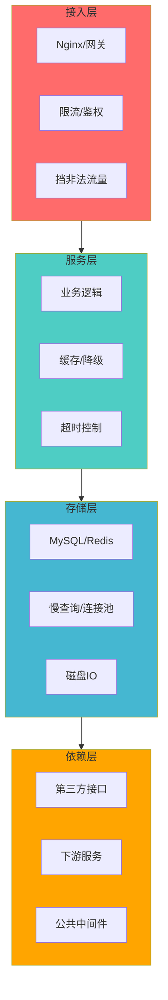
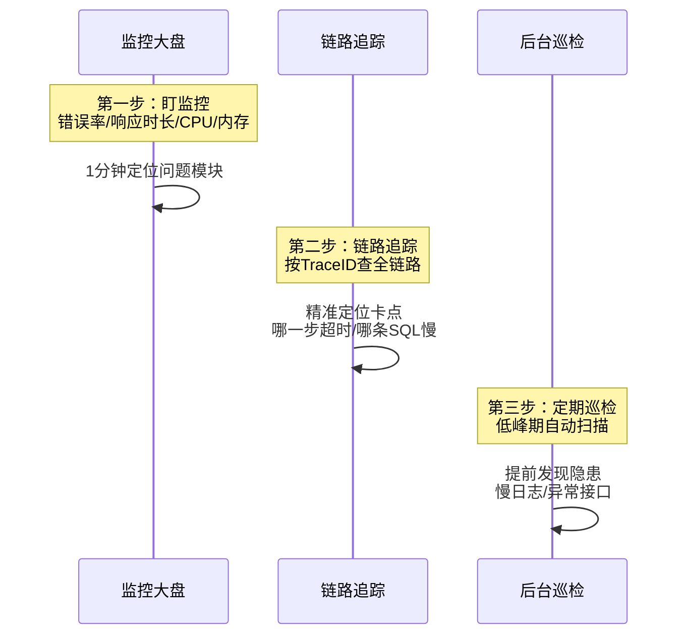
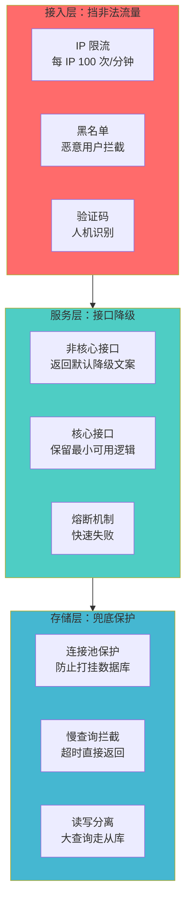
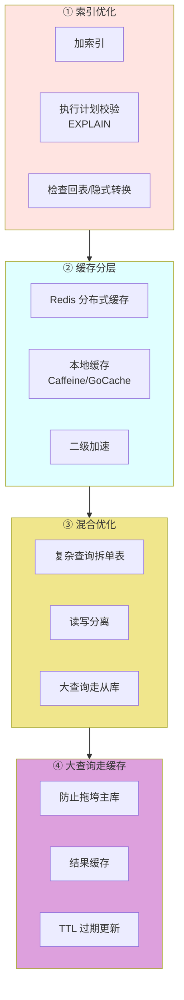
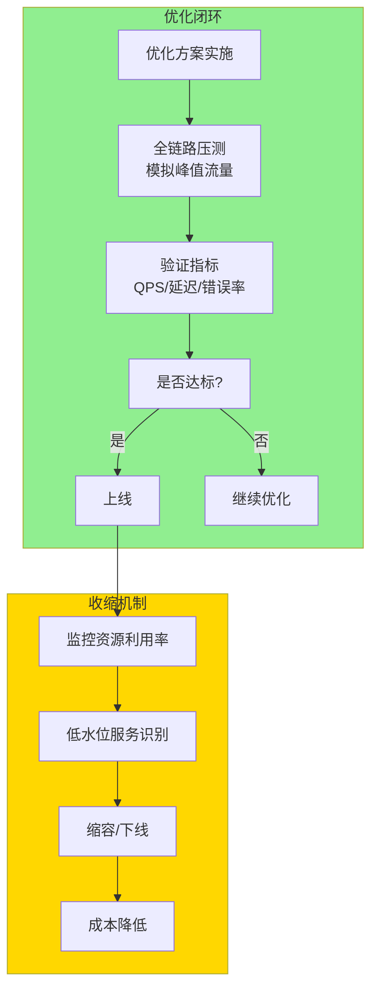
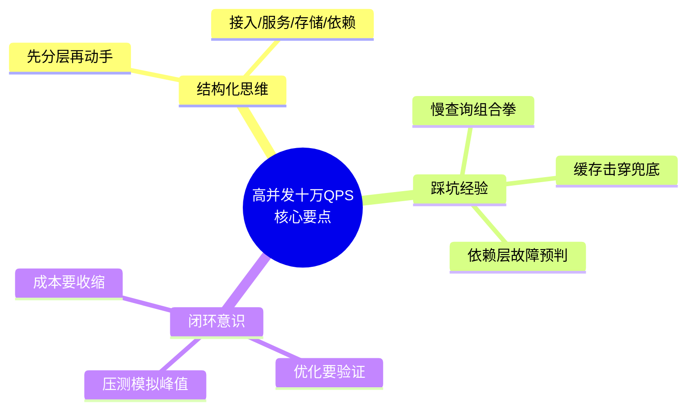

# 高并发接口十万 QPS 实战


---

## 🎯 场景引入

**高并发接口扛十万 QPS 解决什么问题？**
```
大促流量一上来，接口不挂、不慢、不超卖
十万用户同时访问，页面不转圈圈
```

**生活化比喻**：
就像**双十一的快递分拣中心**——平时每天处理 10 万件，双十一要处理 100 万件。你需要：提前扩容（加机器）、限流（限制每人每天下单数）、降级（非核心功能暂停）、兜底（系统挂了手动处理）。不是简单地"加机器"就完了。

**核心特点**：分层思考、组合拳优化、闭环验证。

---

## 💎 核心设计要点速览

### 核心观点（5 个关键点）

**1. 故障分四层，不是两层**
```
❌ 大部分人只说：应用层、数据库层
✅ 完整分类：接入层、服务层、存储层、依赖层
   - 接入层：Nginx/网关（限流、鉴权）
   - 服务层：业务逻辑（缓存、降级）
   - 存储层：MySQL/Redis（慢查询、连接池）
   - 依赖层：第三方接口、下游服务（超时、熔断）
```

**2. 排障三板斧，不是逐台查日志**
```
第一步：盯监控大盘（错误率/响应时长/CPU/内存）→ 1 分钟定位问题模块
第二步：链路追踪捞根因（按 TraceID 查全链路）→ 精准定位卡点
第三步：后台定期巡检（低峰期扫慢日志/异常接口）→ 提前发现隐患
```

**3. 分层止损，不是一刀切全拦**
```
接入层：挡非法流量（IP 限流、黑名单）
服务层：接口降级（非核心返回默认值）
存储层：兜底保护（绝不能让流量穿透打挂数据库）
核心接口：保留最小可用逻辑
```

**4. 慢查询优化四件套，不是只加索引**
```
① 索引优化 + 执行计划校验（看回表/隐式转换）
② 缓存分层（Redis + 本地缓存二级加速）
③ 混合优化（复杂查询拆单表 + 读写分离）
④ 大查询走缓存（防止拖垮主库）
```

**5. 容量治理闭环，不是无限加机器**
```
优化完了要验证：全链路压测模拟峰值流量
长期低水位服务要下线缩容
成本越来越高 → 稳定性越来越差
优化 → 验证 → 收缩 → 闭环
```

---

## 🚀 一句话精华

> **高并发十万 QPS = 故障四层分类（接入/服务/存储/依赖）+ 排障三板斧（监控/链路/巡检）+ 分层止损（限流+降级+兜底）+ 慢查询四件套 + 容量治理闭环**

---

## 一、第一问：故障到底分几层？
### ✅ 正确回答：四层故障模型

**生活化比喻**：
```
四层故障就像快递分拣中心的四个环节：
接入层：大门保安（挡非法请求）
服务层：分拣工人（处理业务逻辑）
存储层：仓库管理员（数据存储）
依赖层：供应商（第三方服务）

任何一个环节出问题，整个链路都会挂。
```



**四层故障详解**：

| 故障层 | 典型问题 | 影响 | 生活化比喻 |
|--------|---------|------|-----------|
| **接入层** | Nginx 挂了、限流配置错误 | 所有请求进不来 | 大门保安睡着了 |
| **服务层** | 缓存击穿、线程池满、OOM | 业务逻辑处理不了 | 分拣工人罢工了 |
| **存储层** | 慢查询、连接池耗尽、磁盘满 | 数据读写不了 | 仓库门打不开了 |
| **依赖层** | 第三方接口超时、下游服务挂了 | 级联故障、雪崩 | 供应商不发货了 |

**依赖层为什么容易漏？**
```
大部分只关注自己的代码和数据库，
忽略了下游服务和第三方接口。

结果：下游服务一挂，自己跟着雪崩，
连降级开关都来不及切。
```

---

## 二、第二问：故障来了怎么定位？

### 排障三板斧

**生活化比喻**：
```
排障就像医生看病：
第一步：看体检报告（监控大盘）→ 1 分钟知道哪个器官有问题
第二步：做 CT（链路追踪）→ 精准定位病灶
第三步：定期体检（后台巡检）→ 提前发现隐患

不是逐台机器查日志（那就像全身检查一遍，太慢了）
```



**工具链**：

| 步骤 | 工具 | 看什么 | 目标 |
|------|------|--------|------|
| **第一步** | Prometheus + Grafana | 错误率、P99 延迟、CPU、内存、连接池 | 1 分钟定位问题模块 |
| **第二步** | Jaeger/Zipkin | 按 TraceID 查全链路调用 | 精准定位卡点 |
| **第三步** | 自研巡检系统 | 慢 SQL、异常接口、资源水位 | 提前发现隐患 |

**代码示例**（监控告警）：
```go
// 监控告警：错误率超阈值自动告警
func monitorAlert() {
    // 每分钟检查一次
    ticker := time.NewTicker(1 * time.Minute)
    
    for range ticker.C {
        // 检查错误率
        errorRate := getErrorRate()
        if errorRate > 0.05 { // 错误率 > 5%
            sendAlert("错误率过高: %.2f%%", errorRate*100)
        }
        
        // 检查 P99 延迟
        p99 := getP99Latency()
        if p99 > 500*time.Millisecond { // P99 > 500ms
            sendAlert("P99 延迟过高: %v", p99)
        }
        
        // 检查连接池水位
        poolUsage := getConnectionPoolUsage()
        if poolUsage > 0.8 { // 连接池使用率 > 80%
            sendAlert("连接池水位过高: %.2f%%", poolUsage*100)
        }
    }
}
```

---

## 三、第三问：流量冲击怎么止损？

### 分层止损策略

**生活化比喻**：
```
分层止损就像医院急诊：
接入层：急诊室门口分诊（挡掉轻症，优先重症）
服务层：医生快速处理（非核心检查暂停，只做核心检查）
存储层：保护病床（绝不能让病人把病床占满）

不是一刀切全拦（那所有病人都看不了），
而是分级处理，优先保证核心链路。
```



**降级策略代码示例**：
```go
// 分层止损：限流 + 降级 + 兜底
func highConcurrencyHandler(ctx *gin.Context) {
    // 接入层：限流挡非法流量
    if !rateLimiter.Allow(ctx.ClientIP()) {
        ctx.JSON(429, gin.H{"error": "请求过于频繁"})
        return
    }
    
    // 服务层：非核心接口降级
    if !isCoreAPI(ctx.Request.URL.Path) {
        if circuitBreaker.IsOpen(getServiceName(ctx)) {
            ctx.JSON(200, gin.H{
                "code": 0,
                "data": getDefaultResponse(),
                "msg":  "服务降级",
            })
            return
        }
    }
    
    // 核心接口：保留最小可用逻辑
    result, err := coreBusinessLogic(ctx)
    if err != nil {
        // 兜底：返回缓存数据或默认值
        result = getFallbackData(ctx)
    }
    
    ctx.JSON(200, result)
}
```

**关键点**：
- ✅ **绝不能让流量穿透到数据库**：一旦数据库被打挂，整个系统瘫痪
- ✅ **核心接口透传保底**：支付、下单这种核心接口，即使降级也要保证可用
- ✅ **非核心接口直接熔断**：推荐、评论这种非核心接口，直接返回默认值

---

## 四、第四问：慢查询只会加索引？

### 慢查询优化四件套

**生活化比喻**：
```
慢查询优化就像治便秘：
只加索引 = 只吃泻药（治标不治本）
组合拳 = 饮食调整 + 运动 + 药物 + 手术（综合治疗）

① 索引优化 + 执行计划校验（基础）
② 缓存分层（Redis + 本地缓存）
③ 混合优化（复杂查询拆单表 + 读写分离）
④ 大查询走缓存（防止拖垮主库）
```



**优化组合拳详解**：

**① 索引优化（基础）**
```sql
-- 加索引
CREATE INDEX idx_user_status ON orders(user_id, status);

-- 执行计划校验
EXPLAIN SELECT * FROM orders WHERE user_id = 123 AND status = 1;

-- 检查项：
-- ✅ type: ref（走索引）
-- ✅ key: idx_user_status（用到索引）
-- ❌ Extra: Using where（回表）→ 考虑覆盖索引
-- ❌ Extra: Using filesort（文件排序）→ 调整索引顺序
```

**② 缓存分层**
```go
// 二级缓存：本地缓存 + Redis
func getOrder(ctx context.Context, orderID int64) (*Order, error) {
    // L1: 本地缓存（最快，零网络 IO）
    if order, ok := localCache.Get(orderID); ok {
        return order, nil
    }
    
    // L2: Redis（快，网络 IO）
    order, err := redisCache.Get(orderID)
    if err == nil {
        localCache.Set(orderID, order, 5*time.Minute) // 回写本地
        return order, nil
    }
    
    // L3: MySQL（慢，但可靠）
    order, err = db.Query(orderID)
    if err == nil {
        redisCache.Set(orderID, order, 1*time.Hour)
        localCache.Set(orderID, order, 5*time.Minute)
        return order, nil
    }
    
    return nil, err
}
```

**③ 混合优化**
```sql
-- 复杂查询拆成单表查询
-- ❌ 慢：JOIN 大表
SELECT o.*, u.name 
FROM orders o 
JOIN users u ON o.user_id = u.id 
WHERE o.created_at > '2024-01-01';

-- ✅ 快：拆成两个单表查询
SELECT * FROM orders WHERE created_at > '2024-01-01';
SELECT * FROM users WHERE id IN (user_id_list);

-- 读写分离
-- 写操作走主库
INSERT INTO orders ...
-- 读操作走从库
SELECT * FROM orders WHERE ...
```

**金句总结**：
> **好的 SQL 优化找的不是最快的写法，是高并发下最稳的方案。**

---

## 五、第五问：机器加越多越好？

### 容量治理与闭环验证

**生活化比喻**：
```
容量治理就像减肥：
加机器 = 吃泻药（短期有效，长期伤身）
容量治理 = 饮食控制 + 运动 + 代谢调整（长期健康）

长期低水位的服务 → 下线缩容
利用率不达标的机器 → 回收
没用的冗余接口 → 下线

不然集群越滚越大，成本越来越高，稳定性反而越来越差。
```



**全链路压测**：
```go
// 全链路压测：模拟峰值流量
func fullLinkPressureTest() {
    // 模拟 10 万 QPS
    for i := 0; i < 100000; i++ {
        go func() {
            resp, err := http.Post("http://api.example.com/order", ...)
            if err != nil {
                log.Error("压测失败: %v", err)
            }
            // 收集指标：QPS、延迟、错误率
            collectMetrics(resp)
        }()
    }
    
    // 观察 10 分钟
    time.Sleep(10 * time.Minute)
    
    // 输出报告
    printReport()
    // QPS: 100000
    // P99 延迟: 200ms
    // 错误率: 0.1%
    // 是否达标: ✅
}
```

**容量收缩机制**：
```go
// 容量收缩：识别低水位服务
func capacityShrinkage() {
    // 每周扫描一次
    services := getAllServices()
    
    for _, svc := range services {
        // 计算过去 7 天的平均 CPU 利用率
        cpuUsage := getAvgCPUUsage(svc, 7*24*time.Hour)
        
        if cpuUsage < 0.2 { // CPU 利用率 < 20%
            log.Warn("服务 %s 资源利用率过低: %.2f%%", svc.Name, cpuUsage*100)
            // 建议缩容
            recommendScaleDown(svc)
        }
        
        // 检查接口调用量
        qps := getAvgQPS(svc, 7*24*time.Hour)
        if qps < 10 { // QPS < 10
            log.Warn("服务 %s 调用量过低: %.2f", svc.Name, qps)
            // 建议下线
            recommendOffline(svc)
        }
    }
}
```

---
## 六、总结



### 🎯 方案总结

> **高并发十万 QPS = 故障四层分类（接入/服务/存储/依赖）+ 排障三板斧（监控/链路/巡检）+ 分层止损（限流+降级+兜底）+ 慢查询四件套 + 容量治理闭环**

### 🧠 核心要点

1. **故障分几层？** 接入层、服务层、存储层、依赖层，依赖层最容易漏。
2. **排障怎么定位？** 监控大盘 1 分钟定位模块 → 链路追踪精准定位卡点 → 后台巡检提前发现隐患。
3. **止损怎么分层？** 接入层挡非法流量，服务层降级非核心，存储层兜底保护数据库。
4. **慢查询怎么优化？** 索引 + 缓存 + 混合优化 + 大查询走缓存，不是只加索引。
5. **机器越加越多？** 容量治理 + 闭环验证，全链路压测 + 低水位缩容。

---
