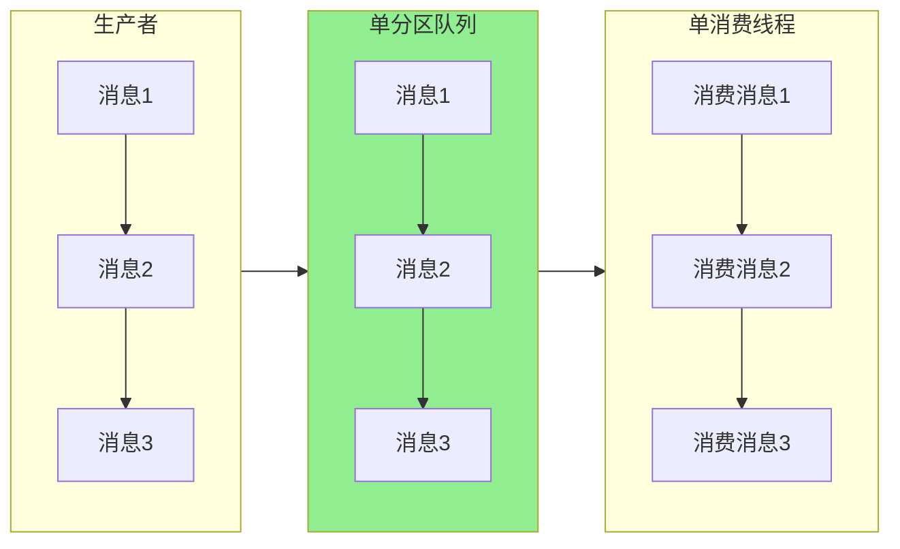
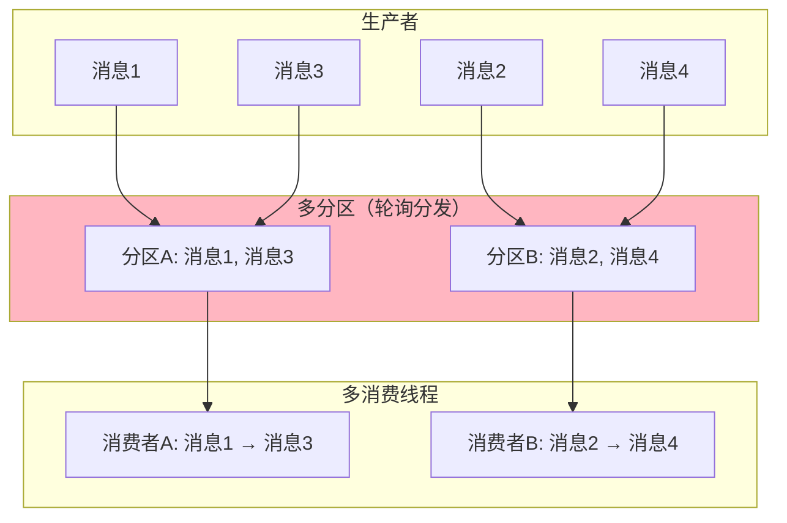
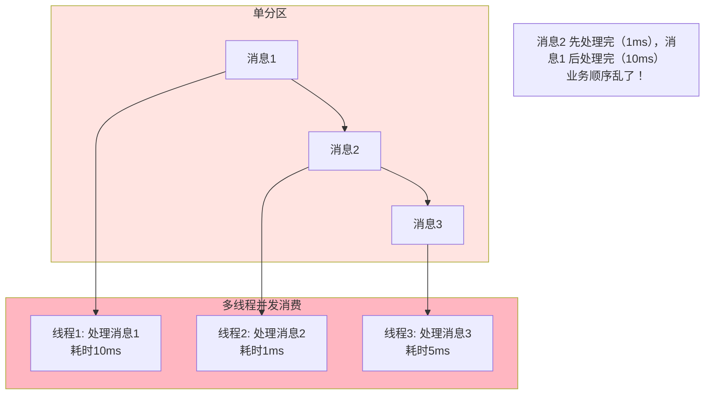
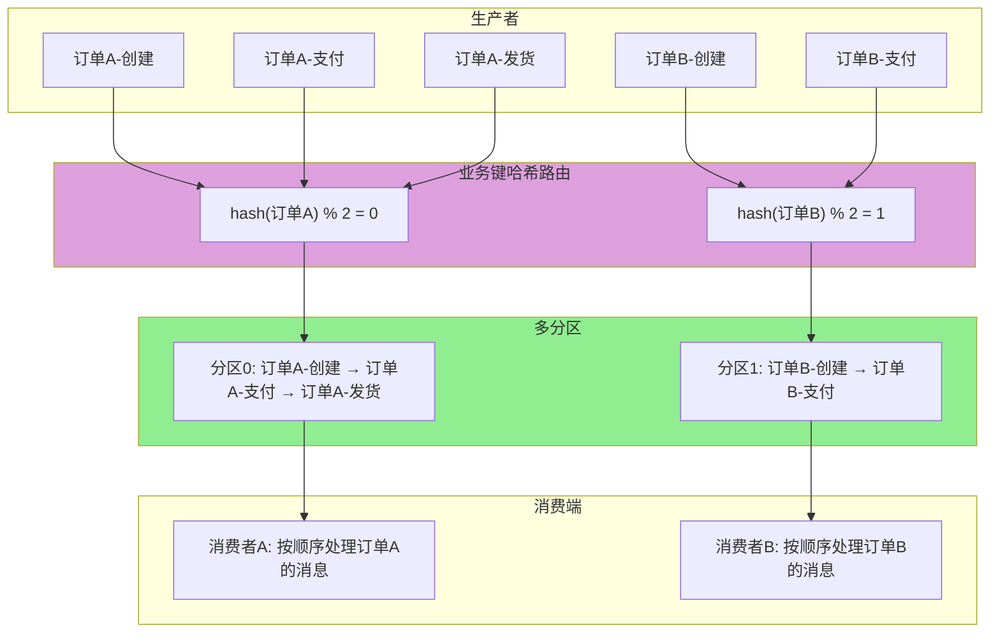
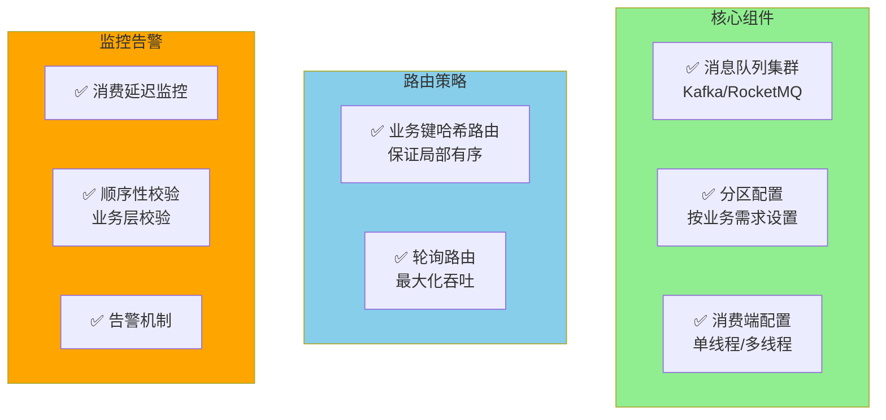
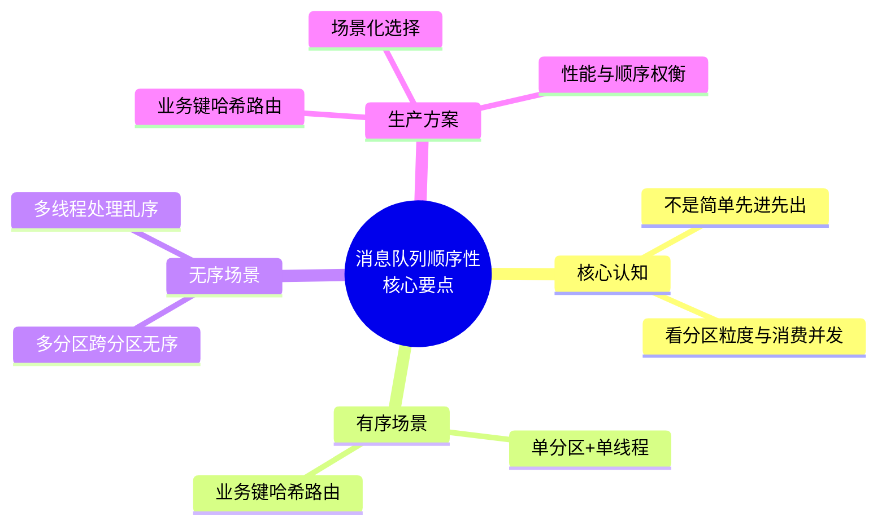

# 消息队列顺序消费深度解析


---

## 🎯 场景引入

**消息队列顺序消费解决什么问题？**
```
保证消息按发送顺序被消费
比如：订单创建 → 订单支付 → 订单发货，不能乱序
```

**生活化比喻**：
就像**快递分拣流水线**——包裹按顺序上传送带，按顺序分拣。但如果有多条传送带（多分区）或者多个分拣员（多消费线程），顺序就会乱。所以关键问题是：**什么时候需要顺序？什么时候不需要？**

**核心特点**：单分区 + 单消费者线程 = 严格有序；多分区或多线程 = 只能分区内有序。

---

## 💎 核心设计要点速览

### 核心观点（5 个关键点）

**1. 顺序性由什么决定？**
```
❌ 错误认知：队列 = 先进先出 = 发送顺序 = 消费顺序
✅ 正确认知：顺序性取决于三个因素：
   ① 分区数量（单分区 vs 多分区）
   ② 消息路由规则（轮询 vs 哈希）
   ③ 消费端并发模式（单线程 vs 多线程）
```

**2. 单分区 + 单线程 = 严格有序**
```
✅ 能保证顺序的场景：
   - 单分区：所有消息到一个分区
   - 单消费线程：按顺序拉取处理
   - 消费顺序 = 发送顺序
```

**3. 多分区或多线程 = 顺序被打破**
```
❌ 顺序被打破的场景：
   ① 多分区路由：消息轮询/哈希到不同分区，分区之间独立
   ② 多线程并发消费：即使单分区，多线程处理速度有快有慢
   结论：高吞吐场景下，全局顺序天然丢失
```

**4. 局部有序：业务键哈希路由**
```
✅ 生产级方案：
   - 同一业务标识（如订单 ID）哈希到同一分区
   - 保证分区内局部有序
   - 非顺序场景用多分区最大化吞吐
   - 需要顺序的场景用业务键哈希保证局部有序
```

**5. 场景化选择**
```
不需要顺序：日志上报、埋点采集 → 多分区 + 多线程最大化吞吐
需要局部顺序：订单状态流转、用户操作记录 → 业务键哈希路由到同一分区
需要全局顺序：极少场景，性能代价极大（单分区单线程）
```

---

## 🚀 一句话精华

> **消息队列顺序性 = 单分区单线程严格有序 + 多分区多线程顺序丢失 + 业务键哈希路由实现局部有序 + 场景化选择**

---

## 一、为什么大家会觉得消息队列是顺序的？

### 1.1 单分区顺序消费场景

**生活化比喻**：
```
单分区 + 单消费者 = 单条传送带 + 单个分拣员
包裹按顺序上传送带，分拣员按顺序拿包裹
顺序完全一致，不会乱

这就是大家说"队列 = 先进先出"的来源
```



**结论**：
> 在 **单分区 + 单消费者线程** 的场景下，消息队列可以严格保证发送顺序与消费顺序一致。

---

## 二、关键转折：顺序被打破的两个场景

### 2.1 场景一：多分区路由

**生活化比喻**：
```
多分区 = 多条传送带
包裹被轮询分发到不同传送带：
- 包裹1 → 传送带 A
- 包裹2 → 传送带 B
- 包裹3 → 传送带 A

每条传送带内部有序，但跨传送带无序
包裹2 可能比包裹1 先被处理
```



**问题**：
```
发送顺序：消息1 → 消息2 → 消息3 → 消息4
消费顺序：消息1 → 消息2 → 消息3 → 消息4（看起来有序）

但如果消费线程速度不同：
- 消费者A 处理消息1 花了 10ms
- 消费者B 处理消息2 花了 1ms
- 结果：消息2 比消息1 先处理完 → 业务顺序乱了
```

### 2.2 场景二：多线程并发消费

**生活化比喻**：
```
单分区 + 多线程 = 单条传送带 + 多个分拣员
多个分拣员同时拿包裹，手快手慢不一样
先拿到的可能后处理完 → 业务顺序乱了
```



**结论**：
> 只要引入 **多分区** 或 **多消费线程**，全局顺序就会被打破。  
> 高吞吐场景下，全局顺序天然丢失。

---

## 三、生产级方案：局部有序

### 3.1 业务键哈希路由

**生活化比喻**：
```
业务键哈希 = 按快递单号尾号分拣
- 单号尾号 1 → 分拣员 A
- 单号尾号 2 → 分拣员 B
- 单号尾号 3 → 分拣员 A

同一个快递单号的所有包裹，总是分到同一个分拣员
这个快递的包裹顺序就保证了
```

**核心思路**：
```
同一业务标识（如订单 ID）的消息 → 哈希到同一分区
分区内单线程消费 → 保证这个订单的消息严格有序

不同订单的消息 → 可以分散到不同分区
最大化吞吐量
```



**代码示例**（Kafka）：
```java
// Kafka 生产者：业务键哈希路由
ProducerRecord<String, String> record = new ProducerRecord<>(
    "order-topic",
    orderID,  // key = 订单ID（业务键）
    message   // value = 消息内容
);

// Kafka 默认按 key 哈希到分区
// 同一订单 ID 的消息 → 同一分区 → 分区内有序
producer.send(record);
```

**代码示例**（RocketMQ）：
```java
// RocketMQ 生产者：顺序消息
SendResult result = producer.send(
    msg,
    (mqs, msg1, arg) -> {
        // 按订单 ID 哈希选择分区
        int index = Math.abs(arg.hashCode()) % mqs.size();
        return mqs.get(index);
    },
    orderID  // 业务键
);
```

### 3.2 消费端保证顺序

**关键点**：
```
生产端按业务键哈希到同一分区 ✅
消费端也要保证单线程消费同一分区 ✅

如果消费端多线程拉取同一分区 → 顺序还是会乱
```

**代码示例**（单线程消费）：
```java
// 消费者：单线程拉取 + 单线程处理
consumer.subscribe(Collections.singletonList("order-topic"));

while (true) {
    // 拉取消息（单线程）
    ConsumerRecords<String, String> records = consumer.poll(100);
    
    // 按顺序处理（单线程）
    for (ConsumerRecord<String, String> record : records) {
        processOrder(record.value());  // 按顺序处理
    }
    
    // 提交 offset
    consumer.commitSync();
}
```

---

## 四、场景化选择

### 4.1 不需要顺序的场景

**典型场景**：
```
日志上报、埋点采集、监控数据
特点：对全局顺序没要求，追求高吞吐
方案：多分区 + 多消费线程 → 最大化吞吐量
```

**生活化比喻**：
```
日志上报 = 快递包裹不需要按顺序
- 包裹1 先到还是包裹2 先到，无所谓
- 重要的是：所有包裹都要到
- 所以：多条传送带 + 多个分拣员 → 越快越好
```

### 4.2 需要局部顺序的场景

**典型场景**：
```
订单状态流转：创建 → 支付 → 发货 → 完成
用户操作记录：登录 → 浏览 → 下单
特点：同一业务实体的操作必须有序
方案：业务键哈希路由 → 同一业务到同一分区 → 分区内有序
```

**生活化比喻**：
```
订单状态流转 = 同一个快递的多个包裹
- 订单创建必须先于订单支付
- 订单支付必须先于订单发货
- 所以：同一订单的所有操作 → 同一个分拣员 → 保证顺序
- 不同订单之间 → 不需要顺序 → 并行处理
```

### 4.3 需要全局顺序的场景

**典型场景**：
```
极少场景：
- 数据库 binlog 同步（必须按顺序回放）
- 某些金融交易场景（必须严格按时间顺序）

方案：单分区 + 单消费线程
代价：吞吐量极低（所有消息排队处理）
```

**生活化比喻**：
```
全局顺序 = 所有包裹只有一条传送带 + 一个分拣员
- 顺序完全保证
- 但：速度极慢
- 所以：能不全局顺序就不全局顺序
```

### 4.4 场景对比表

| 场景 | 顺序要求 | 方案 | 吞吐量 | 生活化比喻 |
|------|---------|------|--------|-----------|
| 日志上报 | 不需要 | 多分区 + 多线程 | ⭐⭐⭐⭐⭐ | 多条传送带 + 多个分拣员 |
| 订单状态流转 | 局部有序 | 业务键哈希路由 | ⭐⭐⭐⭐ | 同一订单同一分拣员 |
| binlog 同步 | 全局有序 | 单分区 + 单线程 | ⭐ | 一条传送带 + 一个分拣员 |

---
## 五、生产环境 Checklist（部署检查清单）



**部署检查清单**：

| 类别 | 检查项 | 状态 | 生活化比喻 |
|------|--------|------|-----------|
| **核心组件** | 消息队列集群（Kafka/RocketMQ） | ⬜ | 快递分拣中心 |
| | 分区配置（按业务需求） | ⬜ | 传送带数量 |
| | 消费端配置（单线程/多线程） | ⬜ | 分拣员数量 |
| **路由策略** | 业务键哈希路由（保证局部有序） | ⬜ | 按单号尾号分拣 |
| | 轮询路由（最大化吞吐） | ⬜ | 轮询分发 |
| **监控告警** | 消费延迟监控 | ⬜ | 包裹积压监控 |
| | 顺序性校验（业务层校验） | ⬜ | 顺序检查 |
| | 告警机制 | ⬜ | 异常自动报警 |

---

## 六、总结



### 🎯 方案总结

> **消息队列顺序性 = 单分区单线程严格有序 + 多分区多线程顺序丢失 + 业务键哈希路由实现局部有序 + 场景化选择（性能 vs 顺序）**

### 🧠 核心要点

1. **消息一定按顺序消费吗？** 不一定，取决于分区数量和消费并发模式。
2. **什么时候有序？** 单分区 + 单线程 = 严格有序。
3. **什么时候无序？** 多分区或多线程 = 全局顺序丢失。
4. **需要顺序怎么办？** 业务键哈希路由到同一分区 + 分区内单线程消费 = 局部有序。
5. **本质是什么？** 看分区的粒度与消费的并发模式，不是简单的先进先出。

---
