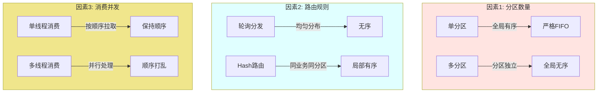
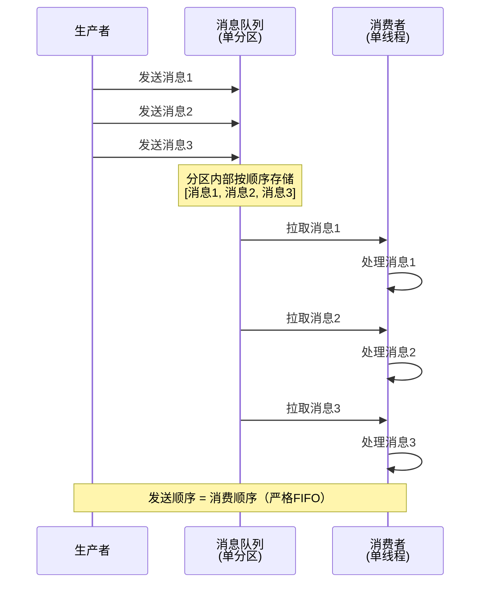
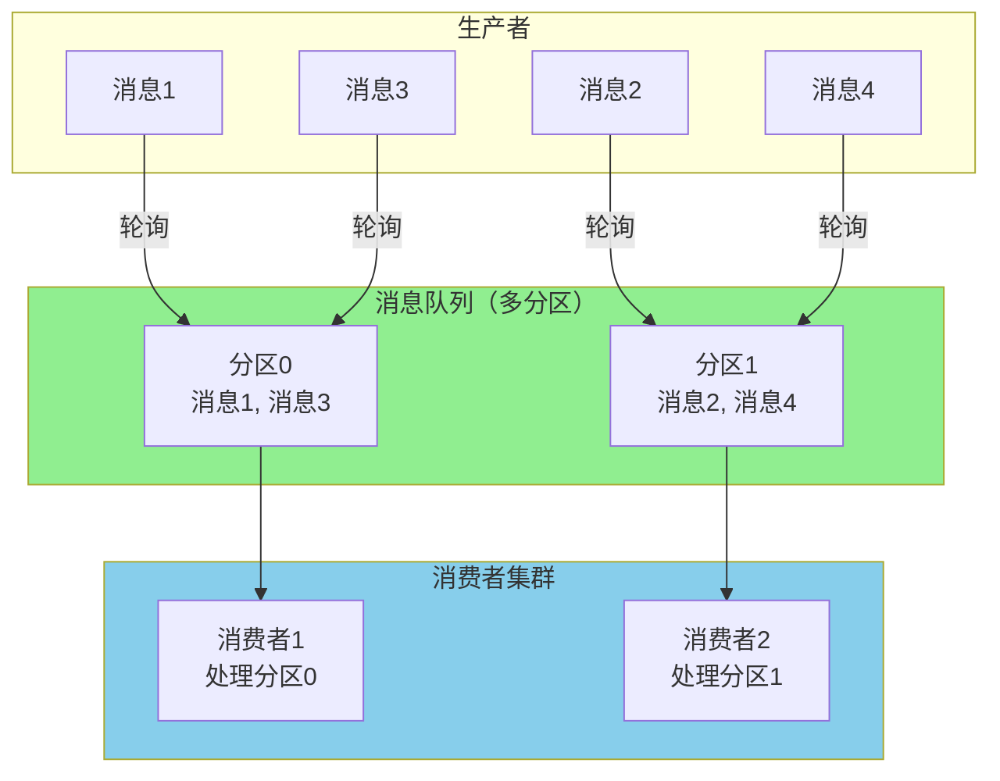
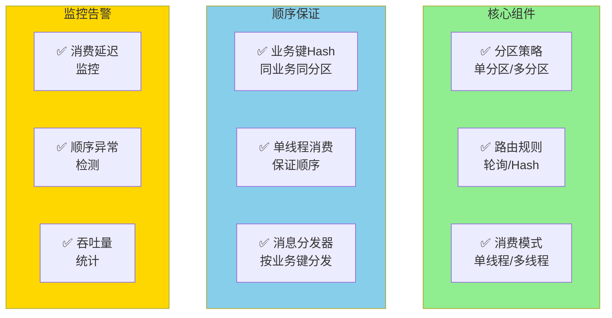
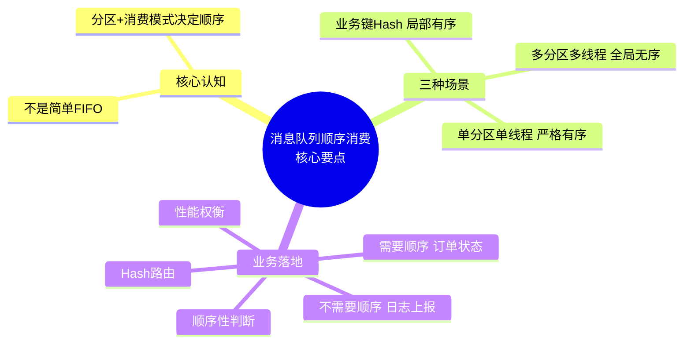

# 消息队列顺序消费


---

## 🎯 场景引入

**消息队列顺序消费解决什么问题？**
```
你以为消息队列是"先进先出"？
错！它更像是"分窗口排队"——每个窗口内部有序，窗口之间无序。
```

**生活化比喻**：
就像银行办理业务：
- 单窗口：所有客户按顺序排队，先来先办（全局有序）✅
- 多窗口：每个窗口内部有序，但窗口之间无序（局部有序）⚠️

**核心特点**：顺序性取决于**分区数量**和**消费并发模式**，不是简单的"先进先出"。

---

## 💎 核心设计要点速览

### 核心观点（5 个关键点）

**1. 单分区 + 单消费线程 = 严格顺序**
```
✅ 单分区：消息按顺序写入同一个分区（像单窗口排队）
✅ 单线程消费：从分区头部按顺序拉取（像只有一个柜员）
结果：发送顺序 = 消费顺序（严格FIFO）

生活化比喻：
就像只有一个收银台的超市，顾客按顺序结账，不会乱。
```

**2. 多分区 = 全局顺序丢失**
```
❌ 多分区：消息轮询/Hash分发到不同分区（像开多个窗口）
❌ 分区之间独立：无法保证跨分区顺序
结果：吞吐量↑，全局顺序↓

生活化比喻：
银行开5个窗口，每个窗口内部有序，但张三在1号窗口，李四在2号窗口，
无法保证张三一定比李四先办完。

适用场景：
日志上报、埋点采集（不需要全局顺序，只要高吞吐）
```

**3. 消费端多线程 = 业务顺序打乱**
```
❌ 单分区 + 多线程消费：
   - 线程A拿到消息1（处理慢）
   - 线程B拿到消息2（处理快）
   - 消息2先处理完，业务顺序乱了！

生活化比喻：
就像你点外卖，先点了汤（消息1），后点了饭（消息2），
但饭先做好了，汤后做好，上菜顺序就乱了。

解决：消费端也要单线程处理同一业务维度的消息。
```

**4. 局部有序方案：业务键Hash路由**
```
✅ 订单状态流转：
   - 同一订单ID的消息 → Hash到同一分区
   - 单线程消费该分区
   - 保证同一订单的消息有序

✅ 用户操作记录：
   - 同一用户ID的消息 → Hash到同一分区
   - 保证同一用户的操作有序

生活化比喻：
就像VIP客户有专属窗口，张三的所有业务都在1号窗口办理，
保证张三的业务顺序不乱，但张三和李四之间不需要保证顺序。

核心思想：
不追求全局有序，只保证业务维度（订单/用户）的局部有序。
```

**5. 业务分级：顺序 vs 吞吐的权衡**
```
需要顺序的场景（局部有序）：
- 订单状态流转（创建→支付→发货→完成）
- 用户行为链路（登录→浏览→下单）
- 库存扣减（不能先扣后加）

不需要顺序的场景（高吞吐）：
- 日志上报（先后顺序不重要）
- 埋点采集（统计数据即可）
- 异步通知（发邮件、发短信）

生活化比喻：
就像餐厅：
- 同一桌的菜必须按顺序上（局部有序）
- 不同桌的菜可以并行做（全局无序）
```

---

## 🚀 一句话精华

> **消息队列顺序性 = 单分区+单线程（严格有序） OR 业务键Hash路由（局部有序），不是简单的"先进先出"。**

---

## 一、为什么大家误以为消息队列是"先进先出"？

### ❌ 误解来源

**生活化比喻**：
```
很多人以为消息队列就像排队买奶茶：
- 先来的人先买到（FIFO）
- 队伍是单一的（单分区）
- 只有一个收银员（单线程消费）

但实际上，高并发场景下：
- 消息队列会开多个队伍（多分区）
- 多个收银员同时工作（多线程消费）
- 不同队伍之间无法保证顺序

这就是"全局有序"和"局部有序"的区别。
```

### ✅ 真相：顺序性取决于三个因素



**核心结论**：
- ✅ 单分区 + 单线程 = 严格有序
- ⚠️ 多分区 + 多线程 = 局部有序（或完全无序）

---

## 二、单分区顺序消费（严格FIFO）

### 生活化比喻

```
想象一个只有一个窗口的银行：
1. 客户按顺序排队（生产者按顺序发消息）
2. 只有一个柜员办理（单线程消费）
3. 先来的客户先办理（FIFO）

这就是单分区顺序消费的场景。
```

### 技术实现



**适用场景**：
- ✅ 订单状态流转（创建→支付→发货）
- ✅ 库存扣减（不能先扣后加）
- ✅ 用户行为链路（登录→浏览→下单）

**缺点**：
- ❌ 吞吐量低（单线程处理，像只有一个收银台）
- ❌ 无法水平扩展（增加消费者会导致顺序混乱）

---

## 三、多分区高吞吐（全局无序）

### 生活化比喻

```
想象银行开了5个窗口：
1. 客户被分散到不同窗口（轮询/Hash分发）
2. 每个窗口内部有序（分区内FIFO）
3. 但窗口之间无序（跨分区无法保证顺序）

张三在1号窗口，李四在2号窗口，
无法保证张三一定比李四先办完。

这就是多分区高吞吐的场景。
```

### 技术实现



**适用场景**：
- ✅ 日志上报（先后顺序不重要）
- ✅ 埋点采集（统计数据即可）
- ✅ 异步通知（发邮件、发短信）

**优点**：
- ✅ 高吞吐（多分区+多消费者，像开了多个窗口）
- ✅ 水平扩展（增加消费者即可提升处理能力）

**缺点**：
- ❌ 全局顺序丢失（跨分区无法保证顺序）

---

## 四、局部有序方案（业务键Hash路由）

### 生活化比喻

```
想象银行有VIP专属窗口：
- 张三的所有业务都在1号窗口办理（同一业务键→同一分区）
- 李四的所有业务都在2号窗口办理
- 张三的业务顺序不乱（分区内有序）
- 但张三和李四之间不需要保证顺序

这就是局部有序的思想：
不追求全局有序，只保证业务维度（订单/用户）的局部有序。
```

### 技术实现

```mermaid
graph TB
    subgraph Producer["生产者"]
        P1[订单A-创建]
        P2[订单A-支付]
        P3[订单B-创建]
        P4[订单A-发货]
    end
    
    subgraph Hash["Hash路由"]
        H1[Hash(订单A) % 2 = 0]
        H2[Hash(订单B) % 2 = 1]
    end
    
    subgraph MQ["消息队列"]
        direction LR
        Q1[分区0<br/>订单A: 创建→支付→发货]
        Q2[分区1<br/>订单B: 创建]
    end
    
    subgraph Consumer["消费者"]
        C1[消费者1<br/>处理订单A]
        C2[消费者2<br/>处理订单B]
    end
    
    P1 --> H1
    P2 --> H1
    P4 --> H1
    P3 --> H2
    
    H1 --> Q1
    H2 --> Q2
    
    Q1 --> C1
    Q2 --> C2
    
    Note over Q1: 订单A的消息按顺序处理<br/>创建→支付→发货
    
    style Hash fill:#FFD700
    style MQ fill:#90EE90
```

**代码示例（Go语言版）**：

```go
// 业务键Hash路由实现
type OrderMessage struct {
    OrderID string
    Action  string // create, pay, ship, complete
    Data    map[string]interface{}
}

func SendMessageToMQ(msg OrderMessage, producer *kafka.Producer) error {
    // 核心：同一订单ID的消息路由到同一分区
    partitionKey := msg.OrderID
    
    // Kafka示例：使用PartitionKey
    kafkaMsg := &kafka.Message{
        Topic: "order-events",
        Key:   []byte(partitionKey), // 相同OrderID → 相同分区
        Value: marshal(msg),
    }
    
    return producer.Produce(kafkaMsg, nil)
}

// 消费端：单线程处理同一分区
func ConsumeOrderEvents(consumer *kafka.Consumer) {
    for {
        msg := consumer.Poll(100)
        if msg == nil {
            continue
        }
        
        // 处理消息（单线程，保证顺序）
        processOrderEvent(msg)
    }
}

func processOrderEvent(msg *kafka.Message) {
    var event OrderMessage
    unmarshal(msg.Value, &event)
    
    // 按顺序处理：create → pay → ship → complete
    switch event.Action {
    case "create":
        createOrder(event)
    case "pay":
        payOrder(event)
    case "ship":
        shipOrder(event)
    case "complete":
        completeOrder(event)
    }
}
```

**适用场景**：
- ✅ 订单状态流转（同一订单的消息有序）
- ✅ 用户行为记录（同一用户的操作有序）
- ✅ 库存变更（同一商品的库存操作有序）

**核心思想**：
- 牺牲全局有序，换取业务维度的局部有序
- 既保证了业务逻辑正确，又保留了高吞吐能力

---

## 五、消费端多线程的顺序陷阱

### 生活化比喻

```
想象你开了5个收银台（多线程消费），但只有一个队伍（单分区）：
- 张三（消息1）被分配到1号收银台
- 李四（消息2）被分配到2号收银台
- 李四先结完账（处理快）
- 张三后结完账（处理慢）

结果：李四比张三先离开，但张三排在李四前面！
这就是消费端多线程打乱顺序的场景。
```

### 技术分析

```mermaid
graph TB
    subgraph Queue["单分区消息队列"]
        Q1[消息1<br/>处理耗时10s]
        Q2[消息2<br/>处理耗时1s]
        Q3[消息3<br/>处理耗时5s]
    end
    
    subgraph ThreadPool["多线程消费"]
        T1[线程A<br/>处理消息1<br/>10s后完成]
        T2[线程B<br/>处理消息2<br/>1s后完成 ✅]
        T3[线程C<br/>处理消息3<br/>5s后完成]
    end
    
    Q1 --> T1
    Q2 --> T2
    Q3 --> T3
    
    Note over T1,T3: 消息2先完成，但消息1排在前面<br/>业务顺序被打乱！
    
    style ThreadPool fill:#FFB6C1
```

**问题本质**：
- 消息队列保证的是"拉取顺序"，不是"处理完成顺序"
- 多线程并行处理，处理速度有快有慢，业务顺序就乱了

**解决方案**：

```go
// 错误方案：多线程消费（顺序打乱）
func ConsumeWithMultiThread() {
    for {
        msg := consumer.Poll(100)
        go processMessage(msg) // ❌ 多线程处理，顺序无法保证
    }
}

// 正确方案1：单线程消费（保证顺序）
func ConsumeWithSingleThread() {
    for {
        msg := consumer.Poll(100)
        processMessage(msg) // ✅ 单线程处理，严格有序
    }
}

// 正确方案2：按业务键分发到固定线程（局部有序+并发）
type MessageDispatcher struct {
    workers []*Worker
}

func (d *MessageDispatcher) Dispatch(msg *Message) {
    // 同一业务键的消息分发到同一worker
    workerID := hash(msg.BusinessKey) % len(d.workers)
    d.workers[workerID].Submit(msg)
}

type Worker struct {
    queue chan *Message
}

func (w *Worker) Start() {
    for msg := range w.queue {
        processMessage(msg) // ✅ 同一worker内单线程处理
    }
}
```

---
## 六、生产环境 Checklist



**部署检查清单**：

| 类别 | 检查项 | 状态 | 生活化比喻 |
|------|--------|------|------------|
| **分区策略** | 单分区（严格有序）/ 多分区（高吞吐） | ⬜ | 窗口数量 |
| **路由规则** | 轮询（无序）/ Hash（局部有序） | ⬜ | 客户分流 |
| **消费模式** | 单线程（有序）/ 多线程（无序） | ⬜ | 柜员数量 |
| **业务键Hash** | 同业务ID → 同分区 | ⬜ | VIP专属窗口 |
| **消费顺序** | 单线程处理 / 按业务键分发 | ⬜ | 专人专办 |
| **监控告警** | 消费延迟、顺序异常检测 | ⬜ | 排队监控 |

---

## 七、总结



### 🎯 方案总结

> **消息队列顺序性 = 单分区+单线程（严格有序） OR 业务键Hash路由（局部有序），不是简单的"先进先出"。**

### 🧠 核心要点

1. **为什么不是简单FIFO？** 多分区+多线程会打破顺序，像多个窗口无法保证客户顺序。
2. **如何保证顺序？** 单分区+单线程（严格有序）或业务键Hash路由（局部有序）。
3. **什么是局部有序？** 同一业务维度（订单/用户）的消息有序，不同业务之间无序。
4. **业务如何选择？** 需要顺序（订单状态）→ 局部有序；不需要顺序（日志上报）→ 高吞吐。

---
