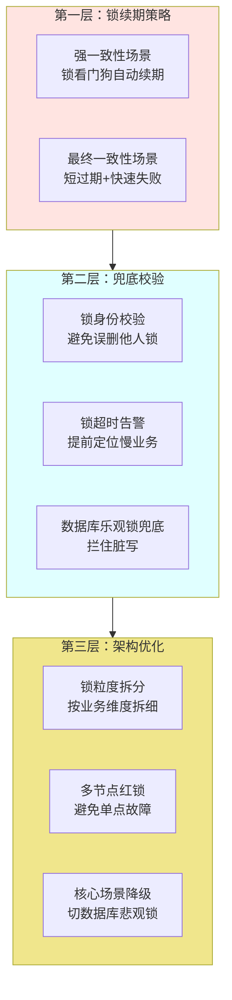
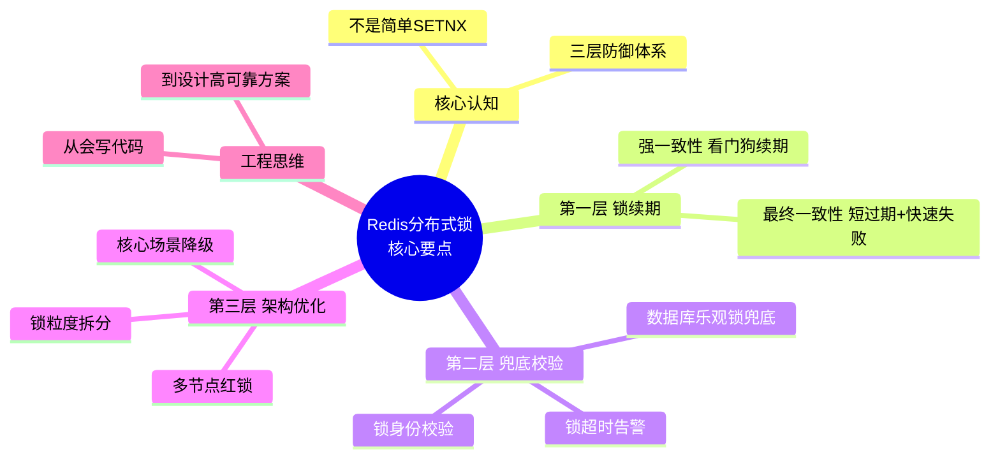

# Redis 分布式锁深度解析


---

## 🎯 场景引入

**Redis 分布式锁解决什么问题？**
```
分布式环境下，多个节点操作共享资源时的互斥访问
比如：库存扣减、订单状态变更，不能超卖、不能重复处理
```

**生活化比喻**：
就像**公共厕所的门锁**——你进去后锁上门（加锁），别人在外面等（阻塞），你出来解锁（释放锁），下一个人才能进去。但如果锁了门却忘了时间，自动解锁了，另一个人就进来了（锁超时），两个人同时在里面（并发冲突）→ 数据错乱。

**核心特点**：不是简单地 `SETNX` + 过期时间，而是三层防御体系。

---

## 💎 核心设计要点速览

### 核心观点（5 个关键点）

**1. 基础实现：SETNX + 过期时间**
```
✅ 基本步骤：
   ① SETNX key value（占锁）
   ② EXPIRE key seconds（加过期时间，防止死锁）
   ③ 业务逻辑执行
   ④ DEL key（释放锁）

❌ 但有个致命问题：业务超时，锁自动失效
```

**2. 幽灵陷阱：业务超时导致锁提前失效**
```
场景：库存扣减，锁过期时间 3 秒
问题：业务执行了 5 秒（网络抖动/慢查询）
结果：3 秒时锁自动释放，另一个线程进来 → 超卖

这就是分布式锁的"幽灵陷阱"
你以为加了锁，其实锁已经失效了
```

**3. 第一层防御：锁续期策略**
```
强一致性场景（库存扣减、订单状态变更）：
→ 开启锁看门狗（Watchdog），自动续期
→ 业务不结束，锁不释放

最终一致性场景（数据统计、日志上报）：
→ 短过期时间 + 快速失败
→ 偶发锁失效不影响核心数据
```

**4. 第二层防御：兜底校验与异常防护**
```
锁身份校验：加锁时存唯一标识，释放时校验，避免误删他人锁
锁超时告警：持有时长超阈值自动告警，提前定位慢业务
数据库乐观锁兜底：更新时带版本号校验，锁层失效也能拦住脏写
```

**5. 第三层防御：架构层优化**
```
锁粒度拆分：按业务维度拆细（如按商品 ID 拆库存锁），别用全局锁
多节点红锁部署：避免单 Redis 节点宕机导致锁完全失效
核心场景降级开关：大促高峰期核心链路强制切数据库悲观锁
```

---

## 🚀 一句话精华

> **Redis 分布式锁 = 三层防御体系（锁续期 + 兜底校验 + 架构优化）+ 工程思维（不是会写加锁代码，而是设计高可靠锁方案）**

---

## 一、基础实现：SETNX + 过期时间

### 1.1 基本实现

**生活化比喻**：
```
基础实现 = 厕所门锁 + 自动解锁定时器
- 进去后锁门（SETNX）
- 设定 3 分钟后自动解锁（EXPIRE）
- 出来时解锁（DEL）
- 防止你忘了解锁，后面的人永远进不来（死锁）
```

**代码示例**（基础版）：
```go
// 基础版：SETNX + EXPIRE
func basicLock(redisClient *redis.Client, key string, value string, expireSeconds int) bool {
    // 1.占锁
    ok, err := redisClient.SetNX(key, value, time.Duration(expireSeconds)*time.Second).Result()
    if err != nil || !ok {
        return false // 加锁失败
    }
    
    // 2.业务逻辑
    doBusinessLogic()
    
    // 3.释放锁
    redisClient.Del(key)
    
    return true
}
```

**问题**：
```
如果业务逻辑执行时间 > 过期时间：
- 3 秒时锁自动释放
- 另一个线程进来加锁成功
- 两个线程同时执行临界区
- 数据错乱（超卖、重复扣减）
```

### 1.2 原子性问题

**错误写法**：
```go
// ❌ 错误：SETNX 和 EXPIRE 不是原子操作
redisClient.SetNX(key, value)  // 如果这一步成功，但下一步失败
redisClient.Expire(key, seconds) // 这一步失败 → 死锁
```

**正确写法**：
```go
// ✅ 正确：SETNX + EXPIRE 原子操作
redisClient.Set(key, value, time.Duration(seconds)*time.Second, redis.OnlyNX())
// 或者用 Lua 脚本保证原子性
```

---

## 二、幽灵陷阱：业务超时导致锁提前失效

### 2.1 线上事故场景

**线上事故场景**：

大促当晚，某电商系统的 Redis 分布式锁用于控制库存扣减。开发同学实现了基础方案：SETNX 占锁、加过期时间、用完 DEL 释放——看似既能保证互斥又不会死锁。

然而当晚出现超卖问题：查日志发现同一时间两个请求都成功扣减了库存。锁加了，过期时间也设了，释放逻辑也没写错。但两个线程就是同时进了临界区。

**根因**：业务执行时长超过了锁的过期时间，锁自动释放后，后续线程拿到锁进入临界区，导致互斥失效。

**追问**：如何保证业务没执行完时锁一定不失效？把过期时间改成一小时？这显然不现实——需要一套动态续期机制。

**事故原因**：
```
业务执行时长 > 锁过期时间
→ 锁自动释放
→ 另一个线程进来
→ 两个线程同时执行临界区
→ 数据错乱（超卖）
```

**生活化比喻**：
```
你在厕所里待了 5 分钟（业务超时）
但门锁 3 分钟后自动解锁（过期时间）
结果：第 4 分钟时，另一个人进来了
两个人同时在厕所里 → 尴尬（数据错乱）
```

---

## 三、第一层防御：锁续期策略

### 3.1 锁看门狗（Watchdog）

**生活化比喻**：
```
锁看门狗 = 厕所里的延时按钮
- 每 30 秒按一下延时（自动续期）
- 只要你在里面，就一直按
- 你出来了，就不按了
- 3 分钟后没人按，自动解锁
```

**核心思路**：
```
强一致性场景（库存扣减、订单状态变更）：
→ 开启锁看门狗，自动续期
→ 业务不结束，锁不释放
→ 避免业务超时导致锁提前失效

最终一致性场景（数据统计、日志上报）：
→ 短过期时间 + 快速失败
→ 偶发锁失效不影响核心数据
```

**代码示例**（Redisson 看门狗）：
```java
// Redisson 分布式锁（自带看门狗）
RLock lock = redisson.getLock("stock_lock");

try {
    // 加锁（默认 30 秒过期，看门狗每 10 秒续期一次）
    lock.lock();
    
    // 业务逻辑（执行多久都不会超时）
    deductStock();
    
} finally {
    // 释放锁
    lock.unlock();
}
```

**代码示例**（Go 语言实现看门狗）：
```go
// Go 语言实现锁看门狗
func lockWithWatchdog(redisClient *redis.Client, key string, value string) {
    // 1.加锁（30 秒过期）
    redisClient.Set(key, value, 30*time.Second)
    
    // 2.启动看门狗（每 10 秒续期一次）
    done := make(chan bool)
    go func() {
        ticker := time.NewTicker(10 * time.Second)
        defer ticker.Stop()
        for {
            select {
            case <-ticker.C:
                // 续期（重置过期时间为 30 秒）
                redisClient.Expire(key, 30*time.Second)
            case <-done:
                return
            }
        }
    }()
    
    // 3.业务逻辑
    doBusinessLogic()
    
    // 4.释放锁
    redisClient.Del(key)
    done <- true // 停止看门狗
}
```

### 3.2 业务分级策略

| 场景类型 | 锁策略 | 过期时间 | 生活化比喻 |
|---------|--------|---------|-----------|
| **强一致性**<br/>（库存扣减、订单状态） | 锁看门狗自动续期 | 30 秒（自动续期） | 厕所里的延时按钮，一直按一直延时 |
| **最终一致性**<br/>（数据统计、日志上报） | 短过期 + 快速失败 | 3-5 秒 | 快速通过，不耽误后面的人 |

---

## 四、第二层防御：兜底校验与异常防护

### 4.1 锁身份校验

**问题场景**：
```
线程 A 加锁，执行业务
锁超时自动释放
线程 B 加锁成功
线程 A 业务完成，释放锁 → 误删了线程 B 的锁
```

**解决方案**：
```
加锁时存入唯一标识（如 UUID）
释放锁时校验标识，只删除自己的锁
```

**代码示例**：
```go
// 锁身份校验
func lockWithIdentity(redisClient *redis.Client, key string) string {
    // 1.生成唯一标识
    identity := uuid.New().String()
    
    // 2.加锁（key = lock_key, value = identity）
    redisClient.Set(key, identity, 30*time.Second)
    
    return identity
}

func unlockWithIdentity(redisClient *redis.Client, key string, identity string) {
    // 1.获取锁的标识
    lockIdentity, err := redisClient.Get(key).Result()
    if err != nil {
        return // 锁已释放
    }
    
    // 2.校验标识，只删除自己的锁
    if lockIdentity == identity {
        redisClient.Del(key)
    }
    // 如果不是自己的锁，不删除
}
```

**Lua 脚本保证原子性**：
```lua
-- 释放锁 Lua 脚本（原子操作）
if redis.call("get", KEYS[1]) == ARGV[1] then
    return redis.call("del", KEYS[1])
else
    return 0
end
```

### 4.2 锁超时告警

**核心思路**：
```
锁持有时长超过阈值 → 自动告警
提前定位慢业务，避免锁超时导致并发问题
```

**代码示例**：
```go
// 锁超时告警
func lockWithAlert(redisClient *redis.Client, key string, identity string) {
    // 1.记录加锁时间
    lockTime := time.Now()
    
    // 2.启动告警协程
    go func() {
        ticker := time.NewTicker(5 * time.Second)
        defer ticker.Stop()
        for {
            <-ticker.C
            duration := time.Since(lockTime)
            if duration > 10*time.Second { // 持有时长 > 10 秒
                sendAlert("锁 %s 持有时长过长: %v", key, duration)
            }
        }
    }()
    
    // 3.业务逻辑
    doBusinessLogic()
    
    // 4.释放锁
    unlockWithIdentity(redisClient, key, identity)
}
```

### 4.3 数据库乐观锁兜底

**核心思路**：
```
即使 Redis 锁层失效，数据库层面也能拦住脏写
更新数据时带版本号校验
```

**代码示例**：
```go
// 数据库乐观锁兜底
func deductStockWithOptimisticLock(db *gorm.DB, productID int64) error {
    // 1.查询当前库存和版本号
    var product Product
    db.First(&product, productID)
    
    // 2.扣减库存（带版本号校验）
    result := db.Model(&Product{}).
        Where("id = ? AND version = ?", productID, product.Version).
        Updates(map[string]interface{}{
            "stock":   gorm.Expr("stock - 1"),
            "version": gorm.Expr("version + 1"),
        })
    
    if result.RowsAffected == 0 {
        return errors.New("库存扣减失败：版本号冲突")
    }
    
    return nil
}
```

**生活化比喻**：
```
乐观锁 = 改作业前拍照
- 改之前拍一张（记录版本号）
- 改的时候检查：有没有被别人改过（版本号是否一致）
- 如果被改过，重新来（重试）
- 如果没被改过，改完更新版本号
```

---

## 五、第三层防御：架构层优化

### 5.1 锁粒度拆分

**问题场景**：
```
全局锁：所有商品共用一把锁
→ 同一时间只能有一个人扣减库存
→ 并发度极低
```

**解决方案**：
```
按商品 ID 拆分锁：每个商品一把锁
→ 商品 A 和商品 B 可以同时扣减
→ 并发度大幅提升
```

**代码示例**：
```go
// 锁粒度拆分
func deductStock(redisClient *redis.Client, productID int64) {
    // 按商品 ID 加锁（细粒度）
    lockKey := fmt.Sprintf("stock_lock:%d", productID)
    lock(redisClient, lockKey)
    
    // 扣减库存
    doDeductStock(productID)
    
    // 释放锁
    unlock(redisClient, lockKey)
}
```

**生活化比喻**：
```
全局锁 = 整个商场只有一间厕所
→ 所有人排队等

锁粒度拆分 = 每个楼层都有厕所
→ 不同楼层的人可以同时上厕所
→ 并发度大幅提升
```

### 5.2 多节点红锁部署

**问题场景**：
```
单 Redis 节点宕机 → 锁完全失效
所有分布式锁都挂在同一个 Redis 上 → 单点故障
```

**解决方案**：
```
RedLock 算法：多个独立的 Redis 节点
加锁时：向大多数节点加锁成功才算成功
避免单点故障
```

**代码示例**（Redisson RedLock）：
```java
// Redisson RedLock（多节点红锁）
RLock lock1 = redisson1.getLock("stock_lock");
RLock lock2 = redisson2.getLock("stock_lock");
RLock lock3 = redisson3.getLock("stock_lock");

RedLock redLock = new RedLock(lock1, lock2, lock3);

try {
    // 加锁（大多数节点成功才算成功）
    redLock.lock();
    
    // 业务逻辑
    deductStock();
    
} finally {
    redLock.unlock();
}
```

### 5.3 核心场景降级开关

**问题场景**：
```
大促高峰期，Redis 压力大
分布式锁频繁超时
核心链路（库存扣减）不稳定
```

**解决方案**：
```
核心场景降级开关：大促高峰期核心链路强制切数据库悲观锁
宁可牺牲一点并发量，也要守住数据一致性
```

**代码示例**：
```go
// 核心场景降级开关
func deductStockWithFallback(redisClient *redis.Client, db *gorm.DB, productID int64) error {
    // 大促高峰期：降级到数据库悲观锁
    if isPromotionPeakTime() {
        return deductStockWithPessimisticLock(db, productID)
    }
    
    // 正常情况：使用 Redis 分布式锁
    return deductStockWithRedisLock(redisClient, productID)
}

// 数据库悲观锁
func deductStockWithPessimisticLock(db *gorm.DB, productID int64) error {
    // 开启事务
    tx := db.Begin()
    
    // 悲观锁：SELECT ... FOR UPDATE
    var product Product
    tx.Set("gorm:query_option", "FOR UPDATE").First(&product, productID)
    
    // 扣减库存
    product.Stock--
    tx.Save(&product)
    
    // 提交事务
    tx.Commit()
    
    return nil
}
```

**生活化比喻**：
```
Redis 分布式锁 = 快速通道（快但不稳定）
数据库悲观锁 = 人工通道（慢但稳定）

大促高峰期：快速通道太拥堵，不稳定
→ 切换到人工通道（数据库悲观锁）
→ 宁可慢一点，也要保证不出错
```

---

## 六、三层防御体系总结



---


---

## 七、总结



### 🎯 方案总结

> **Redis 分布式锁 = 三层防御体系（锁续期 + 兜底校验 + 架构优化）+ 工程思维（从"会写加锁代码"升级为"设计高可靠锁方案"）**

### 🧠 核心要点

1. **基础实现是什么？** SETNX + 过期时间 + DEL 释放，但有幽灵陷阱（业务超时导致锁提前失效）。
2. **第一层防御是什么？** 锁续期策略——强一致性场景开启看门狗自动续期。
3. **第二层防御是什么？** 兜底校验——锁身份校验 + 锁超时告警 + 数据库乐观锁兜底。
4. **第三层防御是什么？** 架构优化——锁粒度拆分 + 多节点红锁 + 核心场景降级。
5. **本质是什么？** 从"会写加锁代码"升级为"设计高可靠锁方案"的工程思维。

---

