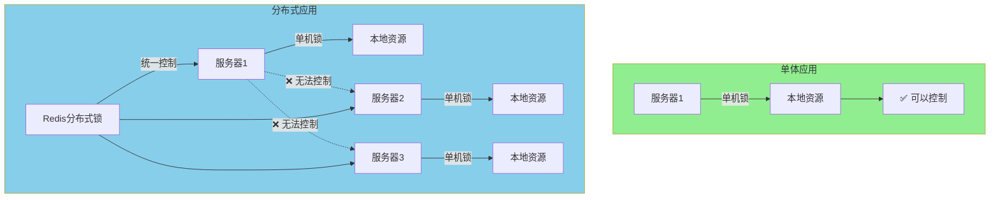
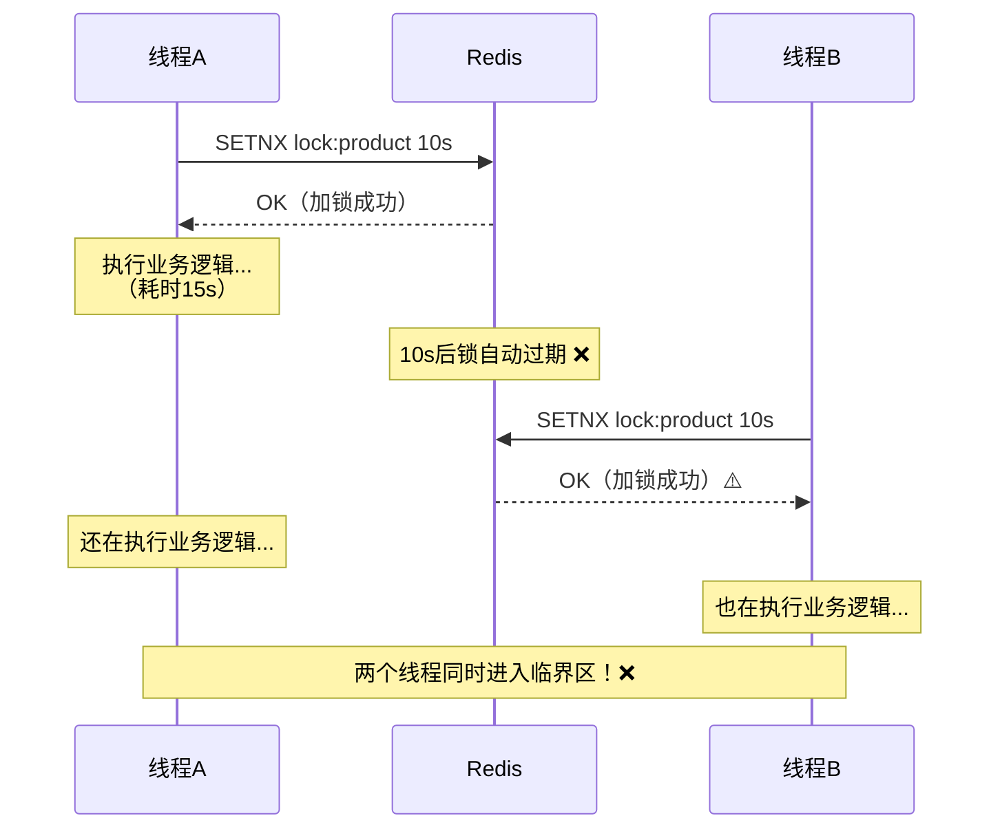
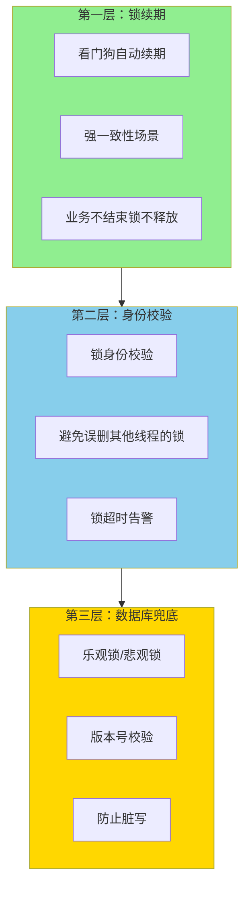
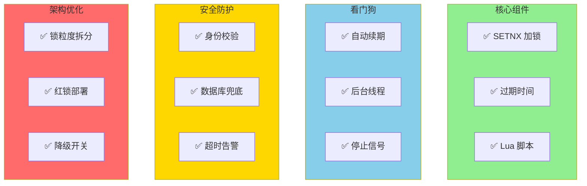
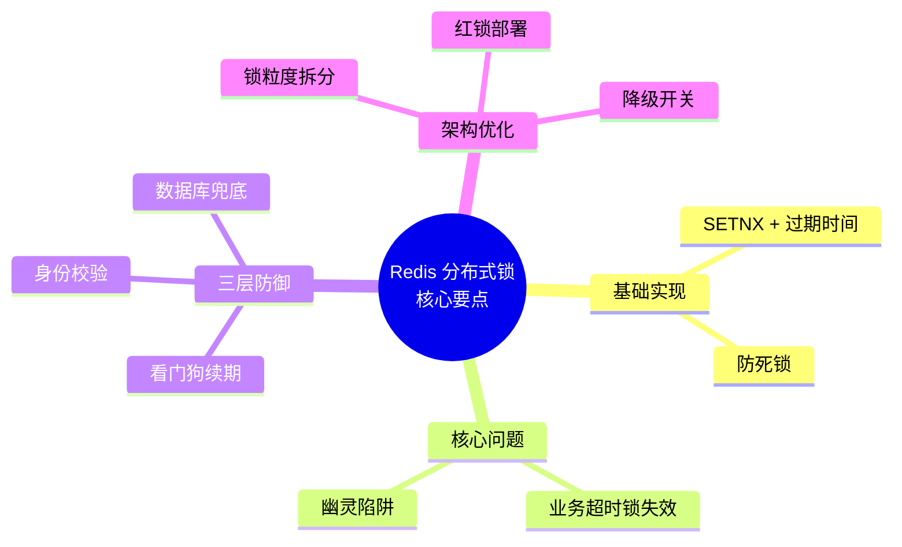

# Redis 分布式锁实现


---

## 🎯 场景引入

**Redis 分布式锁解决什么问题？**
```
单机锁（synchronized/Lock）只能控制单台机器的并发
分布式锁能控制整个分布式系统中多台机器的并发
就像餐厅的厕所：单机锁是单个厕所的门锁，分布式锁是整个餐厅所有厕所的门锁
```

**生活化比喻**：
就像公共厕所的隔间：
- **单机锁**：一个厕所的门锁（只能控制一个厕所）
- **分布式锁**：所有厕所的门锁联动（进了一间，其他间也锁上）
- **Redis 分布式锁**：用 Redis 做"智能门锁"，所有人都能查到哪个厕所被占了

**核心特点**：互斥、防死锁、高可用，但**业务超时**是最大的坑！

---

## 💎 核心设计要点速览

### 核心观点（5 个关键点）

**1. 基础实现：SETNX + 过期时间**
```go
// 基础版（有坑！）
func Lock(key string) bool {
    // SETNX：Set if Not eXists（如果不存在就设置）
    result := redis.SetNX(key, "locked", time.Second * 10)
    return result // true=加锁成功，false=加锁失败
}

func Unlock(key string) {
    redis.Del(key) // 释放锁
}
```
```
✅ SETNX：原子操作，保证互斥
✅ 过期时间：防止死锁（客户端挂了，锁自动释放）
❌ 但有一个致命问题：业务没跑完，锁过期了！

生活化比喻：
你进厕所后锁上门（SETNX），设了10分钟闹钟（过期时间）。
但你拉肚子拉了15分钟，10分钟后锁自动开了，
下一个人以为没人，直接推门进来...尴尬！
```

**2. 幽灵陷阱：业务超时导致锁失效**
```
问题场景：
1. 线程A加锁，过期时间10s
2. 线程A执行业务逻辑（耗时15s）
3. 10s后锁自动过期释放
4. 线程B加锁成功，进入临界区
5. 此时线程A还在执行业务逻辑
结果：两个线程同时进入临界区！❌

生活化比喻：
你进厕所10分钟后锁自动开了，
下一个人进来了，但你还在里面...
这就是分布式锁的"幽灵陷阱"！

根本原因：
锁的过期时间 < 业务执行时间
```

**3. 解决方案1：锁看门狗（自动续期）**
```go
// 进阶版：锁看门狗自动续期
func LockWithWatchdog(key string, expireTime int) {
    // 1. 加锁
    redis.SetNX(key, "locked", expireTime)
    
    // 2. 启动看门狗（后台线程）
    go func() {
        ticker := time.NewTicker(time.Duration(expireTime/3) * time.Second)
        defer ticker.Stop()
        
        for {
            select {
            case <-ticker.C:
                // 每 expireTime/3 秒续期一次
                redis.Expire(key, expireTime)
                // 业务完成后退出循环
                if isBusinessDone() {
                    return
                }
            }
        }
    }()
}
```
```
✅ 看门狗：后台线程定期续期（像厕所里的延时按钮）
✅ 业务不结束，锁不释放
✅ 防止业务超时导致锁失效

生活化比喻：
就像厕所里的延时按钮，每隔3分钟按一下，
只要你还在里面，锁就不会开。

适用场景：
强一致性场景（库存扣减、订单状态变更）
```

**4. 解决方案2：锁身份校验 + 兜底防护**
```go
// 高级版：锁身份校验 + 兜底防护
func LockWithIdentity(key string, value string) bool {
    // 加锁时存入唯一标识（线程ID/UUID）
    return redis.SetNX(key, value, time.Second * 10)
}

func UnlockWithIdentity(key string, value string) {
    // Lua脚本保证原子性
    script := `
        if redis.call("get", KEYS[1]) == ARGV[1] then
            return redis.call("del", KEYS[1])
        else
            return 0
        end
    `
    redis.Eval(script, []string{key}, value)
}

// 数据库乐观锁兜底
func UpdateWithVersion(key string, data interface{}, version int) bool {
    // UPDATE table SET data=?, version=version+1 
    // WHERE key=? AND version=?
    result := db.Exec("UPDATE ... WHERE version=?", version)
    return result.RowsAffected() > 0 // 版本号不匹配则更新失败
}
```
```
✅ 锁身份校验：避免误删其他线程的锁
✅ 数据库兜底：锁层失效，数据库层也能拦住
✅ 版本号校验：防止脏写

生活化比喻：
- 锁身份校验：厕所门上贴你的名字，只有你能开
- 数据库兜底：厕所里还有个内部锁，即使门锁坏了，内部锁也能挡住
```

**5. 三层防御架构**
```
第一层：业务分级 + 锁续期策略
- 强一致性：开启看门狗自动续期（库存扣减、订单状态）
- 最终一致性：短过期 + 快速失败（日志上报、数据统计）

第二层：兜底校验 + 异常防护
- 锁身份校验（避免误删）
- 锁超时告警（提前定位慢业务）
- 数据库乐观锁兜底（防止脏写）

第三层：架构层优化
- 锁粒度拆分（按商品ID拆锁，不用全局锁）
- 红锁部署（多节点，避免单点故障）
- 降级开关（大促切数据库悲观锁）

生活化比喻：
就像银行的安全系统：
- 第一层：门禁卡（锁续期）
- 第二层：密码验证（身份校验）+ 监控告警
- 第三层：保险柜（数据库兜底）+ 多个金库（红锁）
```

---

## 🚀 一句话精华

> **Redis 分布式锁 = SETNX + 过期时间（基础） + 看门狗续期（防超时） + 身份校验（防误删） + 数据库兜底（防失效）**

---

## 一、为什么需要分布式锁？

### 生活化比喻

```
单机锁 vs 分布式锁：

单机锁（synchronized/Lock）：
就像你家的厕所门锁，只能控制你家的厕所。
你家里有3个厕所，每个厕所一个门锁，互不干扰。

分布式锁：
就像整个小区的门禁系统，能控制所有楼栋的大门。
你进了1号楼，2号楼的门禁也会显示"已有人进入"。

为什么需要？
单体应用：只有一台服务器，单机锁就够了
分布式应用：多台服务器，单机锁控制不了其他服务器
```

### 技术场景



**典型场景**：
- ✅ **库存扣减**：多台服务器同时扣减库存，不能超卖
- ✅ **订单状态变更**：防止并发修改订单状态
- ✅ **定时任务**：防止多台服务器同时执行同一任务
- ✅ **资源竞争**：多台服务器竞争同一个资源

---

## 二、基础实现：SETNX + 过期时间

### 核心命令

```go
// SETNX: SET if Not eXists
// 如果 key 不存在，设置成功，返回 true
// 如果 key 已存在，设置失败，返回 false

// 基础版分布式锁
func Lock(key string) bool {
    // 原子操作：如果 key 不存在就设置
    result := redis.SetNX(key, "locked", time.Second * 10)
    return result // true=加锁成功，false=加锁失败
}

func Unlock(key string) {
    redis.Del(key) // 释放锁（删除 key）
}
```

### 为什么需要过期时间？

```
生活化比喻：
你进厕所后锁上门（SETNX），但如果你晕倒了（客户端挂了），
门一直锁着，其他人就永远进不来了（死锁）。

解决方案：
设置过期时间（比如10分钟），10分钟后锁自动释放。
即使你晕倒了，10分钟后其他人也能进来。

技术原因：
- 防止客户端挂了导致死锁
- 保证锁的最终可用性
```

### 代码示例（Go 语言版）

```go
package main

import (
    "github.com/go-redis/redis/v8"
    "time"
    "context"
)

var ctx = context.Background()
var rdb *redis.Client

func init() {
    rdb = redis.NewClient(&redis.Options{
        Addr:     "localhost:6379",
        Password: "",
        DB:       0,
    })
}

// 基础版：SETNX + 过期时间
func Lock(key string, expireTime time.Duration) bool {
    // SETNX：原子操作，保证互斥
    result, err := rdb.SetNX(ctx, key, "locked", expireTime).Result()
    if err != nil {
        return false
    }
    return result // true=加锁成功，false=加锁失败
}

func Unlock(key string) error {
    return rdb.Del(ctx, key).Err()
}

// 使用示例
func DeductStock(productID string, quantity int) error {
    lockKey := "lock:product:" + productID
    
    // 加锁（过期时间10秒）
    if !Lock(lockKey, 10*time.Second) {
        return errors.New("系统繁忙，请稍后重试")
    }
    
    // 确保释放锁
    defer Unlock(lockKey)
    
    // 临界区：扣减库存
    return doDeductStock(productID, quantity)
}
```

### ❌ 致命问题：业务超时

```
问题场景：
1. 线程A加锁，过期时间10s
2. 线程A执行业务逻辑（耗时15s）
3. 10s后锁自动过期释放 ⚠️
4. 线程B加锁成功，进入临界区
5. 此时线程A还在执行业务逻辑
结果：两个线程同时进入临界区！❌

生活化比喻：
你进厕所后锁上门，设了10分钟闹钟。
但你拉肚子拉了15分钟，10分钟后锁自动开了，
下一个人以为没人，直接推门进来...
尴尬！这就是分布式锁的"幽灵陷阱"！
```



---

## 三、进阶方案：锁看门狗（自动续期）

### 生活化比喻

```
锁看门狗（Watchdog）：
就像厕所里的延时按钮，每隔3分钟自动按一下。
只要你还在里面（业务没完成），锁就不会开。

工作流程：
1. 你进厕所，锁上门（加锁，过期时间10s）
2. 后台有个机器人（看门狗）每3秒检查一次
3. 如果你还在里面，机器人就按延时按钮（续期）
4. 直到你出来（业务完成），机器人才停止续期
5. 10s后锁自动释放
```

### 代码示例（Go 语言版）

```go
// 进阶版：锁看门狗自动续期
func LockWithWatchdog(key string, expireTime time.Duration) (bool, chan struct{}) {
    // 1. 加锁
    result, err := rdb.SetNX(ctx, key, "locked", expireTime).Result()
    if err != nil || !result {
        return false, nil
    }
    
    // 2. 创建停止信号通道
    stopChan := make(chan struct{})
    
    // 3. 启动看门狗（后台协程）
    go func() {
        // 每 expireTime/3 秒续期一次（比如10s/3=3.3s）
        ticker := time.NewTicker(expireTime / 3)
        defer ticker.Stop()
        
        for {
            select {
            case <-ticker.C:
                // 续期：延长过期时间
                rdb.Expire(ctx, key, expireTime)
                fmt.Println("看门狗续期：", key)
            case <-stopChan:
                // 收到停止信号，退出循环
                fmt.Println("看门狗停止：", key)
                return
            }
        }
    }()
    
    return true, stopChan
}

func UnlockWithWatchdog(key string, stopChan chan struct{}) {
    // 1. 先停止看门狗
    close(stopChan)
    
    // 2. 再释放锁
    rdb.Del(ctx, key)
}

// 使用示例
func DeductStockWithWatchdog(productID string, quantity int) error {
    lockKey := "lock:product:" + productID
    
    // 加锁（过期时间10秒）
    locked, stopChan := LockWithWatchdog(lockKey, 10*time.Second)
    if !locked {
        return errors.New("系统繁忙，请稍后重试")
    }
    
    // 确保释放锁和停止看门狗
    defer UnlockWithWatchdog(lockKey, stopChan)
    
    // 临界区：扣减库存（可以执行任意长时间）
    return doDeductStock(productID, quantity)
}
```

### 技术细节

```go
// Redisson 风格的看门狗实现（Java 版本参考）
public class RedissonLock {
    private String lockKey;
    private long expireTime; // 锁过期时间（毫秒）
    private long watchdogInterval; // 看门狗检查间隔
    
    public RedissonLock(String lockKey, long expireTime) {
        this.lockKey = lockKey;
        this.expireTime = expireTime;
        this.watchdogInterval = expireTime / 3; // 每 1/3 过期时间检查一次
    }
    
    public boolean lock() {
        // 1. 加锁
        boolean result = redis.setnx(lockKey, "locked", expireTime);
        if (result) {
            // 2. 启动看门狗
            startWatchdog();
        }
        return result;
    }
    
    private void startWatchdog() {
        ScheduledExecutorService scheduler = Executors.newScheduledThreadPool(1);
        scheduler.scheduleAtFixedRate(() -> {
            // 检查业务是否完成
            if (!isBusinessDone()) {
                // 未完成，续期
                redis.expire(lockKey, expireTime);
                System.out.println("看门狗续期：" + lockKey);
            } else {
                // 完成，停止看门狗
                scheduler.shutdown();
            }
        }, watchdogInterval, watchdogInterval, TimeUnit.MILLISECONDS);
    }
    
    public void unlock() {
        redis.del(lockKey);
    }
}
```

### 适用场景

```
强一致性场景（必须开启看门狗）：
✅ 库存扣减（不能超卖）
✅ 订单状态变更（不能并发修改）
✅ 资金转账（不能重复扣款）
✅ 分布式任务调度（不能重复执行）

最终一致性场景（可以不开启）：
❌ 日志上报（偶发失败不影响）
❌ 数据统计（允许少量误差）
❌ 缓存更新（最终一致即可）
```

---

## 四、高级方案：锁身份校验 + 兜底防护

### 问题：误删其他线程的锁

```
场景：
1. 线程A加锁（过期时间10s）
2. 线程A执行业务（耗时15s）
3. 10s后锁自动过期
4. 线程B加锁成功
5. 线程A执行业务完成，调用 Unlock() 释放锁
6. 结果：线程A释放了线程B的锁！❌

生活化比喻：
你进厕所10分钟后锁自动开了，
下一个人进来了，
你出来后把门锁打开了（以为是自己加的锁），
结果把下一个人锁在里面了...
```

### 解决方案：锁身份校验

```go
// 高级版：锁身份校验
func LockWithIdentity(key string, lockValue string, expireTime time.Duration) bool {
    // 加锁时存入唯一标识（线程ID/UUID）
    result, _ := rdb.SetNX(ctx, key, lockValue, expireTime).Result()
    return result
}

func UnlockWithIdentity(key string, lockValue string) bool {
    // 释放锁时先校验身份
    currentValue, _ := rdb.Get(ctx, key).Result()
    if currentValue != lockValue {
        // 不是自己的锁，不能释放
        return false
    }
    rdb.Del(ctx, key)
    return true
}

// 使用 Lua 脚本保证原子性
func UnlockWithLua(key string, lockValue string) bool {
    script := `
        if redis.call("get", KEYS[1]) == ARGV[1] then
            return redis.call("del", KEYS[1])
        else
            return 0
        end
    `
    
    result, err := rdb.Eval(ctx, script, []string{key}, lockValue).Int()
    if err != nil {
        return false
    }
    return result == 1 // 1=释放成功，0=不是自己的锁
}

// 使用示例
func DeductStockWithIdentity(productID string, quantity int) error {
    lockKey := "lock:product:" + productID
    lockValue := generateUUID() // 生成唯一标识
    
    // 加锁
    if !LockWithIdentity(lockKey, lockValue, 10*time.Second) {
        return errors.New("系统繁忙，请稍后重试")
    }
    
    // 确保释放锁（带身份校验）
    defer UnlockWithLua(lockKey, lockValue)
    
    // 临界区：扣减库存
    return doDeductStock(productID, quantity)
}

func generateUUID() string {
    // 生成唯一标识（可以用 UUID、线程ID 等）
    return fmt.Sprintf("%d", time.Now().UnixNano())
}
```

### 数据库乐观锁兜底

```go
// 数据库乐观锁：最后一道防线
type Product struct {
    ID      string
    Stock   int
    Version int // 版本号
}

// 乐观锁扣减库存
func DeductStockWithOptimisticLock(productID string, quantity int) error {
    for {
        // 1. 查询当前库存和版本号
        product, err := db.QueryProduct(productID)
        if err != nil {
            return err
        }
        
        // 2. 检查库存是否充足
        if product.Stock < quantity {
            return errors.New("库存不足")
        }
        
        // 3. 更新库存，带版本号校验
        // UPDATE products SET stock=stock-?, version=version+1
        // WHERE id=? AND version=?
        result := db.Exec(`
            UPDATE products 
            SET stock = stock - ?, version = version + 1 
            WHERE id = ? AND version = ?
        `, quantity, productID, product.Version)
        
        // 4. 检查是否更新成功
        if result.RowsAffected() > 0 {
            // 更新成功（版本号匹配）
            return nil
        }
        
        // 5. 更新失败（版本号不匹配），重试
        // 说明有其他线程已经修改了库存
        fmt.Println("版本号冲突，重试...")
    }
}
```

### 三层防御架构



---

## 五、架构层优化：缩小风险窗口

### 5.1 锁粒度拆分

```
生活化比喻：
粗粒度锁：整个餐厅只有一把锁，所有人排队等
细粒度锁：每个餐桌一把锁，不同餐桌可以同时用餐

技术实现：
粗粒度：lock:stock（全局锁，所有商品共用）
细粒度：lock:stock:{productID}（按商品ID拆分）

优点：
- 降低锁冲突概率
- 提升并发性能
- 减少锁持有时间
```

```go
// 粗粒度锁（不推荐）
func DeductStockOld(productID string, quantity int) error {
    lockKey := "lock:stock" // 全局锁
    
    if !Lock(lockKey, 10*time.Second) {
        return errors.New("系统繁忙")
    }
    defer Unlock(lockKey)
    
    return doDeductStock(productID, quantity)
}

// 细粒度锁（推荐）
func DeductStockNew(productID string, quantity int) error {
    lockKey := fmt.Sprintf("lock:stock:%s", productID) // 按商品ID拆分
    
    if !Lock(lockKey, 10*time.Second) {
        return errors.New("系统繁忙")
    }
    defer Unlock(lockKey)
    
    return doDeductStock(productID, quantity)
}
```

### 5.2 红锁（RedLock）部署

```
生活化比喻：
单节点Redis：只有一个金库，金库被抢就完了
多节点Redis（红锁）：有多个金库，必须抢完所有金库才算成功

技术实现：
- 部署 N 个独立的 Redis 节点
- 客户端向所有节点请求加锁
- 超过半数（N/2+1）节点加锁成功，才算加锁成功
- 避免单点故障导致锁失效
```

```mermaid
graph TB
    subgraph Client["客户端"]
        C1[请求加锁]
    end
    
    subgraph RedisCluster["Redis 集群（5个节点）"]
        R1[节点1<br/>✅ 加锁成功]
        R2[节点2<br/>✅ 加锁成功]
        R3[节点3<br/>✅ 加锁成功]
        R4[节点4<br/>❌ 加锁失败]
        R5[节点5<br/>✅ 加锁成功]
    end
    
    C1 --> R1
    C1 --> R2
    C1 --> R3
    C1 --> R4
    C1 --> R5
    
    Note over R1,R5: 4/5 节点加锁成功（>50%）<br/>判定为加锁成功 ✅
    
    style RedisCluster fill:#87CEEB
```

```go
// 红锁实现（简化版）
type RedLock struct {
    nodes []*redis.Client
    quorum int // 法定人数（N/2+1）
}

func NewRedLock(addresses []string) *RedLock {
    nodes := make([]*redis.Client, len(addresses))
    for i, addr := range addresses {
        nodes[i] = redis.NewClient(&redis.Options{Addr: addr})
    }
    return &RedLock{
        nodes:  nodes,
        quorum: len(addresses)/2 + 1,
    }
}

func (l *RedLock) Lock(key string, expireTime time.Duration) bool {
    successCount := 0
    
    // 向所有节点请求加锁
    for _, node := range l.nodes {
        result, _ := node.SetNX(ctx, key, "locked", expireTime).Result()
        if result {
            successCount++
        }
    }
    
    // 超过半数节点加锁成功，才算加锁成功
    return successCount >= l.quorum
}

func (l *RedLock) Unlock(key string) {
    // 向所有节点释放锁
    for _, node := range l.nodes {
        node.Del(ctx, key)
    }
}
```

### 5.3 降级开关

```
生活化比喻：
大促高峰期，餐厅人太多，分布式锁太慢，
直接换成"纸质登记本"（数据库悲观锁），
虽然慢一点，但更可靠。

技术实现：
- 正常情况：使用 Redis 分布式锁（高性能）
- 大促高峰：切换到数据库悲观锁（高可靠）
- 通过配置中心动态切换
```

```go
// 降级开关
func DeductStock(productID string, quantity int) error {
    // 从配置中心获取是否降级
    if config.IsDegraded() {
        // 降级：使用数据库悲观锁
        return deductStockWithDBLock(productID, quantity)
    } else {
        // 正常：使用 Redis 分布式锁
        return deductStockWithRedisLock(productID, quantity)
    }
}

// 数据库悲观锁
func deductStockWithDBLock(productID string, quantity int) error {
    // SELECT ... FOR UPDATE（悲观锁）
    tx := db.Begin()
    product := tx.Query("SELECT * FROM products WHERE id=? FOR UPDATE", productID)
    
    if product.Stock < quantity {
        tx.Rollback()
        return errors.New("库存不足")
    }
    
    tx.Exec("UPDATE products SET stock=stock-? WHERE id=?", quantity, productID)
    tx.Commit()
    return nil
}
```

---


---

## 六、生产环境 Checklist



**部署检查清单**：

| 类别 | 检查项 | 状态 | 生活化比喻 |
|------|--------|------|------------|
| **基础实现** | SETNX + 过期时间 | ⬜ | 门锁 + 定时器 |
| | Lua 脚本保证原子性 | ⬜ | 一体化操作 |
| **看门狗** | 自动续期（强一致性场景） | ⬜ | 延时按钮 |
| | 后台线程监控 | ⬜ | 保安巡逻 |
| **安全防护** | 锁身份校验（避免误删） | ⬜ | 门上贴名字 |
| | 数据库乐观锁兜底 | ⬜ | 内部保险柜 |
| | 锁超时告警 | ⬜ | 异常监控 |
| **架构优化** | 锁粒度拆分（按业务维度） | ⬜ | 分餐桌锁 |
| | 红锁部署（多节点） | ⬜ | 多个金库 |
| | 降级开关（大促切悲观锁） | ⬜ | 纸质登记本 |

---

## 七、总结



### 🎯 方案总结

> **Redis 分布式锁 = SETNX + 过期时间（基础） + 看门狗续期（防超时） + 身份校验（防误删） + 数据库兜底（防失效）**

### 🧠 核心要点

1. **为什么需要过期时间？** 防止客户端挂了导致死锁，像厕所门锁加了定时器。
2. **业务超时怎么办？** 看门狗自动续期，像厕所里的延时按钮。
3. **如何避免误删？** 锁身份校验 + Lua 脚本，像门上贴你的名字。
4. **单点故障怎么办？** 红锁部署（多节点），像多个金库。
5. **大促高峰怎么办？** 降级开关切数据库悲观锁，像换成纸质登记本。

---

