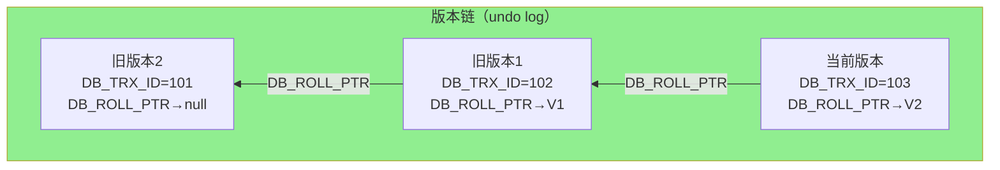
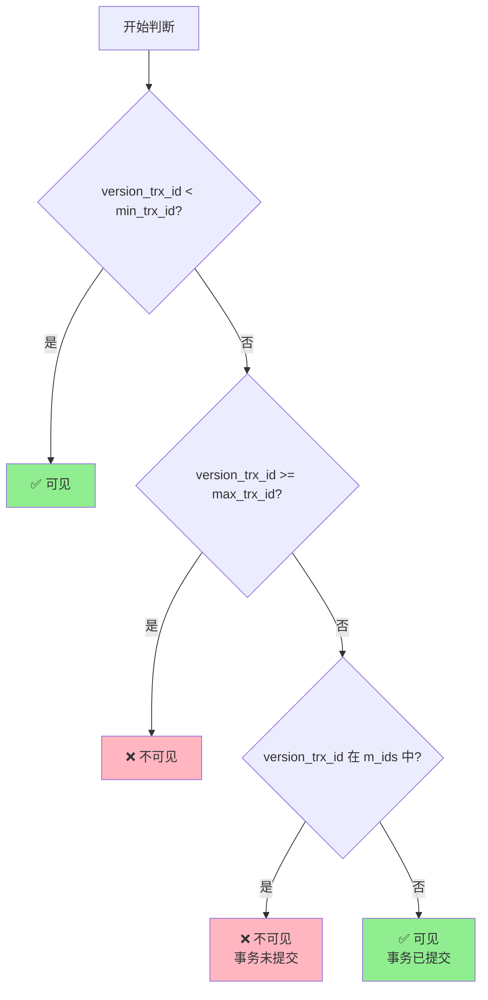
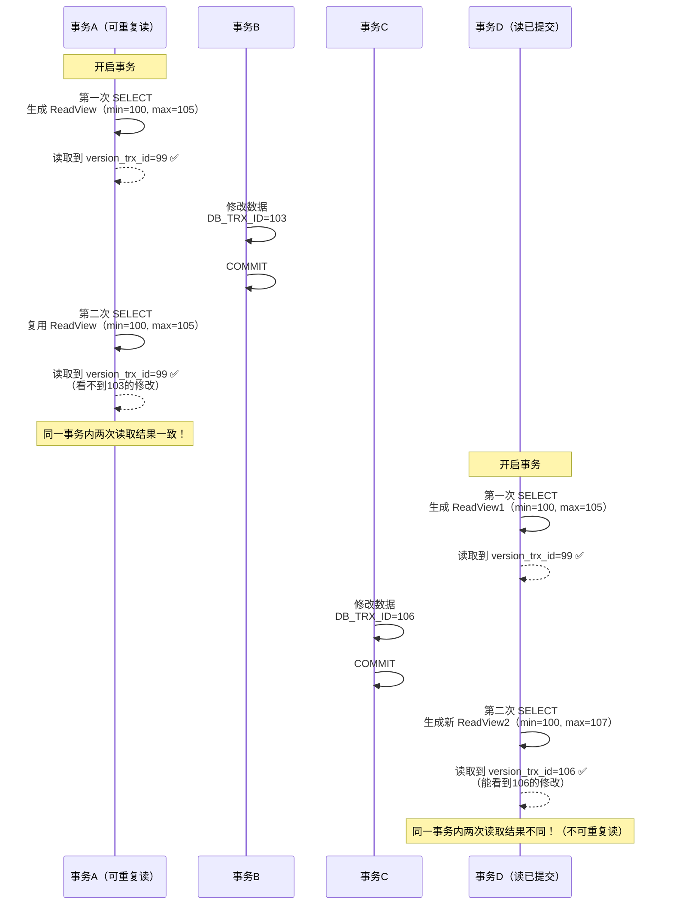
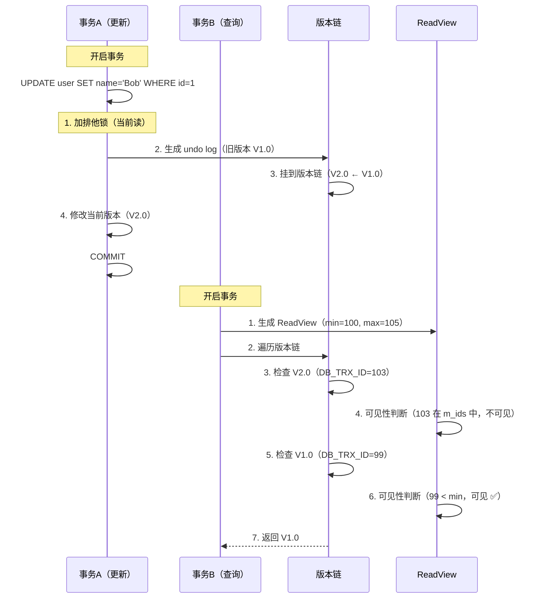
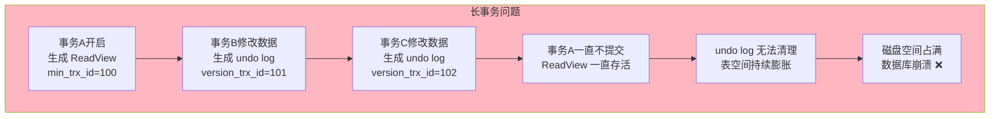
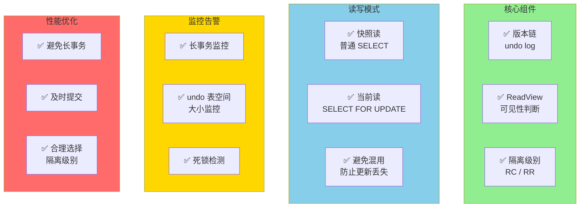
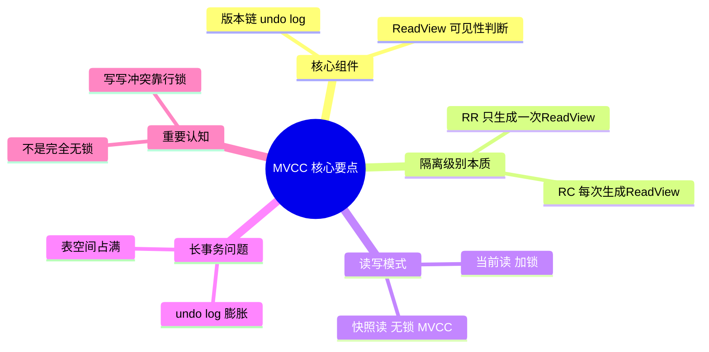

# MVCC 多版本并发控制


---

## 🎯 场景引入

**MVCC 解决什么问题？**
```
事务读写冲突：
- 事务A正在读数据
- 事务B修改了同一行数据
- 事务A读到的数据不一致！

MVCC：让事务A读到"历史版本"，不用等事务B完成
就像你看书的旧版本，别人在修改新版本，互不干扰
```

**生活化比喻**：
就像文档的版本管理：
- 你在看 V1.0 版本（快照读）
- 同事在修改 V2.0 版本（当前读）
- 你们互不干扰，各干各的
- MVCC 就是"版本管理器"，让你能看到历史版本

**核心特点**：读写不冲突，用空间换时间，但**不是完全无锁**！

---

## 💎 核心设计要点速览

### 核心观点（5 个关键点）

**1. 版本链：每行数据都有"家谱"**
```
每行数据都有隐藏字段：
- DB_TRX_ID：最后修改该行的事务ID
- DB_ROLL_PTR：指向旧版本的指针（像家谱的族谱链接）
- DB_ROW_ID：隐藏的行ID

版本链结构：
当前版本 ← DB_ROLL_PTR ← 旧版本1 ← DB_ROLL_PTR ← 旧版本2 ← ...

生活化比喻：
就像文档的版本历史：
V3.0（当前版本）← V2.0 ← V1.0
每个版本都有修改者ID（DB_TRX_ID）和指向上一版本的链接（DB_ROLL_PTR）

存储位置：
undo log（回滚日志），不是 redo log！
```

**2. ReadView：事务的"可见性眼镜"**
```
ReadView 核心字段（4个）：
1. m_ids：创建 ReadView 时，所有活跃（未提交）的事务ID列表
2. min_trx_id：m_ids 中的最小值（最早的事务）
3. max_trx_id：创建 ReadView 时，系统即将分配的下一个事务ID（最大值）
4. creator_trx_id：创建该 ReadView 的事务ID

可见性判断规则：
- 版本事务ID < min_trx_id：✅ 可见（版本已提交）
- 版本事务ID >= max_trx_id：❌ 不可见（版本在ReadView创建后才提交）
- min_trx_id <= 版本事务ID < max_trx_id：
  - 在 m_ids 中：❌ 不可见（版本还未提交）
  - 不在 m_ids 中：✅ 可见（版本已提交）

生活化比喻：
就像你戴着一副"可见性眼镜"看文档：
- 能看到 V1.0、V2.0（已发布的版本）
- 看不到 V3.0（同事正在修改，还未发布）
```

**3. 隔离级别的本质：ReadView 生成时机不同**
```
读已提交（Read Committed）：
- 每次执行 SELECT 都生成新的 ReadView
- 能看到其他事务刚提交的修改
- 导致：不可重复读（同一事务内两次读取结果不同）

可重复读（Repeatable Read）：
- 事务中第一次执行 SELECT 生成 ReadView
- 后续全程复用这个 ReadView
- 保证：同一事务内多次读取结果一致

生活化比喻：
读已提交：每次都看最新版本（像实时刷新朋友圈）
可重复读：只看自己开始时的版本（像看快照，不变）

本质区别：
不是版本链不同，而是 ReadView 的生成时机不同！
```

**4. 快照读 vs 当前读：MVCC 不是完全无锁**
```
快照读（Snapshot Read）：
- 读取历史版本（通过 MVCC）
- 不加锁
- SQL：普通 SELECT
- 场景：读已提交、可重复读下的查询

当前读（Current Read）：
- 读取最新版本
- 加锁（共享锁/排他锁）
- SQL：
  - SELECT ... LOCK IN SHARE MODE（共享锁）
  - SELECT ... FOR UPDATE（排他锁）
  - INSERT / UPDATE / DELETE（排他锁）
- 场景：需要保证数据一致性的操作

生活化比喻：
快照读：看文档的历史版本（不加锁）
当前读：看文档的最新版本，并锁定（加锁，防止别人修改）

重要：
MVCC 只解决快照读的读写冲突，当前读还是要加锁！
```

**5. 长事务的连锁反应：undo log 膨胀**
```
长事务问题：
1. 事务A开启，生成 ReadView（min_trx_id=100）
2. 事务B修改数据，生成 undo log（版本99）
3. 事务C修改数据，生成 undo log（版本98）
4. 事务A一直不提交，ReadView 一直存活
5. 版本99、98的 undo log 无法清理（事务A还需要）
6. undo 表空间持续膨胀，甚至占满磁盘！

生活化比喻：
就像图书馆：
- 你借了一本书的旧版本（ReadView）
- 图书馆想清理旧版本，但你一直没还书
- 旧版本越积越多，仓库都放不下了！

解决方案：
- 避免长事务（及时提交）
- 监控 undo 表空间大小
- 设置长事务告警
```

---

## 🚀 一句话精华

> **MVCC = 版本链（undo log） + ReadView（可见性判断），读已提交每次生成 ReadView，可重复读只生成一次，不是完全无锁！**

---

## 一、MVCC 的核心组件

### 1.1 版本链（undo log）

**生活化比喻**：
```
就像文档的版本历史：
V3.0（当前版本）← V2.0 ← V1.0

每个版本都有：
- 修改者ID（DB_TRX_ID）：谁修改的
- 族谱链接（DB_ROLL_PTR）：指向上一版本

MVCC 通过版本链，让你能看到历史版本。
```

**技术实现**：



**隐藏字段**：

| 字段 | 作用 | 生活化比喻 |
|------|------|------------|
| **DB_TRX_ID** | 最后修改该行的事务ID | 文档的修改者ID |
| **DB_ROLL_PTR** | 指向旧版本的指针 | 文档的"上一版本"链接 |
| **DB_ROW_ID** | 隐藏的行ID | 文档的序号 |

**存储位置**：
- ✅ undo log（回滚日志）：保存历史版本
- ❌ redo log（重做日志）：只记录修改操作，不保存历史版本

---

### 1.2 ReadView（可见性判断）

**生活化比喻**：
```
ReadView 就像一副"可见性眼镜"：
- 戴上它，你能看到哪些版本是"可见的"
- 不同隔离级别，眼镜的"过滤规则"不同

读已提交：每次都换一副新眼镜（每次生成新 ReadView）
可重复读：一副眼镜戴到底（只生成一次 ReadView）
```

**核心字段**：

```go
// ReadView 结构（伪代码）
type ReadView struct {
    m_ids          []int64 // 创建时所有活跃事务ID列表
    min_trx_id     int64   // m_ids 中的最小值
    max_trx_id     int64   // 即将分配的下一个事务ID（最大值）
    creator_trx_id int64   // 创建该 ReadView 的事务ID
}
```

**可见性判断算法**：

```go
// 判断某个版本是否可见
func isVisible(version *RowVersion, readView *ReadView) bool {
    versionTrxID := version.DB_TRX_ID
    
    // 情况1：版本事务ID < min_trx_id
    // 说明版本在 ReadView 创建前已提交
    if versionTrxID < readView.min_trx_id {
        return true // ✅ 可见
    }
    
    // 情况2：版本事务ID >= max_trx_id
    // 说明版本在 ReadView 创建后才提交
    if versionTrxID >= readView.max_trx_id {
        return false // ❌ 不可见
    }
    
    // 情况3：min_trx_id <= 版本事务ID < max_trx_id
    // 需要判断事务是否在活跃列表中
    if contains(readView.m_ids, versionTrxID) {
        // 在活跃列表中，说明事务还未提交
        return false // ❌ 不可见
    } else {
        // 不在活跃列表中，说明事务已提交
        return true // ✅ 可见
    }
}

func contains(m_ids []int64, trxID int64) bool {
    for _, id := range m_ids {
        if id == trxID {
            return true
        }
    }
    return false
}
```

**可视化判断流程**：



---

### 1.3 隔离级别的本质区别

**生活化比喻**：
```
读已提交（Read Committed）：
就像实时刷新朋友圈，每次都能看到最新内容。
每次 SELECT 都生成新 ReadView，能看到其他事务刚提交的修改。
缺点：同一事务内两次读取结果不同（不可重复读）。

可重复读（Repeatable Read）：
就像看快照，只看自己开始时的版本。
事务中第一次 SELECT 生成 ReadView，后续全程复用。
优点：同一事务内多次读取结果一致（可重复读）。
```

**技术对比**：



**代码示例**：

```go
// 读已提交：每次 SELECT 都生成新 ReadView
func ReadCommitted(db *gorm.DB, id int) {
    tx := db.Begin()
    
    // 第一次查询，生成 ReadView1
    var user1 User
    tx.First(&user1, id)
    fmt.Println("第一次读取：", user1.Name) // Alice
    
    // 其他事务修改数据并提交
    // ...
    
    // 第二次查询，生成新 ReadView2
    var user2 User
    tx.First(&user2, id)
    fmt.Println("第二次读取：", user2.Name) // Bob（看到了修改）
    
    tx.Commit()
}

// 可重复读：只在第一次 SELECT 时生成 ReadView
func RepeatableRead(db *gorm.DB, id int) {
    tx := db.Begin()
    
    // 第一次查询，生成 ReadView
    var user1 User
    tx.First(&user1, id)
    fmt.Println("第一次读取：", user1.Name) // Alice
    
    // 其他事务修改数据并提交
    // ...
    
    // 第二次查询，复用 ReadView
    var user2 User
    tx.First(&user2, id)
    fmt.Println("第二次读取：", user2.Name) // Alice（看不到修改）
    
    tx.Commit()
}
```

---

## 二、快照读 vs 当前读

### 生活化比喻

```
快照读（Snapshot Read）：
就像看文档的历史版本（V1.0），不加锁，别人可以继续修改新版本。

当前读（Current Read）：
就像看文档的最新版本（V3.0），并锁定（加锁），防止别人修改。

重要：
MVCC 只解决快照读的读写冲突，当前读还是要加锁！
```

### 技术对比

| 特性 | 快照读 | 当前读 |
|------|--------|--------|
| **读取内容** | 历史版本（通过 MVCC） | 最新版本 |
| **是否加锁** | ❌ 不加锁 | ✅ 加锁（共享锁/排他锁） |
| **SQL 类型** | 普通 SELECT | SELECT ... LOCK IN SHARE MODE<br/>SELECT ... FOR UPDATE<br/>INSERT / UPDATE / DELETE |
| **并发性能** | ⭐⭐⭐⭐⭐（读写不冲突） | ⭐⭐⭐（读写冲突，需要等待） |
| **适用场景** | 读多写少，允许读历史版本 | 需要保证数据一致性 |

### 代码示例

```go
// 快照读（不加锁，通过 MVCC 读取历史版本）
func SnapshotRead(db *gorm.DB, id int) {
    var user User
    db.First(&user, id) // 普通 SELECT，快照读
    fmt.Println(user.Name)
}

// 当前读（加锁，读取最新版本）
func CurrentRead(db *gorm.DB, id int) {
    tx := db.Begin()
    
    // SELECT ... FOR UPDATE（当前读，加排他锁）
    var user User
    tx.Set("gorm:query_option", "FOR UPDATE").First(&user, id)
    
    fmt.Println(user.Name)
    
    // 修改数据
    user.Name = "Bob"
    tx.Save(&user) // UPDATE，当前读，加排他锁
    
    tx.Commit()
}
```

### 混合使用的陷阱

```
场景（可重复读隔离级别）：
1. 事务A：快照读（读到 V1.0）
2. 事务B：修改数据并提交（V1.0 → V2.0）
3. 事务A：当前读（读到 V2.0，最新）
4. 事务A：快照读（读到 V1.0 还是 V2.0？）

答案：读到 V1.0（快照读复用之前的 ReadView）

生活化比喻：
就像你看文档：
- 第一次看 V1.0（快照读）
- 同事修改成 V2.0
- 你第二次看最新版本（当前读）
- 第三次看历史版本（快照读，还是 V1.0）

注意：
两次快照读结果一致，但当前读和快照读结果不同！
这就是"更新丢失"问题的根源。
```

---

## 三、MVCC 的完整链路

### 生活化比喻

```
MVCC 的完整流程：
1. 更新操作：加排他锁 → 修改数据 → 生成 undo log → 挂到版本链
2. 快照读：生成/复用 ReadView → 遍历版本链 → 找到第一个可见版本 → 返回

就像图书馆：
- 更新：锁定最新书籍 → 修改 → 把旧版本放到历史区
- 快照读：戴上可见性眼镜 → 在历史区找书 → 找到第一本可见的 → 借阅
```

### 技术流程



### 更新冲突处理

```
问题：两个事务同时更新同一行，MVCC 怎么处理？

答案：不是靠 MVCC，是靠行锁排队！

生活化比喻：
就像厕所只有一个马桶：
- 事务A进去后锁上门（加排他锁）
- 事务B在外面排队等待
- 事务A出来后，事务B才能进去

技术实现：
1. 事务A：UPDATE ... FOR UPDATE（加排他锁）
2. 事务B：UPDATE ... FOR UPDATE（等待锁）
3. 事务A：COMMIT（释放锁）
4. 事务B：获得锁，继续执行

结论：
MVCC 只解决读写冲突，不解决写写冲突！
写写冲突还是要靠锁。
```

```go
// 写写冲突：靠行锁解决
func UpdateConflict() {
    // 事务A
    go func() {
        tx := db.Begin()
        tx.Set("gorm:query_option", "FOR UPDATE").
            Exec("UPDATE users SET name='Alice' WHERE id=1")
        time.Sleep(2 * time.Second) // 模拟耗时操作
        tx.Commit()
    }()
    
    // 事务B（会等待事务A释放锁）
    go func() {
        time.Sleep(1 * time.Second) // 等事务A先加锁
        tx := db.Begin()
        tx.Set("gorm:query_option", "FOR UPDATE").
            Exec("UPDATE users SET name='Bob' WHERE id=1")
        tx.Commit()
    }()
}
```

---

## 四、长事务的连锁反应

### 生活化比喻

```
长事务问题：
就像你借了图书馆的书一直没还：
- 图书馆想清理旧版本（undo log）
- 但你的 ReadView 还需要这些旧版本
- 旧版本越积越多，仓库都放不下了！

后果：
- undo 表空间持续膨胀
- 磁盘空间被占满
- 数据库性能下降
```

### 技术分析



### 清理机制

```
undo log 清理规则：
- 事务提交后，undo log 不会立刻删除
- 后台线程定期检查
- 只有当没有任何 ReadView 引用某个版本时，才能清理

生活化比喻：
就像图书馆清理旧版本：
- 必须等所有读者都还了书（ReadView 关闭）
- 才能把旧版本扔掉
- 如果有人一直借书不还（长事务），旧版本就一直清理不了

解决方案：
1. 避免长事务（及时提交）
2. 监控 undo 表空间大小
3. 设置长事务告警
4. 定期重启数据库（清理 ReadView）
```

### 监控与告警

```go
// 监控长事务
func MonitorLongTransactions(db *gorm.DB) {
    // 查询运行超过 60 秒的事务
    var longTransactions []map[string]interface{}
    db.Raw(`
        SELECT 
            trx_id, 
            trx_state, 
            trx_started, 
            TIMESTAMPDIFF(SECOND, trx_started, NOW()) as duration
        FROM information_schema.innodb_trx
        WHERE TIMESTAMPDIFF(SECOND, trx_started, NOW()) > 60
    `).Scan(&longTransactions)
    
    if len(longTransactions) > 0 {
        // 发送告警
        sendAlert("发现长事务", longTransactions)
    }
}

// 监控 undo 表空间
func MonitorUndoTablespace() {
    // 查询 undo 表空间大小
    var size int64
    db.Raw(`
        SELECT SUM(data_length) + SUM(index_length) 
        FROM information_schema.tables 
        WHERE table_schema = 'mysql' 
        AND table_name LIKE 'undo_%'
    `).Scan(&size)
    
    // 超过 10GB 发送告警
    if size > 10*1024*1024*1024 {
        sendAlert("undo 表空间过大", size)
    }
}
```

---


---

## 五、生产环境 Checklist



**部署检查清单**：

| 类别 | 检查项 | 状态 | 生活化比喻 |
|------|--------|------|------------|
| **核心组件** | 版本链（undo log） | ⬜ | 文档版本历史 |
| | ReadView（可见性判断） | ⬜ | 可见性眼镜 |
| | 隔离级别选择（RC/RR） | ⬜ | 实时刷新 vs 快照 |
| **读写模式** | 快照读（普通 SELECT） | ⬜ | 看历史版本 |
| | 当前读（SELECT FOR UPDATE） | ⬜ | 看最新版本并锁定 |
| | 避免混用（防止更新丢失） | ⬜ | 避免编辑冲突 |
| **监控告警** | 长事务监控（>60s） | ⬜ | 借书未还监控 |
| | undo 表空间大小监控 | ⬜ | 仓库容量监控 |
| | 死锁检测 | ⬜ | 拥堵检测 |
| **性能优化** | 避免长事务（及时提交） | ⬜ | 及时还书 |
| | 合理选择隔离级别 | ⬜ | 按需选择 |

---

## 六、总结



### 🎯 方案总结

> **MVCC = 版本链（undo log） + ReadView（可见性判断），读已提交每次生成 ReadView，可重复读只生成一次，不是完全无锁！**

### 🧠 核心要点

1. **MVCC 的核心组件？** 版本链（undo log）和 ReadView（可见性判断）。
2. **隔离级别的本质区别？** ReadView 的生成时机不同（RC 每次生成，RR 只生成一次）。
3. **MVCC 是完全无锁吗？** 不是，只解决快照读的读写冲突，当前读和写写冲突还是要靠锁。
4. **长事务有什么危害？** undo log 无法清理，表空间持续膨胀，数据库崩溃。
5. **快照读和当前读混用？** 可能导致更新丢失，避免混用或使用乐观锁。

---

