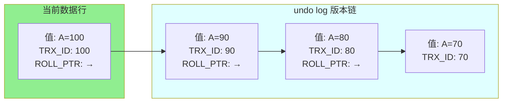
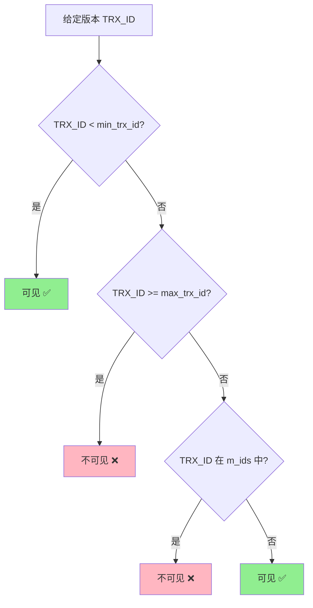
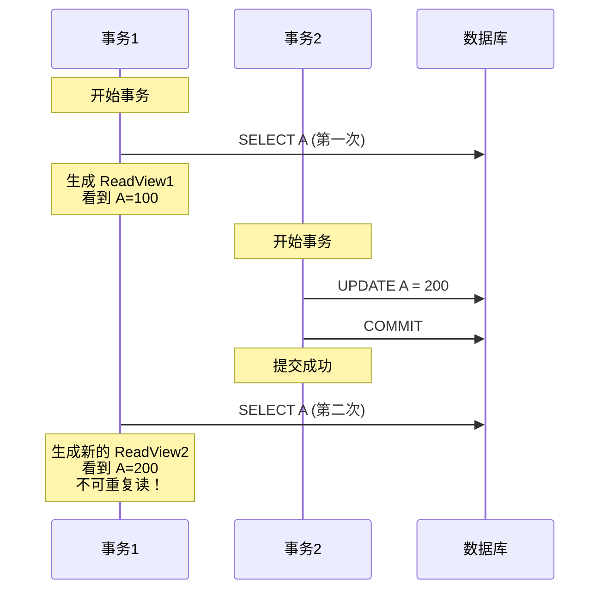
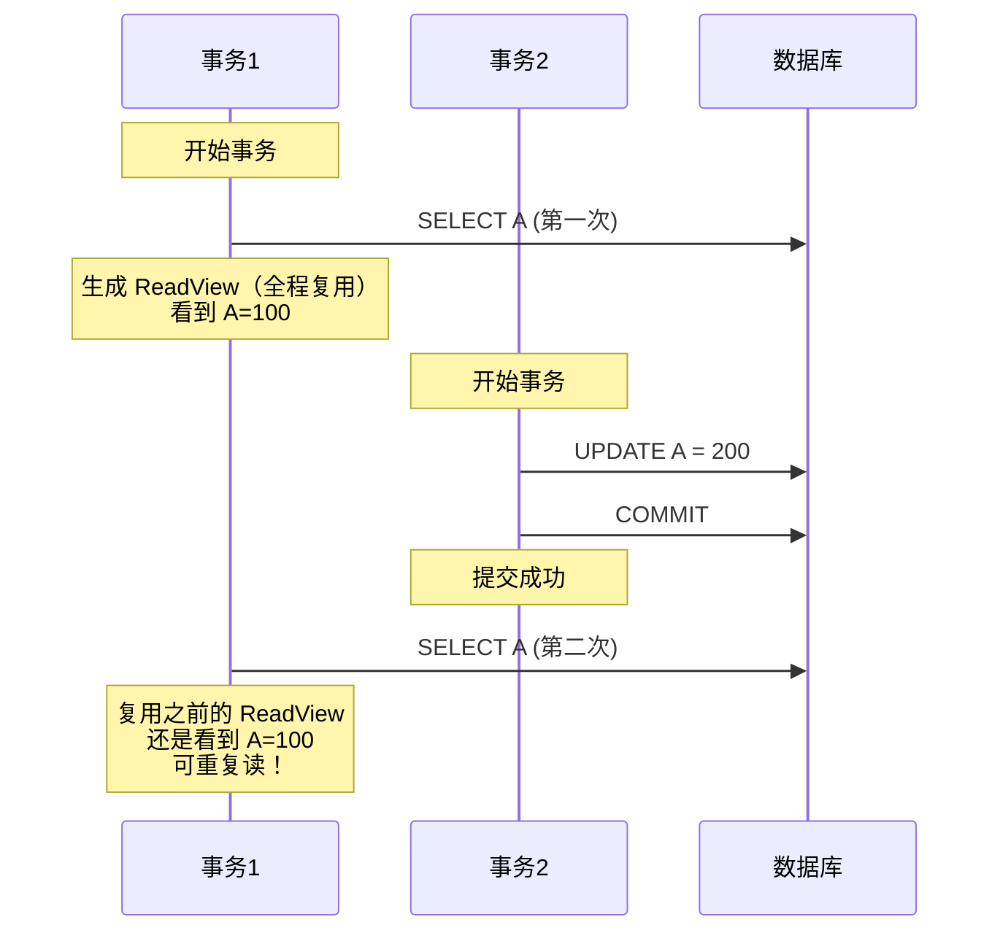
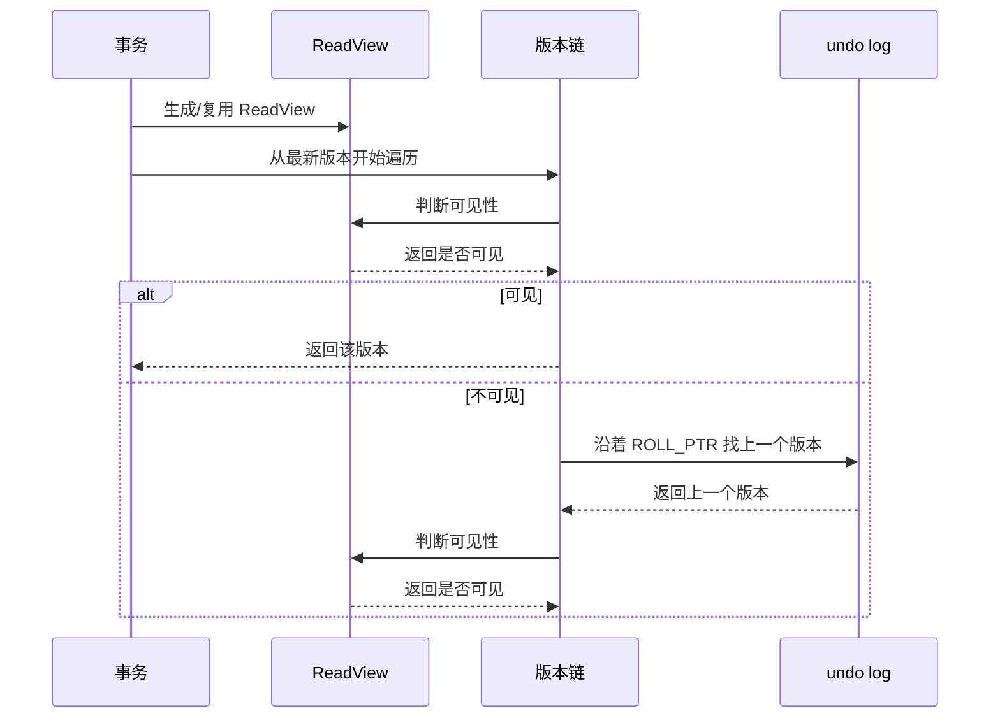
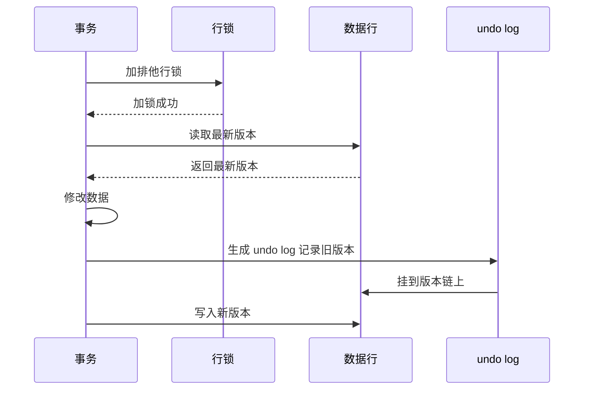
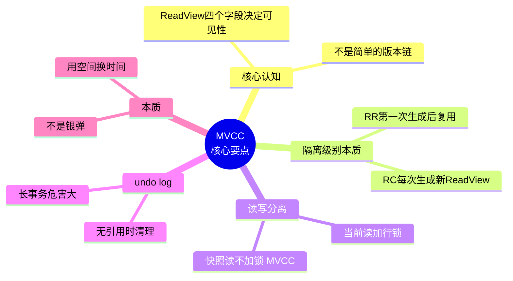

# MySQL MVCC 深度解析


---

## 🎯 场景引入

**MVCC 解决什么问题？**
```
读写不冲突：读操作不加锁，写操作也不阻塞读
事务隔离：不同隔离级别看到的数据视图不同
```

**生活化比喻**：
就像**图书馆的图书管理系统**——你可以随时查看某本书在不在架（快照读，不加锁），别人也可以同时查看。但如果两个人同时借同一本书（写写冲突），必须排队（加锁）。而且你可以选择看"当前最新版本"（当前读）还是"历史版本"（快照读）。

**核心特点**：用空间换时间（undo log 版本空间换取读写不冲突的并发性能）。

---

## 💎 核心设计要点速览

### 核心观点（5 个关键点）

**1. ReadView 四个核心字段**
```
❌ 常见误区：只知道版本链和 undo log
✅ 核心本质：ReadView 的四个字段决定可见性
   ① 活跃事务 ID 列表（m_ids）
   ② 最小活跃事务 ID（min_trx_id）
   ③ 下一个待分配的事务 ID（max_trx_id）
   ④ 当前创建者事务 ID（creator_trx_id）
```

**2. 两个隔离级别的本质区别**
```
读已提交（RC）：每次执行 SELECT 都生成全新 ReadView
→ 每次都能看到其他事务刚提交的修改
→ 不可重复读

可重复读（RR）：事务中第一次 SELECT 生成 ReadView，后续全程复用
→ 看不到其他事务后续提交的修改
→ 可重复读
```

**3. 可见性判断规则**
```
版本可见性判断：
- < min_trx_id：可见（事务已提交）
- >= max_trx_id：不可见（事务在 ReadView 创建后才开始）
- 在 [min_trx_id, max_trx_id) 之间：没在活跃列表里才可见
```

**4. 快照读 vs 当前读**
```
快照读（MVCC）：普通 SELECT，读取历史版本，不加锁
当前读：SELECT ... FOR UPDATE / UPDATE / DELETE / INSERT，读取最新版本，加锁

MVCC 只解决快照读的读写冲突，当前读依然要加行锁
```

**5. undo log 清理与长事务危害**
```
事务提交后 undo log 不会立刻删除
→ 因为可能还有其他事务的 ReadView 依赖这些旧版本
→ 后台线程定期清理没有任何事务引用的 undo log

长事务危害：ReadView 存活时间太久
→ 大量旧版本 undo log 无法清理
→ undo 表空间持续膨胀甚至占满磁盘
```

---

## 🚀 一句话精华

> **MVCC = ReadView 四个字段决定可见性 + 两个隔离级别的 ReadView 生成时机不同 + 快照读（不加锁）vs 当前读（加锁）+ undo log 清理与长事务危害**

---

## 一、基础认知：版本链 + ReadView

### 1.1 版本链结构

**生活化比喻**：
```
版本链 = 图书的修改历史记录
每次修改都保留历史版本：
- 版本1：初稿
- 版本2：修改稿
- 版本3：最终稿

每个版本都有一个"版本号"（事务 ID），按版本号串联
```

**数据结构**：
```
每行数据都有隐藏字段：
- DB_TRX_ID：最近修改这行数据的事务 ID
- DB_ROLL_PTR：回滚指针，指向 undo log 中的上一个版本

版本链结构：
最新版本 → undo log 版本1 → undo log 版本2 → ... → 最早版本
```



### 1.2 ReadView 四个核心字段

**生活化比喻**：
```
ReadView = "可见性判断清单"
就像公司里的"项目进度查看权限"：
- 活跃事务列表 = 正在进行的项目
- 最小活跃 ID = 最早开始的项目编号
- 下一个待分配 ID = 还没开始的项目编号
- 当前创建者 ID = 你自己的项目编号
```

**四个字段详解**：

| 字段 | 含义 | 生活化比喻 |
|------|------|-----------|
| **m_ids** | 创建 ReadView 时，当前活跃（未提交）的事务 ID 列表 | 正在进行的项目列表 |
| **min_trx_id** | m_ids 中的最小值（最早开始的事务） | 最早开始的项目编号 |
| **max_trx_id** | 系统下一个将要分配的事务 ID（当前最大事务 ID + 1） | 还没开始的项目编号 |
| **creator_trx_id** | 创建这个 ReadView 的事务 ID | 你自己的项目编号 |

### 1.3 可见性判断规则

**核心规则**：
```
给定一个版本的 TRX_ID，判断是否可见：

① TRX_ID < min_trx_id
   → 该版本在 ReadView 创建前已提交
   → 可见 ✅

② TRX_ID >= max_trx_id
   → 该版本在 ReadView 创建后才开始
   → 不可见 ❌

③ min_trx_id <= TRX_ID < max_trx_id
   → 该版本在 ReadView 创建时还在进行中
   → 如果 TRX_ID 不在 m_ids 中 → 已提交 → 可见 ✅
   → 如果 TRX_ID 在 m_ids 中 → 未提交 → 不可见 ❌

④ TRX_ID == creator_trx_id
   → 自己的修改
   → 可见 ✅
```

**流程图**：



**代码示例**（可见性判断伪代码）：
```go
// MVCC 可见性判断
func isVisible(versionTrxID uint64, readView ReadView) bool {
    // ① 自己的修改，可见
    if versionTrxID == readView.CreatorTrxID {
        return true
    }
    
    // ② 在 ReadView 创建前已提交，可见
    if versionTrxID < readView.MinTrxID {
        return true
    }
    
    // ③ 在 ReadView 创建后才开始，不可见
    if versionTrxID >= readView.MaxTrxID {
        return false
    }
    
    // ④ 在 ReadView 创建时还在进行中
    //    如果不在活跃列表中，说明已提交，可见
    //    如果在活跃列表中，说明未提交，不可见
    for _, activeTrxID := range readView.MIDs {
        if versionTrxID == activeTrxID {
            return false // 未提交，不可见
        }
    }
    return true // 已提交，可见
}
```

---

## 二、两个隔离级别的本质区别

### 2.1 读已提交（Read Committed）

**核心特点**：
```
每次执行 SELECT 都生成全新 ReadView
→ 每次都能看到其他事务刚提交的修改
→ 不可重复读
```

**生活化比喻**：
```
读已提交 = 每次都看最新版本
- 第一次查询：看到 A=100
- 其他事务修改 A=200 并提交
- 第二次查询：看到 A=200（生成新的 ReadView）
- 两次结果不一样 → 不可重复读
```

**示例**：



### 2.2 可重复读（Repeatable Read）

**核心特点**：
```
事务中第一次 SELECT 生成 ReadView，后续全程复用
→ 看不到其他事务后续提交的修改
→ 可重复读
```

**生活化比喻**：
```
可重复读 = 一直看同一个版本
- 第一次查询：看到 A=100（生成 ReadView，全程复用）
- 其他事务修改 A=200 并提交
- 第二次查询：还是看到 A=100（复用之前的 ReadView）
- 两次结果一样 → 可重复读
```

**示例**：



### 2.3 对比表

| 隔离级别 | ReadView 生成时机 | 可见性 | 生活化比喻 |
|---------|------------------|--------|-----------|
| **读已提交（RC）** | 每次执行 SELECT 都生成新 ReadView | 每次都能看到最新提交 | 每次都看最新版本 |
| **可重复读（RR）** | 事务中第一次 SELECT 生成，后续复用 | 看不到其他事务后续提交 | 一直看同一个版本 |

---

## 三、快照读 vs 当前读

### 3.1 快照读（MVCC）

**定义**：
```
普通 SELECT 语句
读取历史版本（通过版本链 + ReadView 判断）
不加锁
```

**示例**：
```sql
-- 快照读（MVCC）
SELECT * FROM users WHERE id = 1;
```

**特点**：
- ✅ 不加锁，读写不冲突
- ✅ 读取历史版本，可能不是最新数据
- ✅ 高并发性能好

### 3.2 当前读

**定义**：
```
读取最新版本，加锁
包括：
- SELECT ... FOR UPDATE（加排他锁）
- SELECT ... LOCK IN SHARE MODE（加共享锁）
- UPDATE、DELETE、INSERT（加排他锁）
```

**示例**：
```sql
-- 当前读（加锁）
SELECT * FROM users WHERE id = 1 FOR UPDATE;  -- 加排他锁

UPDATE users SET name = 'Alice' WHERE id = 1;  -- 加排他锁

DELETE FROM users WHERE id = 1;  -- 加排他锁
```

**特点**：
- ✅ 读取最新版本
- ✅ 加锁，保证并发安全
- ❌ 读写冲突，性能较差

### 3.3 混合使用的坑

**问题场景**：
```
可重复读隔离级别下：
事务先快照读，再执行一次当前读，再快照读
两次快照读的结果会不会不一样？

答案：会不一样！
```

**示例**：
```sql
-- 事务1
BEGIN;
SELECT * FROM users WHERE id = 1;  -- 快照读，看到 A=100

-- 事务2
BEGIN;
UPDATE users SET A = 200 WHERE id = 1;
COMMIT;

-- 事务1（继续）
SELECT * FROM users WHERE id = 1 FOR UPDATE;  -- 当前读，看到 A=200
SELECT * FROM users WHERE id = 1;  -- 快照读，看到 A=200（ReadView 被更新）
```

**原因**：
```
当前读会更新 ReadView
→ 后续快照读复用的是新的 ReadView
→ 所以两次快照读结果不一样
```

**生活化比喻**：
```
快照读 = 看照片（历史版本）
当前读 = 看真人（最新版本）

你先看照片（快照读），再看真人（当前读），再看照片（快照读）
第三次看照片时，照片已经被更新了
→ 两次看照片结果不一样
```

---

## 四、MVCC 的完整链路

### 4.1 快照读流程



**步骤**：
1. 生成或复用 ReadView
2. 从最新版本开始遍历版本链
3. 对每个版本，用 ReadView 判断可见性
4. 找到第一个可见的版本，返回
5. 如果找不到，返回"记录不存在"

### 4.2 当前读流程（写操作）



**步骤**：
1. 加排他行锁（X 锁）
2. 读取最新版本（当前读）
3. 修改数据
4. 生成 undo log 记录旧版本，挂到版本链上
5. 写入新版本

---

## 五、undo log 清理与长事务危害

### 5.1 undo log 清理逻辑

**核心逻辑**：
```
事务提交后 undo log 不会立刻删除
→ 因为可能还有其他事务的 ReadView 依赖这些旧版本
→ 后台 purge 线程定期清理没有任何事务引用的 undo log
```

**清理条件**：
```
undo log 版本可以被清理的条件：
- 该版本的 TRX_ID < 所有活跃 ReadView 的 min_trx_id
- 说明：所有 ReadView 都不需要这个版本了
```

**生活化比喻**：
```
undo log = 图书的修改历史
purge 线程 = 图书管理员

图书管理员定期清理修改历史：
- 如果所有人都看过这个版本了（所有 ReadView 都不需要了）
- 就清理掉，节省空间
- 如果有人还在看（还有 ReadView 需要），就不能清理
```

### 5.2 长事务的危害

**问题场景**：
```
长事务：事务开启后一直不提交
→ ReadView 一直存活
→ 大量旧版本 undo log 无法清理
→ undo 表空间持续膨胀
→ 甚至占满磁盘
```

**生活化比喻**：
```
长事务 = 借了书一直不还
→ 图书管理员无法清理这本书的修改历史
→ 图书馆空间被占满
→ 新书放不进来
```

**排查方法**：
```sql
-- 查看当前活跃事务
SELECT * FROM information_schema.INNODB_TRX;

-- 查看长事务
SELECT * FROM information_schema.INNODB_TRX 
WHERE TIME_TO_SEC(TIMEDIFF(NOW(), trx_started)) > 60;  -- 超过 60 秒

-- 查看 undo 表空间使用情况
SELECT file_name, tablespace_name, total_extents, extent_size 
FROM information_schema.FILES 
WHERE file_name LIKE '%undo%';
```

**解决方案**：
```
① 避免长事务：业务逻辑尽量短，快速提交
② 设置事务超时：innodb_lock_wait_timeout
③ 定期监控：发现长事务及时告警
④ 手动 kill：紧急情况 kill 长事务
```

---

## 六、MVCC 的优缺点

### 6.1 优点

| 优点 | 说明 | 生活化比喻 |
|------|------|-----------|
| **读写不冲突** | 快照读不加锁，读写互不阻塞 | 看照片不影响别人看真人 |
| **高并发性能** | 不需要加锁，并发度高 | 不用排队，直接看 |
| **事务隔离** | 不同隔离级别看到不同视图 | 不同权限看不同版本 |

### 6.2 缺点

| 缺点 | 说明 | 生活化比喻 |
|------|------|-----------|
| **空间开销** | 需要存储多个版本（undo log） | 图书馆需要更多空间存历史版本 |
| **写冲突性能差** | 写写冲突还是要加锁，MVCC 收益有限 | 两个人同时借同一本书，还是要排队 |
| **长事务危害** | undo log 无法清理，表空间膨胀 | 借了书一直不还，图书馆被占满 |

---


---

## 七、总结



### 🎯 方案总结

> **MVCC = ReadView 四个字段决定可见性 + 两个隔离级别的 ReadView 生成时机不同（RC 每次生成 / RR 复用）+ 快照读（不加锁）vs 当前读（加行锁）+ undo log 清理与长事务危害**

### 🧠 核心要点

1. **ReadView 四个字段？** 活跃事务 ID 列表、最小活跃事务 ID、下一个待分配事务 ID、当前创建者事务 ID。
2. **两个隔离级别区别？** 读已提交每次 SELECT 生成新 ReadView；可重复读第一次生成后复用。
3. **MVCC 完全不用加锁？** 不是，快照读不加锁，当前读（SELECT FOR UPDATE、UPDATE、DELETE）要加行锁。
4. **undo log 什么时候清理？** 没有任何 ReadView 引用时清理。长事务会导致无法清理，表空间膨胀。
5. **本质是什么？** 用空间换时间（undo log 版本空间换取读写不冲突的并发性能），不是银弹。

---

