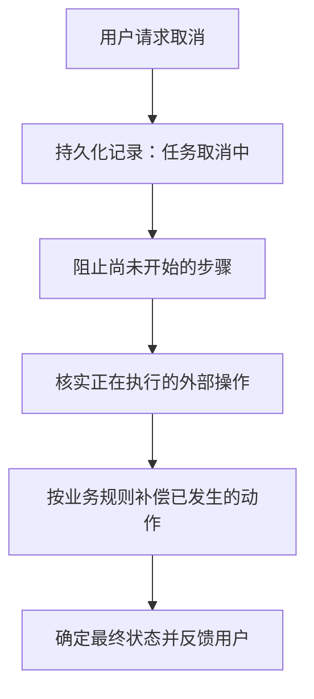

# 01. Agent 执行一半被取消怎么办？

> **场景引入**：客服 Agent 正在“查订单 → 申请退款 → 发确认邮件”。用户在退款请求发出后点击“取消”。此时停掉模型生成，并不能回答钱到底退没退。

> 对应原稿：[01-Agent执行一半被取消怎么办](../origanl/01-Agent执行一半被取消怎么办.md)  
> 适合读者：了解 Agent 会调用工具、想进一步理解长任务工程化的开发者。

---

## 🎯 一句话定位

**取消 Agent 任务，不等于断开模型请求。** 系统要停止尚未开始的步骤，查清正在执行的步骤，对已经发生的外部操作做记录或补偿，最后把真实结果告诉用户。

**生活化理解**：取消外卖时，厨房还没开工可以直接停；骑手已经取餐，就必须核实当前进度，不能关掉页面便当作什么都没发生。

---

## 💎 核心要点概览

| 问题 | 先记住的处理原则 |
| --- | --- |
| 取消请求刚到达 | 先持久化“取消中”，阻止新步骤启动 |
| 工具正在执行 | 传递取消信号，同时查询外部真实结果 |
| 已产生副作用 | 按业务规则补偿；无法撤回则标记部分完成 |
| 客户端超时或重试 | 同一业务操作复用幂等键，避免重复退款 |
| 告诉用户什么 | 区分“收到取消请求”和“最终已取消” |

---

## 🚀 核心总结

> **取消链路 = 停止后续步骤 + 核实在途操作 + 处理已发生的副作用 + 如实反馈。**

---

## 一、从具体场景看取消的三种结果

用户让客服 Agent“查订单、申请退款并发确认邮件”。执行到一半时，用户点击了“取消”。

此时可能出现三种完全不同的情况：

| 取消发生的时刻 | 系统实际情况 | 应该怎么处理 |
| --- | --- | --- |
| 调用退款接口前 | 钱还没退 | 阻止退款与后续发信，任务可以结束为“已取消” |
| 退款请求已发出，结果未返回 | 不知道钱退没退 | 查询退款流水或等待可信结果，不能直接宣称“已取消” |
| 退款已成功，邮件未发送 | 钱已退，通知未发 | 停止邮件步骤，记录“部分完成”，告诉用户退款已经发生 |

**关键区别**：用户点击的是“请求取消”，最终状态取决于已经发生了什么。

## 二、为什么停掉模型调用还不够

Agent 经常跨越多个系统：模型负责决定下一步，工具负责真正执行。模型停止生成文字，并不能保证已经发出的支付、审批、发货或邮件请求同步撤销。

在 Go 中，`context.Context` 可以把取消信号传给数据库等支持它的调用，但接收方仍需配合处理；长任务框架 Temporal 的文档也明确说明，取消请求不会自动打断正在运行的 Activity，取消可能要等到下一次心跳才被执行方发现。**取消通常需要执行方配合。**参见 [Go 官方取消指南](https://go.dev/doc/database/cancel-operations)与 [Temporal 的取消说明](https://docs.temporal.io/nexus/standalone-activity)。

如果前端显示“取消成功”，但外部系统已经退款，用户可能再次提交。没有去重措施，就可能出现重复退款、重复邮件或两份工单。这里的根因是：**界面状态、任务状态和外部系统状态没有对齐**。

## 三、生产级方案：四个环节处理取消

### 1. 任务状态与可取消点

给每次执行分配 `task_id`，保存任务和步骤状态。长任务至少要区分“等待执行、执行中、取消中、已取消、失败、部分完成、已完成”；涉及外部副作用时，还需要“待人工确认”等状态。

在**每个步骤开始前**检查取消标志；对支持取消的模型请求和工具请求，同时传递取消信号。但“发出了取消信号”只表示尝试停止，不能代替对工具结果的核实。

如果核实后确认没有任何副作用，补偿步骤可以跳过，最终状态为“已取消”；如果操作已发生且无法安全撤回，就应记录“部分完成”或“待人工确认”。

实际实现时，要特别处理竞争：某个步骤刚准备执行，取消请求恰好到达。步骤启动与任务取消应通过数据库条件更新、事务或等效的原子机制协调，避免双方都以为自己先完成。

### 2. 幂等：防止重试变成重复执行

给有副作用的操作设置稳定的幂等键，例如 `task_id + step_id`。同一步骤因网络超时而重试时，外部系统应返回同一笔操作的结果，或拒绝重复创建。

注意：**幂等键要跨重试保持不变**。每次重试生成新键，相当于把同一笔退款伪装成多笔不同退款。Stripe 的 [幂等请求文档](https://docs.stripe.com/api/idempotent_requests)给出了直观例子：创建或更新对象时带上幂等键，即使连接错误后重试，也能避免意外重复执行。实际接入时还要核对具体服务的幂等范围、有效期和参数一致性规则，不能假设所有接口完全相同。

如果外部接口不支持幂等键，可以在自己的系统中记录操作意图、请求标识和结果，并在重试前查证；但对于“请求已发出、响应丢失”的情况，仅靠本地记录仍不能证明外部操作未发生，需要查询外部流水或交给人工处理。

### 3. 补偿：处理已经发生的事

补偿不是把历史抹掉，而是追加一个明确的后续动作。

| 已发生的操作 | 可能的补偿 |
| --- | --- |
| 创建了工单 | 将工单标记为取消，并保存原因 |
| 生成了临时文件 | 标记待清理，由后台清理任务删除 |
| 提交了审批 | 如果允许撤回则发起撤回；否则标记待人工处理 |
| 完成了退款 | 不能默认为可自动“反向退款”；核实业务规则后处理 |

每个补偿动作也可能失败，所以要保存执行结果、错误原因和后续处理人。补偿步骤也应尽可能设计成**幂等操作**：例如重复执行“把工单状态设置为取消”，结果仍是已取消。对于失败的补偿，记录进度并在可行时重试；无法自动处理时转人工。微软的 [补偿事务模式](https://learn.microsoft.com/en-us/azure/architecture/patterns/compensating-transaction)明确指出：补偿不一定恢复到最初状态，也可能失败，必须能追踪并恢复。

在设计流程时，还应标出**不可逆点**，例如钱已退或邮件已发。能提前完成的权限、额度和参数检查，尽量安排在不可逆点之前；一旦越过它，取消逻辑就要按实际业务结果收尾。这是将 [Saga 模式中的“不可回头节点”](https://learn.microsoft.com/en-us/azure/architecture/patterns/saga)用于 Agent 任务的设计推论，并不意味着所有 Agent 都需要完整实现 Saga。对支付等高风险操作，宁可清楚地显示“状态待核实”，也不要给出虚假的取消成功提示。

### 4. 用户反馈与可追踪记录

取消接口可以先回答“已收到取消请求”，任务页再显示最终结果。反馈至少说明：**哪些步骤停止了、哪些操作已经完成、还有什么需要处理**。

例如：“报告生成已停止；审批单已经提交，正在申请撤回。可在任务记录中查看进度。”这比单独显示一个绿色的“已取消”更诚实，也更方便排障。

系统日志中应关联 `task_id`、`step_id`、幂等键、外部请求标识、状态变化和错误码。这样用户反馈、客服查询与工程排查才能指向同一件事。

## 四、最小可落地实现

1. **建任务表和步骤表**：记录状态、取消时间、步骤结果、外部请求标识。
2. **执行前检查状态**：发现取消中，就不再启动新步骤。
3. **给副作用调用加幂等键**：退款、发信、创建工单等都要能识别重复请求。
4. **对执行中的操作做结果核实**：不能把客户端超时当成外部操作失败。
5. **定义补偿策略**：明确哪些能自动撤回，哪些只能记录并人工处理。
6. **按真实状态反馈**：区分“已收到取消请求”“已取消”“部分完成”“待人工确认”。

上线前至少演练三个时刻：工具调用前取消、工具执行中取消、工具成功后取消；再加上“结果返回时网络断开并触发重试”。如果四种情况的最终状态都能解释清楚，取消链路才算基本可靠。

## 五、常见误区与边界

- **“有 `cancel token` 就够了。”** 它只能向支持取消的调用发信号，已产生的副作用仍要核实。
- **“取消就是回滚所有动作。”** 跨系统操作往往无法做数据库式回滚，只能按业务规则补偿。
- **“超时说明工具没执行。”** 也可能是工具执行成功而响应丢失；应先查外部结果。
- **“前端按钮变灰就算完成。”** 界面反馈必须跟后端最终状态一致。

## 六、面试时可以这样说

> 我会按任务生命周期设计取消。用户点取消后，先把任务标记为取消中，阻止后续步骤启动；正在执行的模型和工具调用尽量传递取消信号，但会单独核实外部系统的实际结果。对退款、发信等副作用操作使用稳定的幂等键，避免重试造成重复执行。已经发生的操作按业务规则补偿，无法撤回的标记为部分完成或待人工确认。最后把取消进度、已完成动作和处理结果清楚地反馈给用户。

## 七、深度追问与自测

1. 退款接口超时后，用户点了取消。为什么不能立即显示“退款已取消”？
2. 同一个步骤重试时，幂等键应该复用还是重新生成？为什么？
3. 如果审批单已提交且无法撤回，最终任务状态和用户提示应该怎样设计？

**一句话带走：Agent 取消的难点，是让“停止继续做”和“交代已经做过什么”同时成立。**

---

## 八、生产环境 Checklist

- [ ] 取消请求先落库，并与步骤启动做并发协调。
- [ ] 每次外部写操作都有稳定的业务标识与幂等键。
- [ ] 超时、取消、断线后能查询真实业务状态。
- [ ] 对可补偿与不可逆操作分别定义处理结果。
- [ ] 用户界面能显示“取消中、已取消、部分完成、待人工确认”。

---

## 九、总结（一句话带走）

> **取消不是把执行痕迹抹掉，而是安全地停下来，并交代已完成的操作。**
