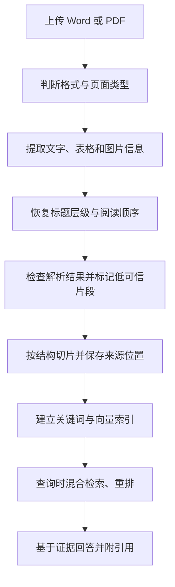

# 02. RAG 怎么处理 Word 和 PDF？

> **场景引入**：用户上传一份采购合同，问“延期交货能否解除合同”。如果 PDF 解析时漏掉“经催告后”四个字，检索命中正确页面仍会答错。

> 对应原稿：[02-RAG怎么处理Word和PDF](../origanl/02-RAG怎么处理Word和PDF.md)  
> 适合读者：知道 RAG 的基本流程，想把 Word、PDF 真正接入知识库的开发者。  
> 原稿说明：原稿标注为“降级内容”，并非视频逐字稿；其中未经核实的效果数字不作为本文结论。

---

## 🎯 一句话定位

**RAG 处理 Word 和 PDF，第一关是把文档还原成可信、可定位的内容。** 如果标题、表格、阅读顺序在解析时已经乱了，后续 embedding 和重排只能在错误内容里找“最像”的片段。

完整流程是：**辨认文件类型 → 提取文字和版面 → 检查解析质量 → 按结构切片 → 建立索引 → 检索与重排 → 带证据回答**。

**生活化理解**：Word 像带章节标签的手稿，普通 PDF 像排好版的印刷页，扫描 PDF 则像给印刷页拍照。先把页上的字和阅读顺序读对，才能谈检索。

---

## 💎 核心要点概览

| 环节 | 要解决的关键问题 |
| --- | --- |
| 文件分类 | DOCX、文本 PDF、扫描 PDF、混合 PDF 需要不同解析路径 |
| 结构恢复 | 标题、阅读顺序、表格行列和脚注不能错位 |
| 切片与索引 | 条件和例外要保持完整，片段要能回到原页 |
| 检索与作答 | 结合关键词和向量结果，核实版本与引用 |
| 验收 | 分别评估解析、召回、回答，定位首个失真环节 |

---

## 🚀 核心总结

> **先保证原文被正确解析、结构被保留，再讨论切片、检索和生成。**

---

## 一、Word 和 PDF 的难点在哪里？

可以把 Word 想成“带章节标签的手稿”，把普通 PDF 想成“排好版的印刷页”。前者通常能直接读到标题、段落、表格等结构；后者的文字可能有坐标，却未必按人类阅读顺序存储。扫描版 PDF 更像“手稿的照片”，通常需要 OCR 才能得到可检索文字。

| 类型 | 优先做什么 | 典型问题 |
| --- | --- | --- |
| DOCX | 提取段落、标题、表格等原生结构 | 图片里的字、文本框、公式或嵌入对象可能遗漏 |
| 可选中文字的 PDF | 提取文本和页面坐标，再检查阅读顺序 | 双栏交错、页眉混入正文、跨页表格断裂 |
| 扫描 PDF | OCR 与版面识别 | 模糊、倾斜、印章遮挡、表格单元格识别错误 |
| 混合 PDF | 按页判断是否需要 OCR | 有的页有文本层，有的页只是图片 |

这里的“通常”很重要：PDF 并非一律没有结构，DOCX 也不保证所有内容都能被完整抽取。PyMuPDF 的 [官方 FAQ](https://pymupdf.readthedocs.io/en/latest/faq/index.html)指出，PDF 提取顺序取决于文件的制作方式，页面有可见文字也可能需要 OCR。微软的 [Document Intelligence 布局模型](https://learn.microsoft.com/en-us/azure/ai-services/document-intelligence/prebuilt/layout)则展示了如何从 PDF、图片和 DOCX 中抽取文字、表格及版面结构。

## 二、用一份合同走完整条流水线

假设用户上传一份 20 页的采购合同，问：“供应商延期交货时，可以直接解除合同吗？”

### 第一步：解析前先分类

记录文件名、版本、上传时间和权限范围。逐页检查文本层是否可用：能稳定提取文字的页面走原生提取；没有文本层或文本明显残缺的页面走 OCR。不要因为第一页可复制文字，就假设整份 PDF 都无需 OCR。

这一关应保存**原始文件、解析方式和解析版本**，方便日后重跑；合同更新后，也要能区分新旧版本，避免旧条款与新条款混用。

### 第二步：恢复阅读顺序与结构

识别“第八条 违约责任”“8.2 延期交货”等标题层级，把正文放回正确章节。双栏页面要按栏阅读；表格要保住行、列和表头；页眉页脚不能反复混入正文。

例如原文是：“延期超过 15 日，经催告后仍未交付，采购方有权解除合同。”如果解析后只剩“延期超过 15 日……有权解除合同”，丢了“经催告后”的条件，系统即使检索命中，也可能给出错误答案。**解析质量会直接影响事实边界。**

### 第三步：按结构切片

先以章节、条款、段落为边界，再按模型上下文和检索效果限制片段长度。让“8.2 延期交货”跟相关条文一起进入片段；不要把条件句、例外条款或表格的一行从中间切开。

如果一节太长，可以在小标题或自然段处分割，并按需要保留少量相邻上下文。表格过大时，按完整的行组切分，每块重复表头和必要的说明。每个片段都保留 `doc_id`、版本、章节、页码或位置、解析方式等元数据。

**不存在对所有文档都适用的固定 token 数和重叠比例。** 原稿提到的“400～800 token、20% 重叠”可当实验起点，不能直接当生产标准。微软的 [按文档布局切片指南](https://learn.microsoft.com/en-us/azure/search/search-how-to-semantic-chunking)也采用标题与正文结构来组织片段，再按需要进一步限制长度。

### 第四步：建索引并检索

为片段建立关键词索引和向量索引。用户问“延期交货能否解除”，向量检索适合找到“迟延履行、合同解除”等意思相近的表达；关键词检索适合命中“8.2”“15 日”“合同编号”等精确内容。合并候选后，再按相关性重排，选出足够且可信的证据。

混合检索不是“越多结果越好”。候选太多会把无关条款塞进上下文；候选太少可能漏掉限制条件。微软的 [混合检索说明](https://learn.microsoft.com/en-us/azure/search/hybrid-search-overview)解释了关键词与向量查询各自擅长的场景，以及如何合并结果。

### 第五步：按证据回答

最终答案应区分**结论、适用条件和出处**，例如：

> 若供应商延期超过 15 日，且采购方催告后仍未交付，采购方可依据合同第 8.2 条解除合同。依据：采购合同 v3，第 12 页，第 8.2 条。

如果 OCR 无法可靠读出“15 日”或“催告”这样的关键条件，就不要猜。可以提示“该页扫描质量不足，关键期限待核对”，并把原页交给人工复核。引用也不能只写文件名，最好能定位到页码、章节，必要时保存原页区域。微软的 [Document Layout Skill 文档](https://learn.microsoft.com/en-us/azure/search/cognitive-search-skill-document-intelligence-layout)说明了结构化章节和位置元数据如何支持后续检索。

## 三、怎样验收解析与问答质量？

用一小批真实、容易出错的文档做验收，覆盖双栏、扫描页、跨页表格、否定条款和新旧版本。分别检查三层结果：

| 检查层 | 要问的问题 | 失败时先查哪里 |
| --- | --- | --- |
| 解析 | 关键文字、表头、阅读顺序是否正确？ | OCR、版面识别、原文件质量 |
| 检索 | 正确条款是否出现在候选片段里？ | 切片、元数据过滤、关键词与向量召回 |
| 回答 | 结论是否保留条件，引用能否定位原文？ | 重排、上下文组装、回答约束 |

这样定位问题时，不会把“扫描件识别错字”误当成“向量模型不够好”。发现错误后，优先修复最早出错的环节，再回归测试整条链路。

## 四、常见误区

- **只把整个文件转成纯文本。** 标题、页码和表格关系会丢失，后面很难补回来。
- **扫描 PDF 一律直接 OCR。** 混合文件可以按页处理，避免无谓成本和对原生文本的二次识别误差。
- **切片只看字数。** 句子短了，不代表证据完整；限定条件和例外可能在相邻段落。
- **检索命中就直接回答。** 还要确认片段内容正确、版本有效、引用可回到原文。
- **盲目追求一个准确率数字。** 先固定评测文档与问题，分别衡量解析、召回和回答，才能知道优化是否真的有效。

## 五、面试时可以这样说

> 我会先按 DOCX、可提取文本的 PDF、扫描 PDF 和混合 PDF 分类。DOCX 尽量保留标题和表格结构；PDF 要检查阅读顺序，扫描页再做 OCR。解析后抽查关键文字、表格和页码，按章节与自然段切片，同时保存文件版本和位置。入库时同时建关键词与向量索引，查询时混合召回并重排。最后只根据可定位的证据回答；关键字段识别不清时标记待核实。评测时把解析、检索和回答三层分开看，这样能准确找到问题所在。

## 六、深度追问与实践

1. 一份 PDF 的第一页能复制文字，第五页却是扫描图片。你会怎样安排解析？
2. “不得退款，除非商品存在质量问题”被切成两个片段后，可能出现什么错误？
3. 检索已经找到正确条款，模型仍答错。你会先检查哪两类信息？

**动手练习：**找一份带表格的 PDF，抽取一页内容，对照原页标出阅读顺序、表头、页码是否保留；再设计一条能定位回原页的片段记录。

**一句话带走：先让文档被正确理解，再让它被正确检索。**

---

## 七、生产环境 Checklist

- [ ] 按页识别文本层与扫描页，并保存原文件及解析版本。
- [ ] 抽查双栏、跨页表格、脚注、数字和否定条件。
- [ ] 每个片段都能定位到文档版本、页码和条款。
- [ ] 检索正确条款后，检查条件与例外是否同时进入上下文。
- [ ] 关键 OCR 字段不清晰时能标记待核实或转人工。

---

## 八、总结（一句话带走）

> **文档解析是 RAG 的事实入口；入口失真，后面的模型再强也无法凭空恢复证据。**
