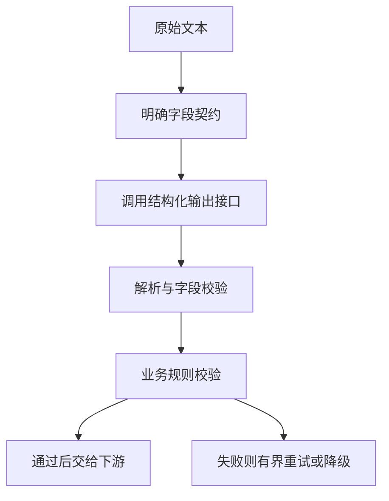

# 04. 让大模型稳定输出 JSON

> **场景引入**：用户说“我叫小明，今年 18 岁”。程序期待 `name` 是字符串、`age` 是整数；模型却可能返回说明文字、代码块，或把年龄写成字符串。

> 对应原稿：[04-让大模型稳定输出JSON](../origanl/04-让大模型稳定输出JSON.md)。原稿标注为主题还原稿，本文只把它当作知识提纲。

---

## 🎯 一句话定位

**稳定输出 JSON 是一条校验链，不是一句“只返回 JSON”。** 先定义字段契约，优先使用模型提供的结构化输出能力，再由程序验证语法、类型和业务含义；失败时重试或降级。

把模型想成一位善于理解语言、但偶尔不按格式交表的同事。提示词像口头叮嘱，JSON Schema 像表格模板，程序校验像收件验收。三者各管一段，不能让“他答应了按格式写”代替验收。

---

## 💎 核心要点概览

| 层次 | 作用 | 不能代替什么 |
| --- | --- | --- |
| 字段契约 | 说清名称、类型、缺失值和范围 | 不能代替服务端校验 |
| 结构化输出 | 限制返回形状 | 不能保证字段事实正确 |
| 程序校验 | 拒绝非法 JSON 与不合约字段 | 不能凭空补出缺失事实 |
| 失败处理 | 有界重试或降级 | 不能无限“修”到看似合法 |

---

## 🚀 核心总结

> **稳定 JSON = 明确契约 + 接口约束 + 程序验收 + 失败兜底。**

---

## 一、先看一个小例子

输入：“我叫小明，今年 18 岁。”期望得到：

```json
{"name":"小明","age":18}
```

程序可能收到 `好的，结果是：{"name":"小明","age":18}`、带 Markdown 代码块的文本，或 `"age":"18"`。第一种不能直接解析，第二种需要额外剥离标记，第三种能解析却违反了字段类型。**“合法 JSON”与“符合业务契约”是两道不同的门。**

## 二、四层防线怎样分工

| 层次 | 具体做法 | 能解决什么 | 仍需注意 |
| --- | --- | --- | --- |
| 任务说明 | 写清字段、类型、缺失值规则，给一两个例子 | 降低理解偏差 | 提示词是软约束 |
| 模型接口 | 优先使用提供的结构化输出或 Schema 约束 | 限制格式与部分字段错误 | 各厂商能力不同；拒答、截断仍需处理 |
| 程序校验 | 解析 JSON，检查字段、类型、范围、枚举 | 拦住不能用的数据 | 语法正确不代表事实正确 |
| 失败处理 | 有界重试、降级、人工核对或返回明确错误 | 避免单次异常破坏流程 | 不要无限重试，也不要暗中编造缺失值 |



### 1. 把字段契约写完整

对这个例子，至少说清楚：`name` 是非空字符串，`age` 是整数；原文没提年龄时输出什么；“我今年十八”是否转换为 `18`；多个姓名出现时取谁。契约越模糊，模型输出越容易看似合理、实则不能用。

例如选择“缺失年龄时为 `null`”，那么字段就应允许 `integer | null`。如果定义为必填整数，却又要求模型“不知道就留空”，两条规则本身打架。

### 2. 区分 JSON Mode 与 Schema 约束

不同服务商的接口名称和保证范围可能不同。一般来说，JSON Mode 重点保证输出能按 JSON 语法解析；Schema 约束还会尝试限制字段名、类型和结构。调用前要核对具体接口文档，不要只看名字就推断它能保证业务正确。

即使接口按 Schema 输出了 `{"name":"小明","age":18}`，也还要确认“18”确实来自输入文本，而不是模型猜的。**结构化输出保证形状，业务校验保证可用性，事实核对保证来源。**

### 3. Prefill 只是可选技巧

原稿提到在 assistant 回复开头预填 `{"name":`，引导模型续写。这只适用于支持此类消息续写的接口，可作为格式引导手段；它不能替代 Schema 和程序校验。有些接口直接不支持这种写法，强行套用反而会报参数错误。

### 4. 失败时谨慎修复

可以有针对性地去掉模型额外套上的代码块，但不要把任意错误 JSON 都“自动修好”后直接执行。例如把 `"age":"18"` 转成整数看似容易，可如果模型输出 `"age":"十八岁左右"`，转换规则就需要业务定义。对于支付金额、权限范围等敏感字段，静默修复尤其危险。

失败处理建议记录**失败类别**：语法错、字段缺失、类型错、业务校验失败、响应截断、模型拒答。重试只对可能恢复的错误有用，且设置次数和超时上限；反复失败时返回明确状态，不向下游传一个“差不多”的对象。

## 三、Go 侧最小验收示例

下面的代码只演示语法、字段和简单业务规则校验；实际项目还需按来源文本核对提取结果。

```go
package main

import (
	"encoding/json"
	"errors"
	"io"
	"strings"
)

type Person struct {
	Name string `json:"name"`
	Age  *int   `json:"age"`
}

func parsePerson(raw string) (Person, error) {
	dec := json.NewDecoder(strings.NewReader(raw))
	dec.DisallowUnknownFields()

	var p Person
	if err := dec.Decode(&p); err != nil {
		return Person{}, err
	}
	var extra any
	if err := dec.Decode(&extra); err != io.EOF {
		return Person{}, errors.New("JSON 后存在多余内容")
	}
	if strings.TrimSpace(p.Name) == "" || p.Age == nil || *p.Age < 0 || *p.Age > 150 {
		return Person{}, errors.New("字段不满足业务规则")
	}
	return p, nil
}
```

这里用 `*int` 区分“年龄缺失”和“年龄为 0”。如果业务允许缺失年龄，需要把契约与校验规则一起改为允许 `null`。**字段如何表示缺失，必须在契约中先说清楚。**

## 四、常见误区

- **只改提示词。** 提示词能降低错误概率，不能给下游程序提供确定性保证。
- **只验证能否 `JSON.parse`。** `{"age":"18"}` 是合法 JSON，但类型可能不符合约定。
- **认为 Schema 解决了所有问题。** 字段类型正确，提取内容仍可能与原文不符。
- **无条件自动修复。** 修复可能掩盖模型的真实错误，并改变业务含义。
- **失败就一直重试。** 应有次数、时限和最终降级路径。

## 五、面试口述版

> 我会先定义字段契约，包括类型、必填项和缺失值规则；调用时优先使用模型原生的结构化输出能力。返回后，程序再做 JSON 解析、字段类型和业务范围校验，并核对关键字段是否有输入依据。遇到代码块等轻微格式问题可做受控清洗；遇到缺字段、截断或事实不明，做有界重试或返回待核实状态。Prefill 只能作为支持该能力时的辅助技巧，不能代替校验。

## 六、深度追问与自测

1. `{"name":"小明","age":"18"}` 为什么“能解析”仍不等于“能入库”？
2. 原文未提供年龄时，你会如何设计输出契约？
3. 模型输出了符合 Schema 的错误姓名，哪一层能发现？

**一句话带走：模型负责生成候选结果，程序负责决定它能不能被信任和使用。**

---

## 七、生产环境 Checklist

- [ ] Schema 明确字段、类型、必填、枚举、缺失值和范围。
- [ ] 调用前确认所选模型与接口是否支持对应结构化模式。
- [ ] 返回后分别检查 JSON 语法、Schema、业务规则与事实来源。
- [ ] 截断、拒答、字段缺失和超时都有明确处理路径。
- [ ] 下游只接收通过校验的对象，关键错误可追溯。

---

## 八、总结（一句话带走）

> **JSON 格式正确只是第一关；结构和事实都验收通过，结果才能进入业务流程。**
