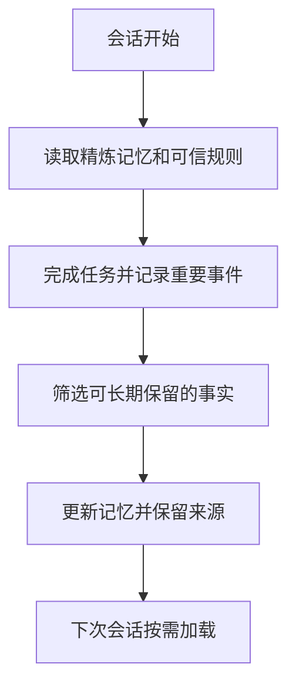

# 05. Agent 记忆不用向量库？试试文件式方案

> **场景引入**：一个长期陪你做项目的 Agent，需要记住“接口字段不能随意改”，但不应把每次聊天都塞进上下文，更不能把“订单已退款”只记在便签里。

> 对应原稿：[05-Agent记忆不用向量库试试文件式方案](../origanl/05-Agent记忆不用向量库试试文件式方案.md)。原稿标注为主题还原稿，本文按其核心观点重新组织。

---

## 🎯 一句话定位

**少量、重要、需要人能读懂的长期信息，可以先用文件保存。** 例如用户偏好、项目约定、曾经踩过的坑。大量外部资料需要语义检索时，再考虑向量检索。选型依据是“要记什么、怎么找、规模多大”，不是“Agent 就必须有向量库”。

但要划清边界：**记忆文件是给 Agent 参考的上下文，不能代替订单、支付、审批等关键业务状态的权威记录。**

---

## 💎 核心要点概览

| 要记的内容 | 推荐载体 | 读取方式 |
| --- | --- | --- |
| 少量稳定偏好与约定 | 精炼 Markdown 或结构化文件 | 开始任务时加载 |
| 过程与历史事件 | 按日期/任务归档的日志 | 需要时检索 |
| 海量参考资料 | 文档库与全文/向量索引 | 按问题召回 |
| 订单、支付、审批状态 | 权威业务系统 | 实时查询与核对 |

---

## 🚀 核心总结

> **把“方便 Agent 回忆的内容”和“必须以业务系统为准的事实”分开管理。**

---

## 一、用人的记事方式理解

想象你在带一个长期项目：

- 一张贴在桌前的便签，写“用户喜欢简洁回答”“接口字段名不能改”。这像核心记忆文件。
- 一本按日期写的工作日志，记每天发生的事。这像原始日志。
- 一整间档案室，放所有合同和产品手册。这像外部知识库。

每天开工先看便签，遇到问题再查日志；查几万份合同则需要专门的索引。把所有聊天记录贴满桌子，便签就失去作用；把一条必须执行的付款状态只写在便签上，则有安全风险。

## 二、按信息用途选择存放方式

| 信息 | 例子 | 合适的存放方式 |
| --- | --- | --- |
| 精炼长期记忆 | 用户偏好、项目约定、重要设计决策 | 可读的 Markdown 或结构化小文件 |
| 历史过程 | 某日尝试过什么、失败原因、讨论记录 | 按日期或任务归档，按需检索 |
| 业务权威状态 | 退款是否完成、审批是否生效、任务当前步骤 | 数据库或可靠的业务系统 |

外部产品手册、PDF、制度文件属于第四类：它们是**参考知识**，当规模大且提问方式多样时，关键词索引、向量检索或混合检索更合适。不要把“Agent 的自身记忆”和“供 Agent 查询的知识库”混成一件事。

## 三、一个可落地的文件目录

```text
memory/
  MEMORY.md             # 少量、稳定、会话开始时加载的事实
  decisions.md          # 重要决策及理由
  logs/
    2026-11-04.md       # 当日事件记录
  archive/              # 过期但仍需保留的历史记忆
```

这只是示意，文件名本身没有魔法。真正重要的是每条记忆写清楚：**内容、来源、更新时间、适用范围、是否仍有效**。例如：“用户偏好简短回答；来源：2026-11-04 的明确要求；适用于技术说明；直到用户另有指示。”

`RULES.md` 之类的规则文件应由可信的人维护，不能让外部文档或陌生网页随便改写。用户偏好也可能随时间变化，更新时应保留来源并处理冲突。

## 四、运行流程：读取、记录、沉淀、清理



### 1. 启动时只加载精炼部分

`MEMORY.md` 应像“项目首页”，能在短时间内读完。它记录长期有效、对后续决策有帮助的信息，不是完整聊天记录。内容太多会挤占上下文，也会让旧事实压过新要求。

### 2. 运行时记事实，不记一切

日志可以记录“做了什么、结果如何、为什么改变做法”，但不必把每个模型输出、每句寒暄都写进长期记忆。涉及个人信息或密钥的内容要按项目要求脱敏、限制访问，不能因为是本地文件就默认安全。

### 3. 定期沉淀与清理

从日志里挑选稳定事实，写进核心记忆；给过时内容标记失效或移到归档。遇到冲突时，优先看明确、较新的权威来源。例如用户今天明确修改偏好，就不应再沿用去年日志中的旧偏好。

### 4. 回溯时按需找

少量文件可以靠文件名、目录和关键词查找；文件多了再加全文索引。直接读取 `MEMORY.md` 不会发生向量召回漏记，但如果你忘了加载某个日志文件，仍然会漏信息。**文件式方案降低了系统复杂度，并没有消除检索与治理问题。**

## 五、什么时候选文件，什么时候增加检索能力？

| 场景 | 建议 |
| --- | --- |
| 个人、本地、小团队 Agent；几十条关键偏好与约定 | 先用文件，人工能检查和修改 |
| 日志逐渐变多，主要按名称、日期、关键词查找 | 文件加全文索引即可 |
| 大量文档、表达方式多样、需要跨文档语义查找 | 增加向量或混合检索 |
| 多用户并发修改、强权限隔离、关键状态需要事务保证 | 用数据库或专门状态服务承载权威数据 |

这些是设计判断，不是固定数量阈值。应根据加载成本、查找命中率、并发需求和维护成本决定何时升级。

## 六、常见误区

- **“文件记忆就是把所有对话写进一个 Markdown。”** 这样只会把上下文塞满，还容易保留过时信息。
- **“文件没有召回误差。”** 直接读到的内容不会被向量检索漏掉，但按需找历史文件仍可能漏查。
- **“记忆能代替任务状态。”** 付款是否完成必须查业务系统，不能依据一段聊天摘要。
- **“有了向量库就不必整理记忆。”** 向量库负责检索，内容是否准确、过期、冲突仍需治理。

## 七、面试口述版

> 我会先区分 Agent 的长期记忆和外部知识库。少量偏好、经验、设计决策适合用可读文件保存，启动时加载精炼摘要，执行过程记日志，再定期沉淀、清理过期信息。文件多了可加全文索引；海量资料需要语义检索时再接向量或混合检索。退款、审批等关键业务状态必须由数据库或业务系统作为权威来源，不能只存在记忆文件里。

## 八、深度追问与实践

1. “用户喜欢简洁回答”和“订单已退款”为什么不该以同样方式保存？
2. `MEMORY.md` 越写越长，你会按什么标准决定保留或归档？
3. 今天用户的明确要求与旧记忆冲突时，系统应怎样处理？

**动手练习：**选一个自己的项目，写一份不超过一页的 `MEMORY.md`，只收录下次开始工作必须知道的事实，并为每条事实标上来源和更新时间。

**一句话带走：记忆的价值在于准确、可用、可更新，不在于存储技术有多复杂。**

---

## 九、生产环境 Checklist

- [ ] 核心记忆足够精炼，每条都有来源、时间和适用范围。
- [ ] 历史日志与核心记忆分开，过期内容能归档或删除。
- [ ] 新的明确要求可以覆盖旧偏好，冲突可追溯。
- [ ] 外部知识库与个人记忆分开，并按权限检索。
- [ ] 订单、支付、审批等关键事实从权威系统实时读取。

---

## 十、总结（一句话带走）

> **文件式记忆适合少量可读的长期事实；规模、并发和业务权威性决定何时改用索引或数据库。**
