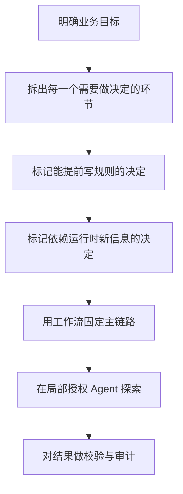

# 08. Agent 和工作流怎么选？关键看决策权

> **场景引入**：报销审批有固定节点；出差路线遇到航班晚点后可能改查高铁。两者都可能用模型，但下一步由谁决定，架构就不同。

> 对应原稿：[08-Agent和工作流怎么选？关键看决策权](../origanl/08-Agent和工作流怎么选？关键看决策权.md)。

---

## 🎯 一句话定位

**判断标准是：下一步由预先写好的规则决定，还是由模型根据新信息决定。** 前者是工作流，后者具有 Agent 特征。一个系统完全可以外层采用工作流，在局部加入 Agent。

---

## 💎 核心要点概览

| 问题 | 选型线索 |
| --- | --- |
| 路径能预先列清吗？ | 能：优先工作流，便于审计与复现 |
| 下一步依赖运行时新线索吗？ | 是：局部引入 Agent 探索 |
| 动作有资金或权限后果吗？ | 用确定性规则与授权机制把关 |
| 两种方式能一起用吗？ | 可以，工作流管主链路，Agent 管局部不确定性 |

---

## 🚀 核心总结

> **把决策权交给最合适的一层：稳定规则写成流程，不确定选择限定在 Agent 的授权范围内。**

---

## 一、用出差订票理解两种方式

报销流程规定“提交票据 → 校验金额 → 主管审批 → 财务付款”，分支条件也事先写好。这是工作流。即使“校验票据内容”用到大模型，流程的决定权仍在程序。

另一种任务是“帮我找一条适合出差的路线”。系统先查航班，发现晚点后改查高铁，再比较到达时间和价格。下一步要等工具结果回来才能定，由模型在边界内选择，这部分是 Agent。

| 维度 | 工作流 | Agent |
| --- | --- | --- |
| 路径 | 节点与允许的分支预先定义 | 运行中依据观察选择下一步 |
| 模型职责 | 完成某些节点的提取或生成 | 参与规划、选择工具和调整路径 |
| 优点 | 容易复现、审计、定位故障 | 能处理事先难以穷举的情况 |
| 主要代价 | 新情况需要修改流程 | 决策可能出错，调用次数和耗时更难预测 |

工作流也可以有复杂分支；Agent 也不等于没有约束。核心差异仍是**路径决定权**。

## 二、三个选型问题

1. **路径能否提前列清？** 规则稳定、分支有限，优先工作流。
2. **运行结果会改变后续步骤吗？** 每一步都可能发现新线索，局部需要 Agent。
3. **哪些决定绝不能交给模型？** 权限校验、资金操作、合规审批等要由确定性规则和授权机制把关。

## 三、混合方案怎样落地

例如客服处理退款：外层流程固定为“核验身份 → 查询订单 → 判断退款资格 → 确认风险 → 执行退款 → 通知用户”。Agent 可以在“查询订单相关信息”环节灵活选择检索工具，并把证据交回工作流。退款资格和最终执行仍由业务规则与权限系统决定。

给局部 Agent 明确四个边界：**可调用哪些工具、最多执行多少步、允许花多少时间与费用、何时必须交还控制权**。没有这些边界，所谓“灵活”会变成难以预测的循环。

落地时先画出确定性步骤，再把无法提前穷举的子任务圈出来。对每个子任务写输入、输出和失败处理；使用真实案例比较纯工作流、混合方案的成功率、耗时与成本，再决定是否扩大 Agent 的决策范围。

## 四、常见误区

- **“用了大模型就是 Agent。”** 模型只在固定节点提取信息时，整体仍是工作流。
- **“工作流只能走直线。”** 它可以有条件分支，只是分支逻辑预先定义。
- **“Agent 越自由越聪明。”** 工具权限、预算和终止条件仍要明确。
- **“只能二选一。”** 很多业务适合固定主流程与局部探索组合。

## 五、面试口述版

> 我先看流程决策权归谁。如果路径和分支能提前写清，就用工作流，即使某些节点调用大模型也一样。若目标明确、但下一步必须依据实时工具结果决定，就在该环节使用 Agent。实际项目常用工作流管主链路和关键约束，让 Agent 处理局部探索，再对其输出做校验和审计。

**自测：**“用大模型识别发票金额，随后按固定审批规则流转”属于哪种结构？如果航班取消后系统必须自主重新规划路线，哪一部分需要动态决策？

**一句话带走：把能写成规则的决定交给规则，把必须探索的决定交给有边界的 Agent。**

---

## 六、落地 Checklist

- [ ] 标出每个节点的决策者：规则、用户还是模型。
- [ ] 能预先穷举的分支已写成确定性流程。
- [ ] 局部 Agent 有明确工具权限、步骤、时间和费用上限。
- [ ] 模型建议进入业务系统前有参数、权限和结果校验。

## 七、总结（一句话带走）

> **工作流管稳定路径，Agent 处理有限的不确定性；两者可以组合。**
