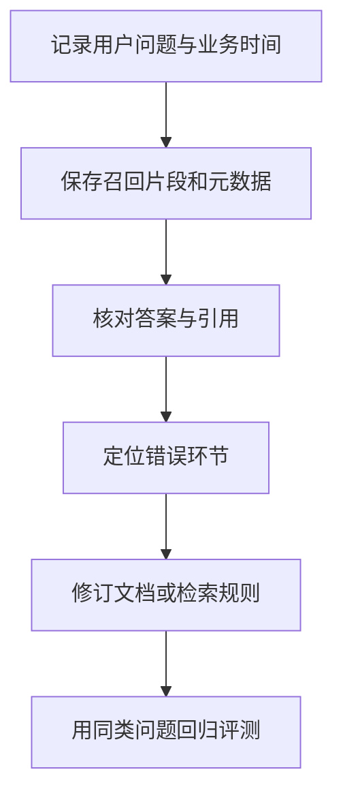

# 09. RAG 准确率越用越差？教你搞定知识库治理

> **场景引入**：上个月的退货期限是 30 天，这个月改为 14 天。两版政策都在知识库里，用户第 20 天来问，系统却引用了旧版。

> 对应原稿：[09-RAG准确率越用越差？教你搞定知识库治理](../origanl/09-RAG准确率越用越差？教你搞定知识库治理.md)。原稿中的准确率变化数字未附评测口径，本文不把它当作可复用结论。

---

## 🎯 一句话定位

**RAG 的资料库需要像代码和制度一样管理版本、生效范围与责任人。** 相似度高只能说明“问法像”，不能证明资料最新、有效或有权回答。

---

## 💎 核心要点概览

| 治理环节 | 要解决的问题 |
| --- | --- |
| 入库 | 记录版本、生效期、适用范围和发布责任人 |
| 检索 | 先确定业务时点与用户范围，再筛选有效资料 |
| 冲突 | 核对权威来源与修订关系，无法裁决时停止确定回答 |
| 反馈 | 按资料、检索、生成三个环节归因并回归测试 |

---

## 🚀 核心总结

> **知识库不是“上传完就结束”的文件夹，而是有版本、责任人和失效规则的数据产品。**

---

## 一、从客服误答看问题根源

上个月的退款政策允许 30 天内退货，这个月改为 14 天。新政策入库了，旧政策却仍可被普通检索命中。用户问“第 20 天还能退吗”，旧文档与问题高度相关，模型可能选错版本，甚至把两版规则拼起来。

问题不在“向量不够聪明”，而在知识库没有告诉检索系统：**哪一版从什么时候起有效、对谁有效、谁有权发布。**

## 二、入库时至少记录什么

| 元数据 | 作用 |
| --- | --- |
| `doc_id`、主题 | 识别同一份资料及其版本族 |
| 版本与发布时间 | 追踪变化；发布时间不等于生效时间 |
| 生效与失效时间 | 按业务发生的时间选择版本 |
| 来源部门、责任人 | 发生冲突时找到权威发布者 |
| 适用范围 | 区分地区、产品、用户群、租户 |
| 状态 | 草稿、待审核、生效、归档、撤销 |

查询时先确定问题的**业务时间和适用范围**，再过滤候选资料。用户问“去年签的合同当时按什么规则”，就不能一律只看今天的最新版本。旧文档可以留档，但普通当前问答应排除或明确标记为历史。

### 冲突怎么处理

同一主题出现两份互相矛盾的文档时，不能仅靠相似度或发布时间猜赢家。需要预先定义权威顺序：例如正式制度高于部门便笺，已审批版本高于草稿；仍无法判定时停止自动回答，交给责任人裁定。**“最新”不总等于“有效”，“同主题”也不总等于“同适用范围”。**

## 三、如何发现资料库在变差

诊断时把错误分开：

1. **资料错。** 旧版本、重复内容、错误 OCR 或错误元数据进入知识库。先治理源文档。
2. **没找对。** 正确资料存在，但过滤、切片或检索没召回。检查检索链路。
3. **找对却答错。** 正确条款已出现，模型忽略了否定词或限制条件。检查重排、上下文组装和回答约束。

记录 Top-K 列表、文档版本、过滤条件、引用片段与最终答案，才能复现错误。相似度分数可辅助排查，但不同检索方式的分数未必可直接比较，也不能单独判断答案正确性。

## 四、一套实用的治理节奏

- **入库前：**检查来源、版本、权限和内容完整性；同主题文档建立版本关系。
- **每次更新：**新版本生效时同步调整旧版本状态，保留历史可追溯性。
- **日常监控：**按主题跟踪错误反馈、无答案率、引用失效和重复召回情况。
- **定期回归：**固定一组典型问题，覆盖新旧政策、例外条款与部门冲突；每次治理后重跑。

治理频率由资料更新速度决定。价格每天变动的库，需要更及时的更新机制；稳定的内部手册可按发布节奏维护。关键是让责任人和触发机制明确，而不只是建几个字段。

## 五、常见误区

- **“继续加文档就会更准。”** 新旧冲突未解决时，更多资料可能增加噪音。
- **“版本号越大就是答案。”** 还要核对生效时间和适用范围。
- **“只看最终正确率。”** 不拆解资料、检索和生成环节，就难以修复根因。
- **“文本相同才算重复。”** 同义改写也可能占满候选位；去重需结合主题和内容含义。

## 六、面试口述版

> 我会把知识库当成持续维护的数据产品。入库时记录版本、生效时间、来源和适用范围；检索时根据问题时间与用户范围过滤，历史版本留档但不混入当前问答。线上记录召回片段、版本和答案引用，出现错误时先区分资料问题、检索问题还是生成问题，再做去重、归档、补充或规则调整，最后用固定问题集回归验证。

**自测：**用户问“去年某政策是什么”，为什么不能只检索最新版本？两份同日发布且结论冲突的文档，系统还缺什么信息才能判定？

**一句话带走：知识库的质量，取决于资料是否有效、检索是否选对、错误是否能闭环修复。**

---

## 七、落地 Checklist

- [ ] 每份文档有来源、版本、生效期、范围和责任人。
- [ ] 新版发布时明确旧版的状态和历史查询方式。
- [ ] 冲突文档不能只按相似度或发布时间自动裁决。
- [ ] 能追踪错误答案引用了哪一版、哪一段原文。
- [ ] 每次修复后都运行覆盖版本和例外场景的回归题。

## 八、总结（一句话带走）

> **RAG 效果变差时，先查资料治理，再按检索与生成环节定位；不能靠持续堆文档掩盖旧版本冲突。**
