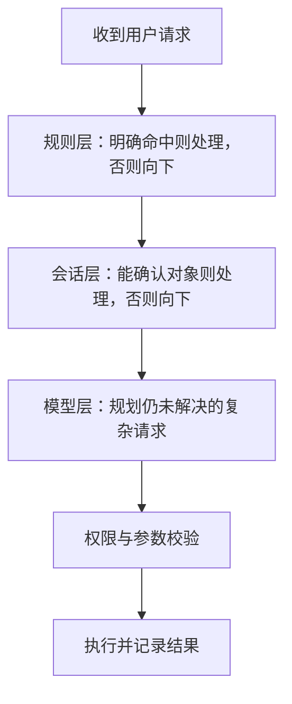

# 10. 别全丢给大模型！Agent 意图分层架构

> **场景引入**：用户说“那取消吧”。如果只匹配“取消”两个字，系统可能把停止对话、取消订单和撤销退款申请混成同一件事。

> 对应原稿：[10-别全丢给大模型！Agent意图分层架构](../origanl/10-别全丢给大模型！Agent意图分层架构.md)。原稿中的流量占比与延迟数字没有统一测试条件，本文只保留分层思路。

---

## 🎯 一句话定位

**意图识别应按请求难度逐层处理。** 明确且稳定的指令用规则；需要理解“那个”“继续”等指代的请求结合会话状态；确实要探索、拆解或调用多种工具时，再用大模型。每层都要允许“我不确定”，把请求交给下一层或人工。

像医院分诊：挂号台处理明确事项，普通门诊根据病历看常见问题，复杂病例转专家。系统不是为了追求“所有请求都让最强模型看一遍”，而是让每种请求得到足够且合适的处理。

---

## 💎 核心要点概览

| 层次 | 擅长处理 | 放行条件 |
| --- | --- | --- |
| 规则层 | 固定、低歧义指令 | 精确命中且无业务冲突 |
| 会话状态层 | “那个”“继续”等指代 | 对象和当前任务都明确 |
| 模型与工具层 | 需要探索与多步规划的任务 | 规划受权限和预算约束 |
| 执行层 | 真正调用外部系统 | 重新校验参数、风险与授权 |

---

## 🚀 核心总结

> **先用确定性方法处理明确请求，再把不确定部分交给模型；识别意图不等于获准执行。**

---

## 一、三层分别做什么

| 层 | 适合的请求 | 判断依据 | 不该做的事 |
| --- | --- | --- | --- |
| 规则层 | “转人工”“打开设置”等固定指令 | 明确匹配、低歧义 | 用宽泛关键词误伤其他请求 |
| 会话状态层 | “那笔退款到哪了”“那取消吧” | 当前任务、对象、已收集参数 | 只看最后一句就猜对象 |
| 大模型与工具层 | “分析上月消费并生成报表” | 需要多步规划或跨工具处理 | 绕过权限与业务校验直接执行 |

这是从上到下的**判断顺序**，不是每条请求都走完所有层。上层若能可靠处理，就直接返回；无法确认时再向下转。

## 二、最容易出错的指代请求

上一轮用户在查询订单 `A123`，下一句说“那取消吧”。如果只匹配“取消”，可能错把“取消对话”“取消订单”“取消退款申请”混为一谈。状态层至少要知道：当前活跃任务、目标对象、已经确认的操作、会话是否过期。

即使上下文指向 `A123`，取消订单仍可能有副作用。系统可以先识别意图和对象，再按风险等级要求确认或交给业务规则判断。**识别到意图，不等于获得执行权限。**

## 三、怎样设计每层的“放行”条件

1. **规则层：宁可少收，也别误收。** 只放高频、稳定、表达清楚的指令；每加一条规则检查与旧规则是否冲突。规则输出应带命中依据。
2. **会话层：显式维护状态。** 记录任务、对象、参数与更新时间；多个任务并存时要求用户澄清指代。状态过期要清理，不能把很久以前的订单当作“那个”。
3. **模型层：限定动作范围。** 给出允许的工具、参数 Schema、最大步骤和超时；工具执行前再验证身份、权限、业务条件。

“置信度 0.8 才执行”不是万能规则。不同层的分数含义可能不同，应拿真实标注请求做校准；高风险操作要求更高的确定性和更严格的确认方式。

## 四、如何证明分层真的有价值

把线上请求按类型抽样标注，至少比较四组指标：意图识别准确率、错误路由率、各层延迟与费用、最终任务成功率。只看“有多少请求被规则层拦住”会鼓励规则过度匹配，反而增加错单风险。

记录每次走过的层、退出理由、引用的会话状态和最终动作。发现某类请求大量进入模型层时，先看它是否真的复杂；只有表达稳定、风险可控的类型，才适合上移到规则层。

## 五、常见误区

- **规则越多越省钱。** 规则冲突与误路由也有维护和事故成本。
- **会话历史越长越准确。** 过期、跨任务的旧内容可能污染意图。
- **模型能理解就能执行。** 业务权限和确认必须由系统单独控制。
- **固定流量比例适用于所有业务。** 各层占比取决于真实请求分布与风险要求。

## 六、面试口述版

> 我会做分层路由：明确、稳定的高频指令先由少量规则处理；依赖指代和多轮信息的请求，结合显式会话状态识别；复杂复合目标才进入大模型规划和工具层。每层都设置拒识或转交机制，模型只获得有限工具权限。上线后同时监控错误路由、任务成功率、P95/P99 延迟和成本，用标注样本调阈值，避免为了省模型调用而把复杂请求错分到规则层。

**自测：**用户说“那取消吧”，你至少需要哪三类上下文？为什么“识别为退款”还不足以调用退款接口？

**一句话带走：把算力用在需要判断的地方，把关键操作留给可靠的业务约束。**

---

## 七、落地 Checklist

- [ ] 规则层只收低歧义指令，并可解释命中依据。
- [ ] 会话层能确认目标对象、任务状态和上下文是否过期。
- [ ] 模型层有工具、轮数、费用和超时边界。
- [ ] 所有写操作由执行层再次验证权限与参数。
- [ ] 用错误路由率和最终任务成功率评估分层，而非只看节省的模型调用。

## 八、总结（一句话带走）

> **分层的目的，是让明确请求走短路，让复杂请求获得足够判断，并让所有执行动作守住权限边界。**
