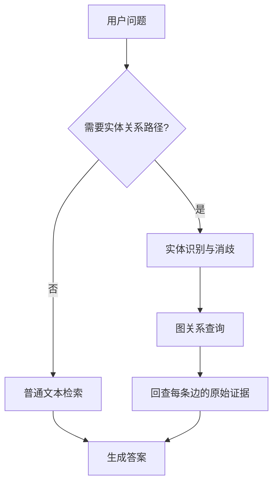

# 100. 什么场景值得考虑 Graph RAG

> **场景引入**：问“张三通过哪条汇报链到王五”，需要关系路径；问“价格低于 3000 的商品”，普通结构化查询可能更简单。

> 对应[原始材料](../origanl/100-什么场景必须用GraphRAG.md)。标题中的“必须”不准确：是否建图应由基线方案与评测结果决定。

---

## 🎯 一句话定位

Graph RAG 适合需要显式实体关系、路径查询或跨文档多跳证据的任务。普通 RAG 擅长找相关片段；但若问题依赖“谁属于谁、谁通过什么关系影响谁”，图结构更容易表达和检查。图谱建设有抽取、消歧、更新和权限成本，不能因为问题复杂就默认建图。

---

## 💎 核心要点概览

| 问题特点 | 是否值得评估图结构 |
| --- | --- |
| 多跳实体关系 | 值得验证 |
| 路径解释与关系溯源 | 值得验证 |
| 单字段过滤或简单问答 | 先用普通查询/检索 |
| 资料频繁更新 | 需计入图维护成本 |

---

## 🚀 核心总结

> **Graph RAG 适合关系型问题，不是“复杂问题”的万能默认方案。**

---

## 一、四类候选场景

组织层级、供应链依赖、关联交易和跨文档事件链常需要实体路径。全局主题分析也可能利用图社区摘要，但并非唯一方案；分层摘要或多轮检索可能更便宜。商品推荐中“影像好、续航长”只是多条件筛选时，关系数据库与结构化过滤往往更直接，不必强行转 Graph RAG。

## 二、先做基线实验

收集单跳、多跳、别名、时间变化和无答案问题。比较普通 RAG、迭代检索、数据库关系查询及图谱方案的正确率、证据可追溯性、延迟与维护成本。建图时每个节点和边都保留来源、时间和权限；抽取错误必须可纠正，旧关系要能失效。

**面试口述：**“多跳关系与实体路径是 Graph RAG 的强项，但我会先用普通检索和结构化查询建基线。只有图结构在真实问题上带来可验证收益，才承担建图和维护成本。”

**自检：**用户问‘价格低于 3000 且重量小于 1.5 kg 的商品’，一定需要知识图谱吗？

---

## 三、建图 Checklist

- [ ] 问题确实依赖实体关系与多跳路径。
- [ ] 普通检索或结构化查询基线已测。
- [ ] 实体消歧、关系来源、时间和权限可治理。
- [ ] 图带来的质量收益超过建图与维护成本。

## 四、总结（一句话带走）

> **先验证问题需不需要关系图，再承担图谱治理成本。**
