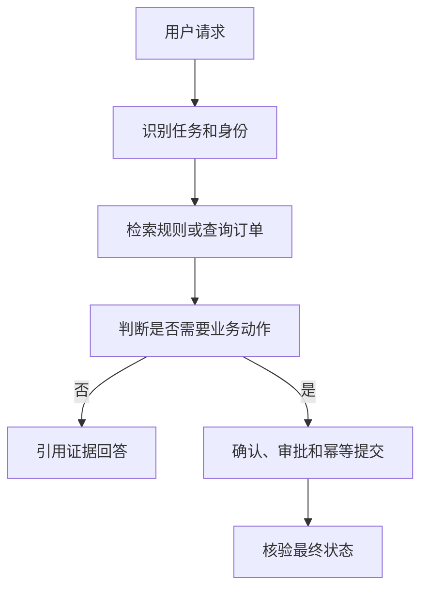

# 101. 电商客服 Agent：项目功能清单与验收

> **场景引入**：客服系统能回答退货规则，用户接着问“我的订单退了吗”。若模型不查实时订单就说“成功”，演示看似流畅，业务结果却可能完全不同。

> 对应[原始材料](../origanl/101-手把手带你开发电商客服Agent.md)。原稿是课程推广，课程资料数量与“可上线”承诺不等于项目质量证据。

---

## 🎯 一句话定位

**电商客服项目要把规则问答、实时查询和售后写操作分开设计，并分别验收。**

---

## 💎 核心要点概览

| 任务 | 主要来源或控制 |
| --- | --- |
| 规则问答 | 现行制度与引用 |
| 订单/物流查询 | 鉴权后的实时 API |
| 售后申请 | 对象确认、权限、审批与幂等 |
| 完成判断 | 实际业务状态与 Trace |

---

## 🚀 核心总结

> **功能列表只是范围，真实业务结果与失败处理才是验收。**

---

## 一、项目要完成什么

把客服能力拆成规则问答、订单查询、物流查询和售后申请四类。前三类以读取为主，最后一类会改变业务状态。模型只负责理解用户和组织回复；所有个人数据读取与写入由业务服务鉴权。

## 二、验收别只看演示

规则问答要给出文档版本；订单查询要阻止跨用户访问；物流接口失败要如实提示；退款申请必须展示对象、金额和条件，重复点击不得重复提交。保留任务 trace 和回归集，至少覆盖缺订单号、旧规则、工具超时、提示词注入与重复请求。

**面试口述：**“我先把客服需求按读写风险拆开，规则走检索，实时状态走鉴权 API，高风险写操作经确认与幂等提交。用结果和执行轨迹双重验收。”

**自检：**模型回复“退款成功”，业务接口未写入，项目验收能通过吗？

---

## 三、项目 Checklist

- [ ] 每种任务有明确的数据来源。
- [ ] 个人订单读取前完成鉴权。
- [ ] 写操作经确认、审批与幂等提交。
- [ ] 接口结果与用户回复一致。

## 四、总结（一句话带走）

> **客服 Agent 的交付标准是答得有据、查得准确、操作可控。**
