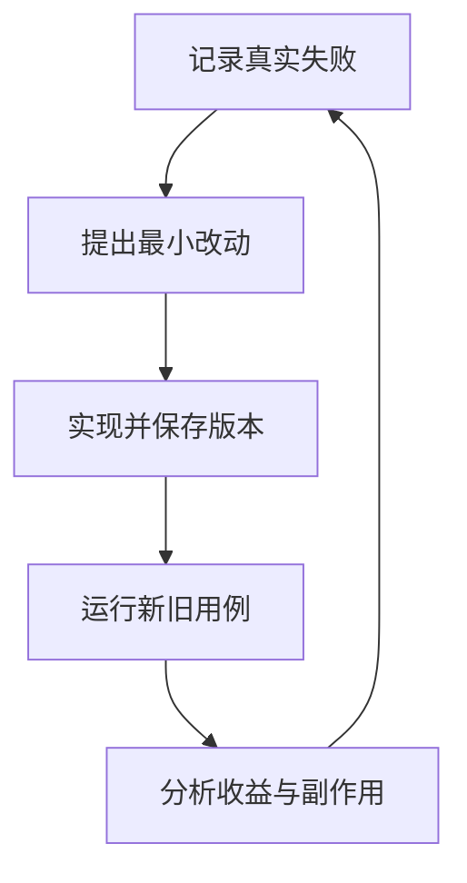

# 102. 如何用版本迭代学会 Agent 设计

> **场景引入**：从闲聊客服到可查订单、可申请退款，每加一项能力都可能修复旧问题，也可能引入新风险。迭代次数本身不能证明进步。

> 对应[原始材料](../origanl/102-40次迭代带你手写电商客服Agent.md)。原稿强调课程的“40 次迭代”；次数本身并不重要，关键是每次迭代可解释、可验证。

---

## 🎯 一句话定位

**每版围绕一个明确失败做最小改动，并用旧用例与新用例共同验收。**

---

## 💎 核心要点概览

| 版本记录 | 要回答的问题 |
| --- | --- |
| 原始故障 | 用户遇到了什么错误 |
| 修改方案 | 为什么选这个最小改动 |
| 新版验收 | 问题是否得到解决 |
| 回归结果 | 旧能力是否仍然正常 |

---

## 🚀 核心总结

> **迭代价值由问题与证据决定，不由版本数量决定。**

---

## 一、一次迭代只解决一个主要问题

例如第一版只会闲聊；第二版发现售后规则常答错，于是接入可溯源检索；第三版发现订单信息不是静态文档，于是接只读 API；第四版发现退款可能产生资金风险，于是加入人工确认和业务幂等。每一步都保留旧版本的失败样例和新版本的验证结果。

## 二、版本说明模板

写清“用户场景、旧版失败、根因假设、代码修改、回归结果、遗留风险”。例如模型编造物流轨迹，根因可能是缺实时数据；仅改提示词不足以证明问题解决，应新增物流工具并测试接口超时。新版本若改善物流问答却破坏订单权限，不能称为成功。

独立项目不需要刻意凑 40 个提交。选少量有实际业务理由的版本，逐步加入 trace、成本统计和人工接管，就能形成可解释的项目演进故事。

**面试口述：**“我按失败驱动迭代，每版只加必要能力，保留旧用例回归，并说明新能力的成本与风险。”

**自检：**改动后只展示一个成功截图，能证明没有回归吗？

---

## 三、迭代 Checklist

- [ ] 每个版本有独立的失败样例与改动目的。
- [ ] 新旧用例都通过回归。
- [ ] 记录新能力的时延、费用和风险。
- [ ] 面试时能复现至少一次故障与修复过程。

## 四、总结（一句话带走）

> **版本多不等于工程深；能解释每一步改动才是成长。**
