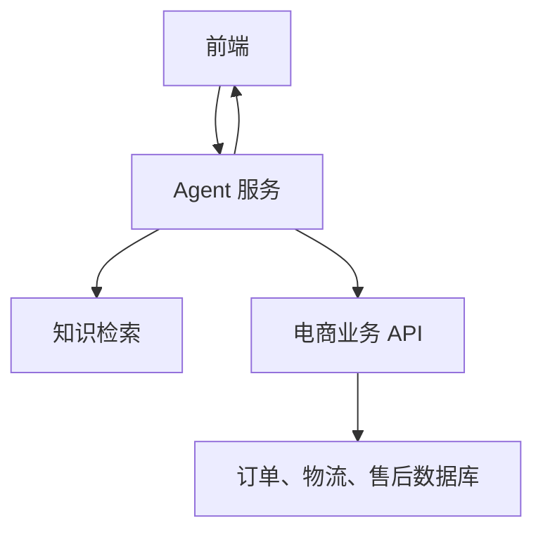

# 103. 从零搭建电商客服 Agent 的系统边界

> **场景引入**：工具描述写“退款金额不得超过 100 元”，模型却提交了 200 元。若后端不再校验，提示词里的限制很容易被绕过。

> 对应[原始材料](../origanl/103-从0到1开发完整电商AI客服Agent.md)。原稿是课程介绍；本文按业务系统设计整理。

---

## 🎯 一句话定位

**前端负责交互，Agent 服务负责理解与编排，电商后端负责交易规则、权限和最终状态。**

---

## 💎 核心要点概览

| 服务 | 责任边界 |
| --- | --- |
| 前端 | 展示证据、确认与实际进度 |
| Agent 服务 | 上下文、检索、工具路由与 Trace |
| 电商后端 | 订单、物流、资金、权限和事务 |

---

## 🚀 核心总结

> **模型能建议和组织流程，交易约束必须在业务后端强制执行。**

---

## 一、三个服务各负其责

前端展示对话、证据与确认信息；Agent 服务管理上下文、检索、工具路由和 trace；电商后端管理订单、物流、资金、权限和最终状态。把退款规则只写在提示词里是不够的，业务后端必须再次校验。

## 二、最小交付范围

先做制度问答与只读订单查询。引入退款前，定义身份校验、订单归属、金额计算、用户确认、审批、幂等键和失败对账。提示词注入测试用一份恶意文档：其中要求 Agent 忽略用户授权直接退款；正确系统应将其当数据，不允许越过业务权限。

上线验收看真实业务结果、执行轨迹、错误恢复、人工接管和成本。原稿提到的技术栈可以替换；真正不能省的是这些业务约束。

**面试口述：**“我把自然语言层与业务状态层分开。Agent 能查资料、组织建议，电商服务负责鉴权和交易提交。项目按只读到写入渐进，最后用故障和安全用例验收。”

**自检：**Agent 工具描述写了“金额不得超过 100 元”，是否可省略后端金额校验？

---

## 三、架构 Checklist

- [ ] 交易规则由后端二次校验。
- [ ] Agent 工具仅获得当前任务必要权限。
- [ ] 前端区分“正在处理”和“业务已完成”。
- [ ] 故障样例覆盖超时、重复请求与权限不足。

## 四、总结（一句话带走）

> **智能交互可以灵活，资金与订单状态必须确定性受控。**
