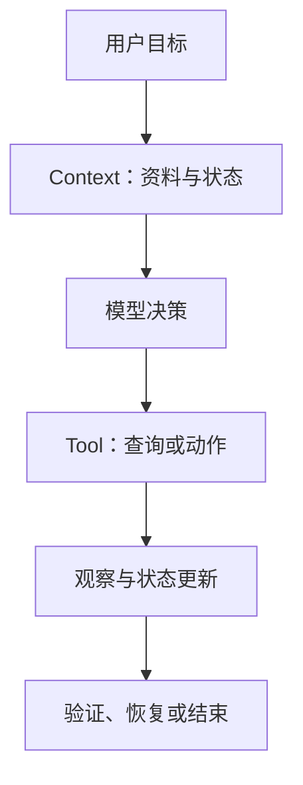

# 104. 把 Agent 知识点串成一条执行链

> **场景引入**：会说 RAG、MCP、记忆和评估各自是什么，仍可能不知道“检索到旧规则”是在任务链的哪一环出错。

> 对应[原始材料](../origanl/104-告别碎片化！动画图解Agent开发.md)。原稿为课程推广，本文把“避免碎片化”的方法转成自学图谱。

---

## 🎯 一句话定位

**用一条用户请求链把数据、模型、工具、反馈和验证连起来，再学习各项技术。**

---

## 💎 核心要点概览

| 环节 | 相关能力 |
| --- | --- |
| 获取事实 | RAG、实时工具和记忆 |
| 选择动作 | 模型与规则 |
| 接入外部系统 | 工具或 MCP |
| 处理反馈 | 状态与 Agent Loop |
| 保证质量 | 权限、Trace 与评测 |

---

## 🚀 核心总结

> **名词有价值，是因为它解决执行链上的具体缺口。**

---

## 一、从一次请求看全局

用户提出任务，系统识别目标，组装上下文，模型选择动作，工具返回事实，再验证结果。RAG、MCP、记忆、评估都能放到这条链上的具体位置；脱离问题背名词，很难看出它们解决什么。

RAG 帮 Context 找资料；MCP 是连接部分工具和资源的方式；记忆保存跨轮事实或任务状态；评估回答“做得对不对”；安全护栏限制能做什么。每学一个概念，问三件事：它位于链路哪一步？输入输出是什么？失败后如何发现和恢复？

用一个售后问答项目练习：先手工输入规则，再用检索自动找规则，最后接订单 API。每次只改变一个模块，对比正确性与成本。动画和图适合形成直觉，运行日志和失败用例负责检验理解。

**面试口述：**“我用用户请求链路组织知识：上下文、模型决策、工具、反馈、验证。每个名词都落到输入输出和失败处理上。”

**自检：**RAG 召回了旧规则，这个错误首先属于链路的哪一步？

---

## 二、学习 Checklist

- [ ] 能说出每个模块的输入、输出和失败方式。
- [ ] 知道旧规则、工具超时、错执行分别属于哪一层。
- [ ] 用同一个案例验证组合能力。

## 三、总结（一句话带走）

> **把零散知识点放回执行链，才能理解它们为什么存在。**
