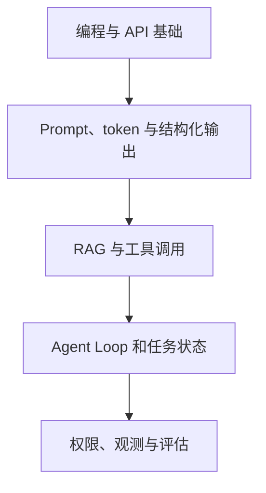

# 105. Agent 系统学习路线：先能力，后框架

> **场景引入**：知道 ReAct 的定义，却不会处理工具超时。此时继续背框架名称，补不了运行时的基础能力。

> 对应[原始材料](../origanl/105-别等了！大模型Agent系统学习路线.md)。原稿包含课程销售与“别等了”的劝购话术；学习时机由个人目标决定。

---

## 🎯 一句话定位

**按程序接口、模型输出、资料与工具、任务状态、权限评测的顺序建立能力。**

---

## 💎 核心要点概览

| 阶段 | 验收题 |
| --- | --- |
| API 基础 | 能处理超时与错误码吗 |
| 模型调用 | 能稳定解析结构化输出吗 |
| 检索与工具 | 能找到证据、查实时事实吗 |
| 状态与安全 | 能恢复任务、限制写操作吗 |
| 评估 | 修复是否经真实样例验证 |

---

## 🚀 核心总结

> **学习顺序服务于真实任务，不受营销节奏或框架热度支配。**

---

## 一、五段学习路线

先掌握 HTTP、JSON 与错误处理，再调用模型 API；随后理解检索与工具，最后处理状态、权限、评估和部署。新框架名称会变，但输入、输出、状态与失败处理仍是基础。

每段都有可检验的产物：API 阶段能调用并记录用量；RAG 阶段能给答案标出原文；工具阶段能处理参数错和超时；Agent Loop 阶段能避免死循环；工程阶段能展示 trace、回归集和业务结果。用同一个小项目贯穿，避免在多个教程间重复搭环境。

不要把课程模块数量当作学习质量。完成一个可复现项目、能解释一次失败及改进，比看完大量视频更能证明能力。

**面试口述：**“我从模型 API 和数据流学起，再做检索、工具、状态与评估，每阶段用同一个业务案例验证。框架按项目需求选择。”

**自检：**只记得 ReAct 的定义，却不会处理工具超时，下一步该练什么？

---

## 二、实践 Checklist

- [ ] 每阶段做出可运行、可解释的成果。
- [ ] 同一项目逐步增加能力并保存失败样例。
- [ ] 工具错误、权限与结果验证均有练习。
- [ ] 新框架只在解决已识别问题时加入。

## 三、总结（一句话带走）

> **先补能运行和排错的基础，再学编排框架。**
