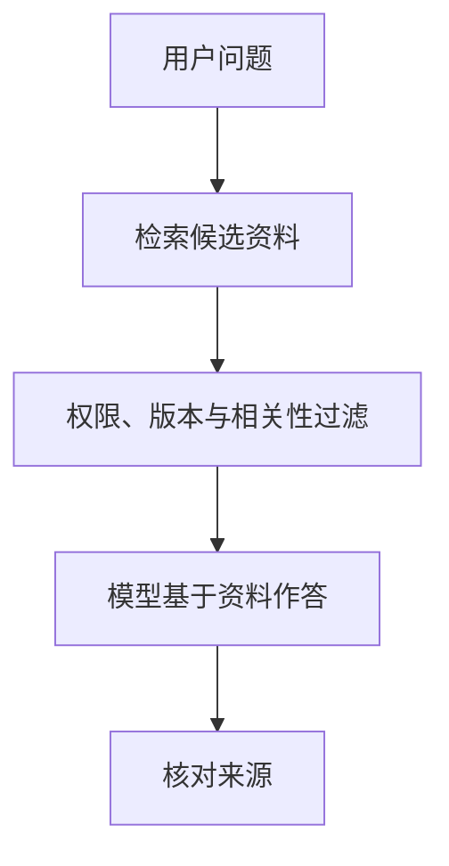
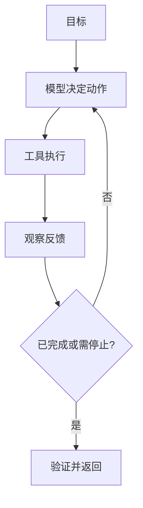

# 106. 图解两个基础闭环：RAG 与 Agent Loop

> **场景引入**：用户问制度内容，先找证据再回答；用户要求完成多步业务操作，还要观察每次工具结果并决定下一步。

> 对应[原始材料](../origanl/106-动画图解大模型Agent应用开发.md)。原稿是课程介绍；本文提供可复述的基础流程。

---

## 🎯 一句话定位

**RAG 解决外部证据获取，Agent Loop 解决根据反馈推进多步目标；两者可以组合。**

---

## 💎 核心要点概览

| 闭环 | 输入 | 输出与验收 |
| --- | --- | --- |
| RAG | 问题和资料库 | 带引用、可核对的回答 |
| Agent Loop | 目标、工具和当前状态 | 可验证动作结果或明确停止 |

---

## 🚀 核心总结

> **找对资料和办成事情是两个不同问题，都需要结果验证。**

---

## 一、RAG：先找证据再回答

把资料解析、分块并建立索引。收到问题时先检索和筛选相关片段，带着来源给模型生成答案，最后核对引用。向量检索是常见方式，但关键词、结构化过滤同样可能重要。

## 二、Agent Loop：观察结果再决定下一步

Agent 收到目标与可用工具，模型决定是否调用工具；应用或托管服务执行，结果返回后再判断。循环必须有目标完成标准、步骤预算和错误退出路径。

两者能组合：Agent 在某一步调用检索工具获取资料。练习时先画出每个箭头传递的数据，再用日志核对实际运行，不要只背“规划、记忆、反思”等标签。

**面试口述：**“RAG 解决外部证据获取，Agent Loop 解决反馈驱动的多步执行。二者可组合，但都要有来源、错误处理和结果验证。”

**自检：**检索返回空结果时，Agent 应继续编造答案吗？

---

## 三、落地 Checklist

- [ ] RAG 的引用能回到原文与版本。
- [ ] Agent 工具结果进入下一步前经过校验。
- [ ] 证据缺失时可拒答或补检索。
- [ ] 动作失败时能停止或接管，不把失败说成成功。

## 四、总结（一句话带走）

> **一个负责“找依据”，一个负责“按反馈做事”。**
