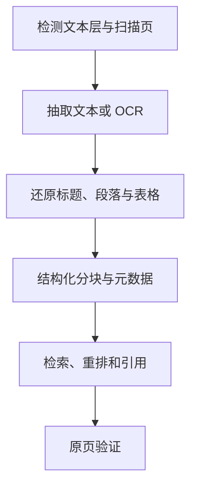

# 107. 面试题：RAG 如何处理复杂 PDF

> **场景引入**：合同“不得退款”的条件跨了两页，扫描 OCR 又可能漏字。面试回答不能只说“抽文本、切 500 字、做向量”。

> 对应[原始材料](../origanl/107-RAG遇到PDF怎么处理？高分回答.md)。与第 75 篇主题相近，这里整理成面试中的排障顺序。

---

## 🎯 一句话定位

识别 PDF 类型，抽取或 OCR，还原阅读顺序与表格，按结构分块，绑定来源和权限，再索引检索，最后核对答案引用。面试官若追问“为什么不能抽文本后直接切 500 字”，重点解释双栏、跨页表格和否定条款会被切乱。

---

## 💎 核心要点概览

| 追问 | 核心回答 |
| --- | --- |
| 扫描件怎么办 | 按页 OCR，抽检关键数字与否定词 |
| 表格怎么办 | 保留表头、单位、行列与跨页关系 |
| 怎样分块 | 按章节和完整语义单元 |
| 怎样证明有效 | 分层测解析、召回与答案引用 |

---

## 🚀 核心总结

> **PDF 入 RAG 的关键是保住结构、条件与可定位来源。**

---

## 一、追问一：扫描件怎么办

OCR 输出必须保留页码、区域位置和置信度。关键金额、日期、合同义务要抽样回看原页；低置信文本不能直接作为确定事实。多模态模型可辅助读图表，但它的解释同样需要核对。

## 二、追问二：表格怎么办

保留表头、行列、单位、脚注和时间范围。长表格可以分块，但每块都带上必要的表头。将“金额 100”与“单位：万元”拆开会造成严重错误。

## 三、追问三：如何证明效果

建立包含文本 PDF、扫描件、双栏、表格和跨页条款的问题集，分别测解析准确、证据召回和答案忠实度。引用应能定位到原页，而不是仅显示文件名。分块长度和模型选择由评测结果决定。

**面试口述：**“PDF 先分类，再做版面与结构还原；按语义单元分块并保存页码、版本和权限。用原页引用验证答案，分层评估解析、检索和生成。”

**自检：**合同“不得退款”跨了两页，分块时要怎样保留条件？

---

## 四、面试 Checklist

- [ ] 先区分文本页、扫描页和混合页。
- [ ] 说明阅读顺序、表格与跨页条款如何恢复。
- [ ] 每个片段可定位版本与页码。
- [ ] 关键 OCR 错误有人工核对或拒答路径。

## 五、总结（一句话带走）

> **解析正确是前提，引用正确才是交付。**
