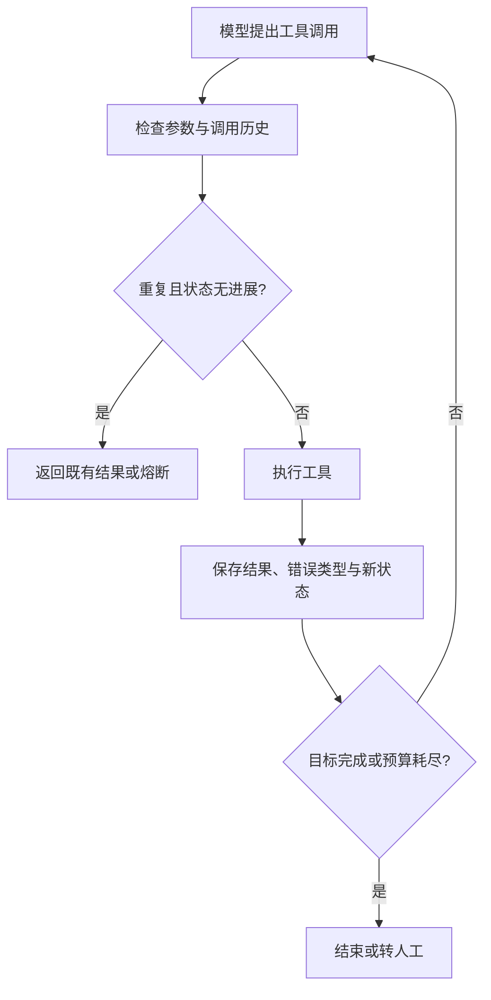

# 108. 工具调用死循环：用进展检测而非只数轮数

> **场景引入**：Agent 用同一参数反复查库存，接口一直返回“服务暂不可用”。它每轮都有动作，却没有任何新事实。

> 对应[原始材料](../origanl/108-智能体工具调用死循环怎么解.md)。

---

## 🎯 一句话定位

Agent 连续用同一参数查询库存，结果一直“服务暂不可用”。可能是工具错误没有明确分类、模型忘记已试过、任务计划存在循环依赖，或模型误以为重复请求会改变结果。只在提示词里写“不要重复”不能可靠解决。

---

## 💎 核心要点概览

| 控制 | 作用 |
| --- | --- |
| 动作指纹 | 识别同参数、同版本的重复调用 |
| 进展检测 | 判断是否得到新事实或状态变化 |
| 错误分类 | 只对可恢复错误有限重试 |
| 总预算 | 到轮数、时间或费用上限就停止 |

---

## 🚀 核心总结

> **真正要拦的是无进展重复，不能只靠“不要死循环”的提示词。**

---

## 一、动作指纹怎么用

记录工具名、关键参数、目标对象、数据版本和上次结果。相同只读查询在数据未变化且缓存有效时可返回旧结果；但不能一律拦截重复调用，库存随时间变化，或第一次超时后允许有限重试。写操作更不能单纯凭参数相同就判断重复，必须用业务幂等键与状态查询。

同时设置总步数、单工具重试、总耗时和成本预算。每轮检查任务是否有新事实、新子任务完成或新状态；连续无进展时停下解释阻塞原因。工具错误应明确“超时”“权限拒绝”“参数无效”，避免模型把所有错误当成可重试。

**面试口述：**“我保存结构化执行轨迹，按工具、参数、版本和结果识别无进展循环。对可重试错误有限重试，对写操作用幂等，另设总预算；达到目标或持续无进展都能退出。”

**自检：**相同库存查询一分钟后是否一定应拦截？取决于哪些条件？

---

## 二、运行 Checklist

- [ ] 记录工具名、参数、对象版本和调用结果。
- [ ] 区分可重试错误与永久错误。
- [ ] 连续无进展时熔断并报告原因。
- [ ] 写操作重试使用幂等键。

## 三、总结（一句话带走）

> **有动作不等于有进展，Agent 必须能识别并停下。**
