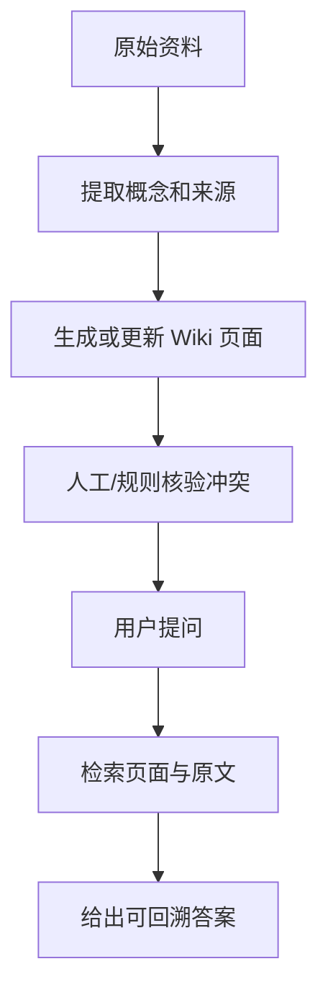

# 109. LLM Wiki：预先整理知识，不等于替代 RAG

> **场景引入**：Wiki 页面把旧政策总结为“7 天可退”，新政策改为 3 天。若页面未更新，回答时直接引用概览会误导用户。

> 对应[原始材料](../origanl/109-告别RAG！带你看懂LLM%20Wiki.md)。原稿关于概念提出者和时间的说法需一手出处；本文将“LLM Wiki”作为一种由模型辅助维护的知识页面方案来讨论。

---

## 🎯 一句话定位

普通 RAG 常在提问时从原始资料检索片段。知识 Wiki 则在资料录入或更新时，先整理主题页、术语页、相互链接和来源；提问时可以读取这些页面，也可以再用 RAG 检索原文。区别是**何时整理资料**，不是“Wiki 出现后就不检索”。

---

## 💎 核心要点概览

| 环节 | 关键要求 |
| --- | --- |
| 入库整理 | 主题页附来源与版本 |
| 更新 | 新旧政策冲突可识别 |
| 查询 | 概览与原文检索组合 |
| 验证 | 关键结论能回到原始资料 |

---

## 🚀 核心总结

> **提前整理知识能提高可读性，但不能省去更新和原文核查。**

---

## 一、为什么不能只信自动整理

模型写的页面是二次解释，可能漏掉例外条件、混淆不同版本。每条重要结论要能回到原始文件，标注生效时间；新增资料与旧页冲突时，不应自动覆盖。知识页面适合浏览和复用，但实时订单状态仍应查业务 API，不能从 Wiki 猜测。

## 二、什么时候值得做

大量反复使用、概念关系复杂的稳定资料，预整理可能节省每次问答的重复理解成本。更新很频繁、资料少或只是一次性问答时，直接检索原文更轻。用真实问题比较回答正确率、整理维护成本、版本延迟和引用可核查性。

**面试口述：**“LLM Wiki 可以在入库阶段把资料整理成可读页面，但回答仍需检索和原文溯源。它与 RAG 是可组合关系，选型看资料复用率与更新成本。”

**自检：**Wiki 页面把旧政策摘要成‘7 天可退’，新政策已改为 3 天，系统该怎样防止旧页误导？

---

## 三、维护 Checklist

- [ ] 页面主张与原文引用相连。
- [ ] 制度更新时能标记旧页面失效或待审核。
- [ ] 冲突内容不被模型自动合并成虚假结论。
- [ ] 用重复查询收益衡量整理成本。

## 四、总结（一句话带走）

> **Wiki 解决知识组织，RAG 解决证据检索；两者都需治理。**
