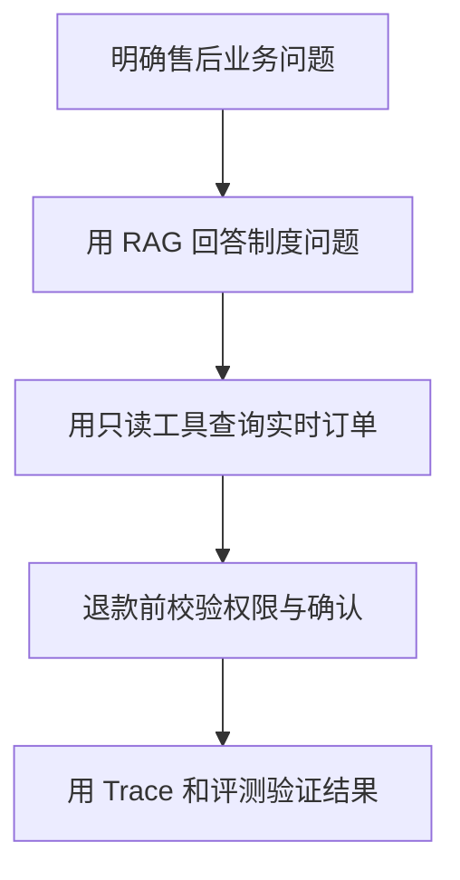

# 11. 有含金量的 Agent 项目，要看哪些标准？

> **场景引入**：一个电商客服 Demo 能回答问题，却在“订单到哪了”“能否退款”时拿不到实时状态，也没有权限和失败处理。这样的项目该怎么改，才有工程价值？

> 对应原稿：[11-有含金量的Agent项目，要看哪些标准-20261021](../origanl/11-有含金量的Agent项目，要看哪些标准-20261021.md)。原稿包含课程推广；本文提炼“怎样判断项目是否值得学、值得写进简历”的方法。

---

## 🎯 一句话定位

**项目的价值不在于用了多少框架，而在于能否从业务问题出发，解释设计取舍，并展示可验证的改进。** 完整成品可以演示，但面试官更关心你遇到什么问题、怎么定位、为什么这样改。

---

## 💎 核心要点概览

| 看什么 | 如何判断 |
| --- | --- |
| 业务问题 | 能说清用户需求、失败表现与验收标准 |
| 迭代证据 | 每版有问题、改动、结果，而非只堆组件 |
| 工程闭环 | 数据来源、权限、异常、追踪和评测齐全 |
| 个人贡献 | 能区分亲自设计与教程复现 |

---

## 🚀 核心总结

> **一份可信项目经历，要能回答“解决了什么、为什么这样做、怎样证明有效”。**

---

## 一、用电商客服项目举例

最初版本只能闲聊。用户问退货期限，模型编造规则；加入 RAG 后能引用售后制度。用户问“我的订单到哪了”，静态文档无法回答；于是接入订单查询工具。用户要求退款，直接让模型调用退款接口有风险；于是加入权限校验、确认、幂等和人工审核。线上又发现偶发错误，才补 Trace 和评测。

这条演进线每一步都有**真实问题 → 方案 → 验证结果**。相比“我用了 RAG、工具调用和工作流”，它更能说明你理解系统。

## 二、判断项目质量的五个维度

| 维度 | 你应能展示什么 |
| --- | --- |
| 前置知识 | 能解释模型、检索、工具调用各自解决什么问题 |
| 迭代过程 | 版本之间有明确的问题、修改和验证记录 |
| 工程质量 | 有错误处理、权限边界、状态管理、观测与评测 |
| 可复现性 | 项目能运行，有样例数据和清楚的启动说明 |
| 可辩护性 | 能说明为什么选当前方案、没选另一种方案的条件 |

原稿把“课程版本多、配有导学 Skill 和模拟面试”列为学习材料卖点。它们可能帮助学习，但**数量本身不证明项目质量**。真正要看的是：每个版本是否解决了可复现的问题，Skill 是否帮助理解而非代写答案，模拟面试能否指出设计漏洞。

## 三、怎样把项目写进简历

采用“业务场景—我的职责—关键设计—可验证结果”的顺序。例如：

> 在电商售后客服项目中负责订单查询与退款链路。针对静态知识与实时订单混用导致的错误，拆分 RAG 问答和业务工具调用；为退款接口加入权限校验、用户确认与幂等键；使用任务日志追踪失败步骤。用覆盖正常退款、重复提交和超时重试的样例验证链路。

如果没有真实指标，就写你实际验证过的范围，不要捏造“准确率提升 80%”。如果只是课程跟做项目，应明确自己改动过的部分；面试追问时，能讲清楚的内容才是自己的成果。

## 四、深度追问：自己评估项目的三个动作

1. 画出请求从用户到最终回答的链路，标出数据来源与副作用。
2. 找出三次有意义的迭代，写明问题、备选方案、选择理由和验证方式。
3. 请别人问你“工具超时怎么办”“检索到旧规则怎么办”“谁批准退款”；答不上来就回项目补足。

**一句话带走：能跑通是起点，能解释取舍、处理失败并验证结果，才是项目含金量。**

---

## 五、实践 Checklist

- [ ] 能画出请求到结果的完整链路，并标记外部副作用。
- [ ] 至少讲清一次真实错误的定位和修复过程。
- [ ] 展示可复现的验收样例，而非无口径的提升数字。
- [ ] 简历准确区分本人工作、团队工作和教程内容。

## 六、总结（一句话带走）

> **项目含金量来自可验证的工程判断，不来自功能数量或课程宣传。**
