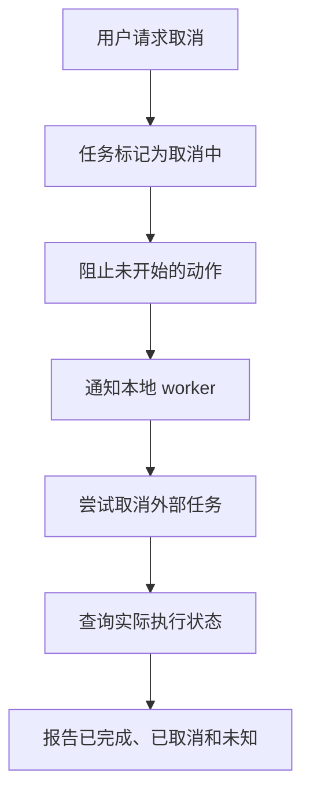

# 111. 用户取消任务：前端停止与后端取消是两回事

> **场景引入**：用户按取消后进度条消失，后台批量生成仍在写文件。前端停止显示和后端停止执行是两个不同事实。

> 对应[原始材料](../origanl/111-用户点了取消，后台为什么还在跑？.md)。Go 服务可参考 [官方 context 取消指南](https://go.dev/doc/database/cancel-operations)。

---

## 🎯 一句话定位

**取消请求要逐层传播到任务与外部操作，并按真实执行状态反馈用户。**

---

## 💎 核心要点概览

| 层 | 取消后需要确认 |
| --- | --- |
| 前端 | 只是停止展示还是收到最终状态 |
| 服务端 | 队列与本地步骤是否停止 |
| 外部系统 | 已提交任务能否撤销，实际完成了什么 |

---

## 🚀 核心总结

> **按钮发出取消意愿，任务状态与外部结果决定最后能否算“已取消”。**

---

## 一、取消涉及三层状态

用户点“取消”只表示发出意愿。前端停止展示、服务端停止排队/本地计算、外部服务停止已提交任务是三个不同结果。系统需要逐层传播取消信号，并如实报告哪些工作已完成、哪些仍在执行、哪些状态未知。

## 二、批量生成例子

十份报告中两份已写入数据库，一份正在外部服务排队，其余未开始。取消时应阻止后七份提交；对排队中的一份调用外部取消接口或查询状态；已完成两份是否删除，要看业务规则和用户授权。不能把整个任务直接标成“全部已取消”。

本地 worker 应在安全点检查取消令牌；外部工具若不支持取消，停止等待也不会终止对方工作。已经发生的支付、发送邮件等副作用需要补偿或明确告知，不可假设能撤回。测试覆盖取消与完成同时发生的竞态，状态更新要有版本条件。

**面试口述：**“取消是状态转换，不是关闭页面。阻止新动作、传播本地取消、尝试撤销外部任务，再对账实际结果；已完成的副作用需单独补偿并向用户说明。”

**自检：**前端进度条消失后，能直接向用户说‘所有操作已撤销’吗？

---

## 三、取消 Checklist

- [ ] 取消请求持久化并阻止新步骤。
- [ ] 本地模型、工具和子任务收到取消信号。
- [ ] 已发出的外部操作有状态查询或补偿流程。
- [ ] 用户能看到取消中、部分完成或最终已取消。

## 四、总结（一句话带走）

> **停止展示不是停止工作，取消完成要靠执行结果证明。**
