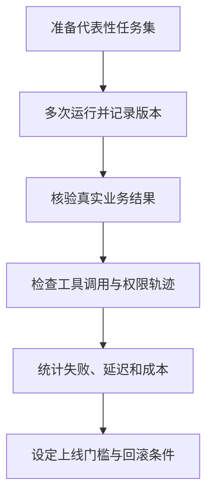

# 112. Agent 本地跑通后，怎样验收上线

> **场景引入**：模型回复“工单已创建”，数据库却没有记录；或工单创建了，却读取了不该看的客户资料。只看聊天结果都发现不了完整问题。

> 对应[原始材料](../origanl/112-Agent本地跑通就能上线？千万别踩这些坑.md)。

---

## 🎯 一句话定位

Agent 可能以不同路径完成同一任务，也可能表面回复正确却越权读了数据。上线前要同时检查**业务结果 Outcome**与**执行轨迹 Trace**。结果证明任务真的完成；轨迹帮助确认工具、权限、成本和异常处理是否合规。

---

## 💎 核心要点概览

| 验收对象 | 证据 |
| --- | --- |
| 业务结果 | 工单、订单等权威记录 |
| 执行轨迹 | 工具调用、权限、重试与状态转换 |
| 可靠性 | 多次运行、边界故障与回归 |
| 运营表现 | 尾延迟、费用和人工接管 |

---

## 🚀 核心总结

> **一次 Demo 成功不足以上线，结果与过程都要可验证。**

---

## 一、用工单示例理解验收

Agent 回复“工单已创建”，数据库里必须能查到对应工单，且只创建一次。Trace 还要显示调用了哪个工具、参数是什么、是否触发重复重试或越权读取。若只看回复或工具“成功”日志，无法发现静默失败；若只看数据库结果，也可能漏掉高成本循环。

评测集覆盖正常、模糊、接口超时、权限不足、重复请求和恶意资料；每个样例有外部可检查的成功标准。重复运行次数按风险与统计需求设定，不必机械套用原稿的固定次数。灰度发布、监控告警与回滚条件也应提前定义。

**面试口述：**“我用固定任务集验证最终业务状态和 trace，分别测成功率、错误动作、权限、尾延迟和成本。上线先灰度，触发质量或风险阈值就回滚。”

**自检：**模型说“已创建工单”，但数据库无记录，这属于哪类验收失败？

---

## 二、上线 Checklist

- [ ] 代表性任务集覆盖正常、异常和高风险情况。
- [ ] Outcome 与 Trace 都保存并能关联。
- [ ] 越权与重复写入有硬性门槛。
- [ ] 灰度发布有告警与回滚条件。

## 三、总结（一句话带走）

> **会演示只是起点，能证明真实结果、合法路径和故障恢复才可上线。**
