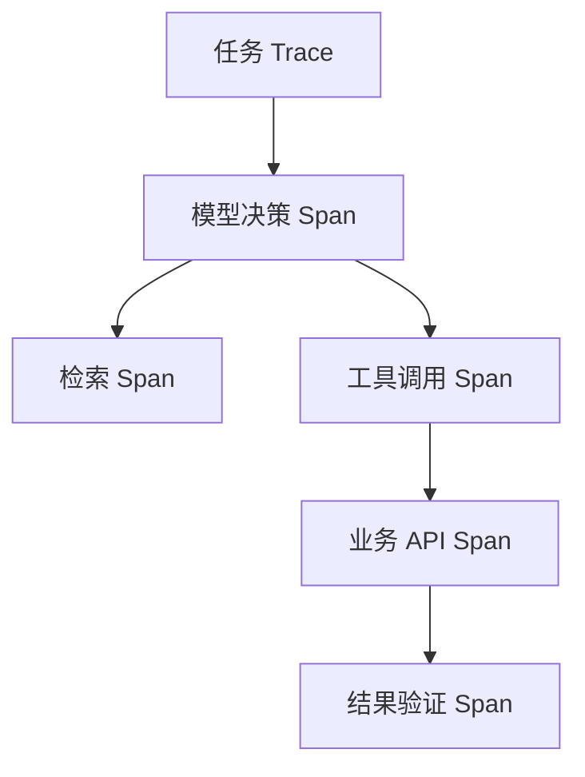

# 113. Agent 链路追踪：从报错定位到哪一步错

> **场景引入**：日志只写“工具调用失败”，没有工具名、参数来源或上一步模型选择依据。工程师无法判断是检索、参数还是外部接口出错。

> 对应[原始材料](../origanl/113-Agent报错难排查？带你搞懂链路追踪.md)。

---

## 🎯 一句话定位

一次用户任务是一条 Trace；模型调用、检索、工具执行、审批等待等步骤是 Span。父子关系告诉我们“哪个模型决定触发了哪个工具，工具结果又驱动了下一步什么动作”。有了这条因果链，才能区分检索错、参数错和外部接口错。

---

## 💎 核心要点概览

| 记录层次 | 内容 |
| --- | --- |
| Trace | 一次用户任务的统一 ID |
| Span | 模型、检索、工具、审批等步骤 |
| 父子关系 | 哪个决策触发了哪个动作 |
| 业务关联 | 外部流水号、状态变化与错误 |

---

## 🚀 核心总结

> **链路追踪要重建因果路径，不能只留下最终报错。**

---

## 一、每步记录什么

任务/租户 ID、父 Span ID、步骤类型、模型与提示版本、工具名、参数摘要、结果状态、开始结束时间、token 用量、重试次数和错误类别。保存检索命中的文档 ID 与版本，才能复现“为什么引用旧规则”。关键业务动作还要记录业务流水号，用于和真实系统对账。

原始对话、密钥、身份证号和支付信息不能无差别写进日志。用脱敏摘要、受控原文存储和权限隔离；追踪系统自身也要有保留期限。Span 太细会增加成本，按排障需要采样，但高风险错误和失败请求应保留足够证据。

**面试口述：**“一次任务一条 Trace，关键模型、检索和工具步骤各有 Span，并带父子关系。记录版本、耗时、错误与业务流水号；敏感输入脱敏，失败链路可复现。”

**自检：**只看到‘工具调用失败’，却没有工具名与参数摘要，能定位哪一层问题吗？

---

## 二、可观测 Checklist

- [ ] 每个模型与工具步骤有父子 ID、版本和耗时。
- [ ] 工具参数来源和结果摘要可定位。
- [ ] 外部业务流水号与任务 Trace 关联。
- [ ] 敏感内容脱敏，失败样例可安全回放。

## 三、总结（一句话带走）

> **知道“哪里报错”不够，还要知道错误是怎样沿步骤传播的。**
