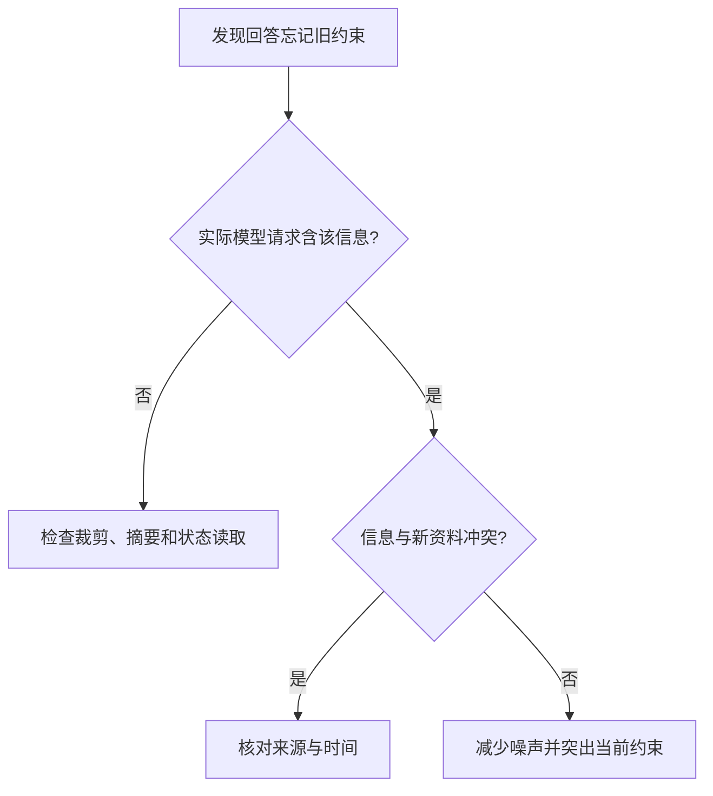

# 114. Agent 失忆：先查信息有没有进入请求

> **场景引入**：用户明确说“只分析华东”，Agent 最终却写出全国报告。排障第一步是查看实际发给模型的请求，而不是猜测模型记性差。

> 对应[原始材料](../origanl/114-AI%20Agent失忆？别只怪上下文窗口.md)。

---

## 🎯 一句话定位

Agent“失忆”要区分信息未传入、传入后未使用和跨会话未保存，三者修法不同。

## 💎 核心要点概览

| 现象 | 先查什么 | 对应处理 |
| --- | --- | --- |
| 本轮忘记约束 | 实际请求是否包含约束 | 修裁剪、摘要和任务状态 |
| 约束在却答错 | 冲突资料和输出校验 | 减噪、标来源、校验结果 |
| 新会话忘记 | 是否读取受控记忆 | 明确保存与读取机制 |

## 🚀 核心总结

> 先定位信息在哪一步丢失，再决定是修上下文组装、输出校验还是长期记忆。

---

## 一、三种不同故障

**没传入**：前端可看到旧消息，但后端裁剪时删掉了关键约束。**传入但没用**：关键规则仍在输入里，却被大量工具输出和冲突资料干扰。**跨会话未保存**：新会话没有长期记忆读取逻辑。换更大上下文窗口只可能缓解部分容量问题，不能解决遗漏或错误状态。

## 二、华东报告例子

用户一开始限定“只分析华东”，后面工具返回全国日志。如果摘要把“华东”丢掉，属于组装错误；如果保留了但输出仍分析全国，需要查看工具结果是否过长、提示结构是否清楚，以及报告校验是否检查地区范围。更稳的是把 `region=华东` 存为结构化任务状态，并在 SQL 和最终报告两处校验。

跨会话记忆还需用户授权、时间、来源与删除机制。不要将一切聊天永久保存；任务状态与用户长期偏好应分开。

**面试口述：**“先看模型实际请求，而非前端历史。信息没进入就修状态与裁剪；进入却没用就处理冲突、噪声和输出校验；跨会话则设计受控记忆。”

**自检：**模型输入里没有“华东”二字，调整温度能解决吗？

---

## 三、落地 Checklist

- [ ] 保存脱敏后的实际请求及裁剪摘要，确认关键约束是否进入模型输入。
- [ ] 把地区等硬约束存为结构化状态，并在工具参数和最终结果双重校验。
- [ ] 跨会话记忆明确授权、有效期、来源与删除方式。

## 四、总结（一句话带走）

> **先查请求里有没有，再查模型为何没遵守；扩大窗口不是通用解法。**
