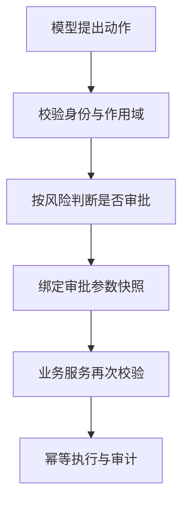

# 115. 防止 Agent 越权：权限在工具端执行

> **场景引入**：用户批准给甲退款 50 元，模型随后却生成给乙退款 500 元的调用。工具必须拒绝与审批内容不一致的请求。

> 对应[原始材料](../origanl/115-Agent安全指南：如何防止大模型越权？.md)。

---

## 🎯 一句话定位

模型负责提出动作，工具和业务服务负责校验权限与执行条件。

## 💎 核心要点概览

| 环节 | 必查内容 | 失败时 |
| --- | --- | --- |
| 工具入口 | 用户、资源、动作范围 | 拒绝调用 |
| 高风险审批 | 对象、金额、有效期、参数快照 | 重新审批 |
| 业务执行 | 权限、幂等、审计 | 阻断并记录 |

## 🚀 核心总结

> 把模型输出当作不可信的操作建议，权限必须由确定性的业务系统强制执行。

---

## 一、核心原则

模型可以提出“转账 50 元”的工具调用，但不能仅凭它的输出获得转账权。每次调用都由应用和业务服务校验用户身份、目标资源、操作范围与审批状态。提示词和模型自信程度不构成安全边界。

## 二、三个容易漏的细节

**最小权限**：只给当前任务必要的读写能力，避免一个长期全局密钥拥有全部订单权限。**人工确认**：展示收款人、金额、对象和后果，不能只给一个模糊“继续”按钮。**参数绑定**：用户批准退款 50 元，执行前若变为 500 元，原批准必须失效；审批记录应绑定任务 ID、参数哈希和有效期。

临时凭证也不是万能方案，仍需正确传递用户身份并在业务服务鉴权。高风险接口设置速率、金额上限、幂等和审计。对提示词注入测试时，即使模型被诱导，也应被工具权限层拒绝。

**面试口述：**“模型只生成建议。工具端按用户、资源和动作做最小权限校验，高风险动作审批并绑定参数快照；最终业务服务复核、幂等执行和留痕。”

**自检：**审批后模型改了收款账号，是否仍能沿用原审批？

---

## 三、落地 Checklist

- [ ] 按当前用户与资源校验每次工具调用，避免共享全局权限。
- [ ] 审批页面展示关键参数，审批记录绑定参数哈希与有效期。
- [ ] 执行前复核参数，设置幂等键、业务限额和审计记录。

## 四、总结（一句话带走）

> **模型可以建议转账，但只有通过工具权限和审批校验的请求才能执行。**
