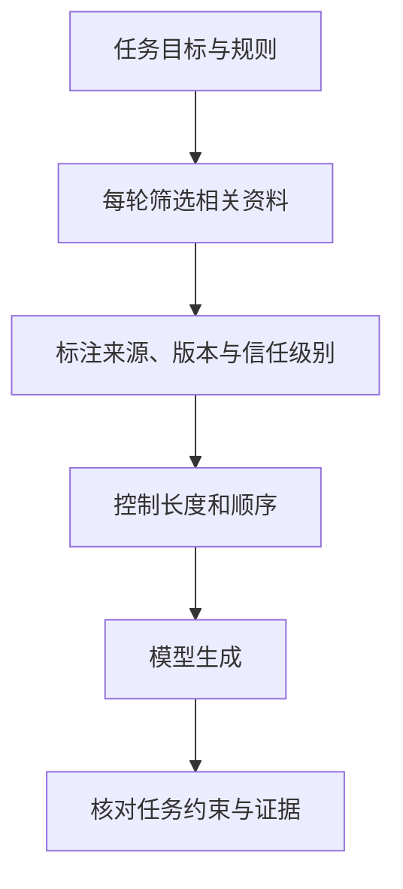

# 116. 提示词工程与上下文工程：分别管什么

> **场景引入**：提示词反复强调“只看新制度”，模型却仍引用旧制度。此时应先检查检索结果是否混入未标版本的旧文档。

> 对应[原始材料](../origanl/116-AI总被带偏？搞懂提示词与上下文工程.md)。

---

## 🎯 一句话定位

提示词说明任务和规则，上下文工程决定本轮实际提供哪些资料、状态与工具结果。

## 💎 核心要点概览

| 层次 | 解决的问题 | 常见故障 |
| --- | --- | --- |
| 提示词 | 要做什么、怎样输出 | 目标模糊、格式不清 |
| 上下文 | 看什么、信什么、保留什么 | 资料过期、缺失、冲突 |
| 校验 | 答案是否符合事实和约束 | 引用错版、越过边界 |

## 🚀 核心总结

> 好提示词需要可信、相关且有版本标识的上下文支撑。

---

## 一、区别

提示词工程主要让任务、输出格式和行为要求说清楚；上下文工程决定每轮模型实际看到哪些资料、状态、历史和工具结果。两者相互依赖：再清楚的“只按现行规则回答”，若上下文里混进旧规则且没标版本，仍可能答错。

## 二、具体做法

把用户当前目标和禁止事项保留为结构化任务状态；检索结果附文档标题、生效日期和权限；工具返回只保留与当前决策有关的字段，长日志给摘要与按需读取入口。模型上一步的猜测不能和工具返回的业务事实混写成同一段“已知信息”。

排障时保存经过脱敏的实际请求组成：系统指令版本、用户输入、状态、检索文档 ID 和工具结果摘要。先检查内容是否过期、冲突、遗漏，再考虑修改措辞。外部网页或文档始终是数据，不能因进入上下文就获得指令权限。

**面试口述：**“Prompt 说明怎么做，Context 决定这一轮看见什么。我先治理资料的新鲜度、来源和长度，再优化指令表达；输出以任务状态和原始证据核验。”

**自检：**模型总引用旧制度，反复加粗“只看新制度”之前应查哪一层？

---

## 三、落地 Checklist

- [ ] 固定当前任务目标和硬约束，检查每轮请求是否保留。
- [ ] 为检索资料附来源、生效时间、权限和可信级别。
- [ ] 查看脱敏请求快照，区分旧资料混入与指令表述不清。

## 四、总结（一句话带走）

> **先把输入资料治理好，再调整提示词措辞。**
