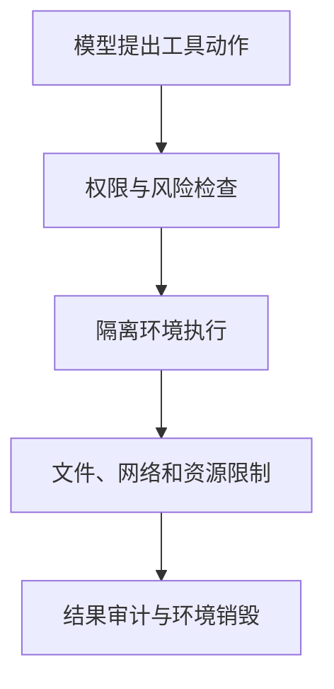

# 117. Agent 沙箱：限制错误动作的影响范围

> **场景引入**：代码 Agent 读到恶意网页，准备运行下载脚本。隔离环境应限制它能访问的文件、网络和资源，真实账户操作还要单独审批。

> 对应[原始材料](../origanl/117-AI智能体失控有多可怕？沙箱隔离机制解析.md)。

---

## 🎯 一句话定位

沙箱通过操作系统边界限制错误动作的影响，业务审批则限制真实账户的副作用。

## 💎 核心要点概览

| 边界 | 限制对象 | 典型措施 |
| --- | --- | --- |
| 文件 | 非任务目录和凭证 | 最小挂载、独立工作区 |
| 网络 | 未授权站点与 API | 白名单、受限代理 |
| 资源 | 无限运行或耗尽资源 | 超时、内存和进程限制 |
| 业务 | 付款、发布等真实动作 | 参数确认与服务端校验 |

## 🚀 核心总结

> 沙箱缩小技术层面的破坏范围；涉及真实账户时，还需权限与审批。

---

## 一、为什么提示词不够

Agent 读到恶意网页或误判任务时，可能提出下载脚本、读取凭证、删除文件等动作。提示词只影响模型建议，真正的边界要由执行环境和业务权限强制执行。沙箱目标是缩小影响范围，不能保证模型永不犯错。

## 二、代码 Agent 的四类隔离

文件只挂载任务所需目录，写入独立工作区；网络只放行必要目标；限制 CPU、内存、进程数和运行时间；不给不可信进程长期密钥。若需要访问外部 API，使用受限代理或短期凭证，并对日志脱敏。工作树隔离只能防主目录被误改，不能替代进程或容器权限边界。

浏览器 Agent 还可能在已登录会话中付款、发邮件或公开发布。它的风险在真实账户，不会因为浏览器跑在隔离容器里就消失；高风险动作应展示参数、暂停并由用户确认。确认后再次核对参数和页面状态，避免执行时对象变化。

**面试口述：**“我用沙箱限制文件、网络、进程和资源，再用业务权限和审批限制真实世界副作用。任务结束撤销临时权限，保存脱敏审计记录。”

**自检：**浏览器在沙箱里，但能用用户登录态直接付款，这个沙箱是否覆盖了资金风险？

---

## 三、落地 Checklist

- [ ] 为执行环境设置目录、网络、资源与凭证边界。
- [ ] 真实账户的高风险动作展示参数并在执行前复核。
- [ ] 任务结束撤销临时权限，保留脱敏审计记录。

## 四、总结（一句话带走）

> **限制进程能做什么，也限制业务接口允许它做什么。**
