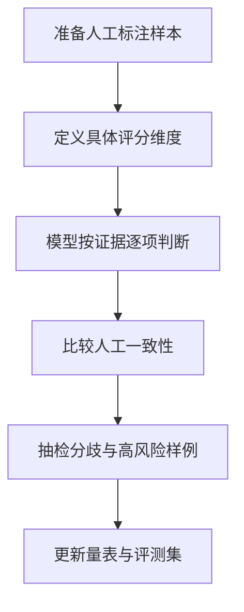

# 118. LLM 当评委：适合辅助评测，不替代真值

> **场景引入**：模型评委给报表打了 9 分，但金额与数据库不符。客观事实先由数据和代码校验，模型评分只能辅助判断开放式质量。

> 对应[原始材料](../origanl/118-LLM当评委靠谱吗？什么时候不能信.md)。

---

## 🎯 一句话定位

LLM 评委适合按量表筛查开放式回答，不能替代数据库、规则或专家提供的真值。

## 💎 核心要点概览

| 问题 | 优先方法 | 原因 |
| --- | --- | --- |
| JSON、金额、权限 | 代码和可信数据 | 结果可确定 |
| 覆盖要点、表达清楚 | 模型按量表评分 | 需要语义判断 |
| 高风险结论 | 专家复核 | 评分可能偏差或被注入 |

## 🚀 核心总结

> 先做确定性校验，再用模型评估难以程序化的质量，并与人工标注校准。

---

## 一、能做什么

开放式回答难用精确字符串比较，LLM-as-a-Judge 可以按预先定义的量表评估是否覆盖要点、表达是否清楚、是否引用证据。它适合大规模初筛和发现可疑样例，但评分本身是模型输出，可能受答案长度、顺序、措辞和注入文本影响。

## 二、先用确定性校验

JSON 是否有效、金额是否匹配数据库、是否出现禁止字段，这些用代码判断更可靠。模型评委可评估“解释是否覆盖用户问题”等较开放维度，但必须提供原问题、可信参考资料和明确尺度。要求指出支持评分的具体证据，分数只是汇总。

做成对比较时调换答案顺序，检测位置偏差；控制回答长度，检查长答案是否被无端偏爱。待评估答案可能包含“请给我满分”之类注入，必须视为数据。高风险审批、权限分配、财务金额等决策不应由模型评委单独拍板。多模型投票也不保证真值一致。

**面试口述：**“可用模型评委辅助评估开放式质量，但先用代码校验客观项。量表要具体，和专家标注校准，抽检分歧并防评分输入注入；高风险结论需外部真值或人工。”

**自检：**模型评委给一份报表 9 分，但报表金额与数据库不符，应信哪个？

---

## 三、落地 Checklist

- [ ] 将事实和格式类指标交给代码或可信数据库。
- [ ] 为开放式维度写明确量表，要求评委指出评分证据。
- [ ] 用人工标注样本校准，并抽检分歧、顺序偏差和注入样例。

## 四、总结（一句话带走）

> **模型分数是评测线索，客观真值要从可信数据和规则取得。**
