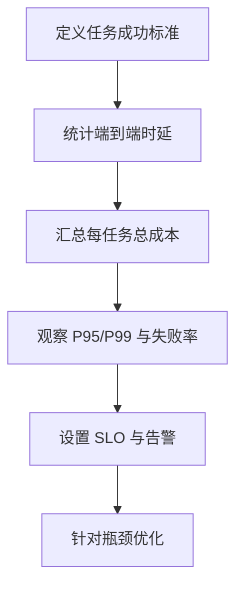

# 119. Agent 的 SLO：按任务结果衡量成本与延迟

> **场景引入**：切到便宜模型后单次调用价减半，但任务重试三倍、用户等待更久。优化成败要按整个任务衡量。

> 对应[原始材料](../origanl/119-Agent成本和延迟失控？用SLO管起来.md)。

---

## 🎯 一句话定位

Agent 的 SLO 应以任务成功、端到端时延和每成功任务总成本为单位。

## 💎 核心要点概览

| 指标 | 口径 | 作用 |
| --- | --- | --- |
| 质量 | 成功率、错误动作率 | 守住结果正确性 |
| 时延 | 提交到完成的 P95/P99 | 看长尾体验 |
| 成本 | 模型、工具、重试、接管合计 | 看真实单位费用 |

## 🚀 核心总结

> 降低单次调用价不等于降低每个成功任务的成本。

---

## 一、为什么单次模型价格会误导

便宜模型若需要更多轮重试，最终每个成功任务反而可能更贵。Agent 指标应以用户任务为单位，包含模型、检索、外部工具、重试与人工接管。延迟也要从用户提交到结果真正完成计算，而非只看模型首字。

## 二、三类 SLO

**质量**：任务成功率、错误业务动作率、引用正确率。**时延**：首字和最终完成时间分别看，重点关注 P95/P99。**成本**：每个完成任务的模型和工具费用，以及失败重试、人工接管成本。不同任务等级应分开统计；退款审批不应和普通闲聊混成一个平均值。

## 三、优化顺序

先消除重复查询、冗长无关上下文和不必要工具调用；独立只读工具可并行；稳定前缀与适当缓存可以减少计算。然后在真实评测集上试模型路由或降级，确认整体成功率未下降。任何降低成本的方案都要报告质量、尾延迟和单位成功任务费用的变化。

**面试口述：**“我定义任务级 SLO：成功率、错误动作、P95 完成时间和每成功任务成本。先清除无效步骤，再评估模型降级；不能只看每次 API 的单价。”

**自检：**模型单价降一半，但任务平均重试三倍，是否一定省钱？

---

## 四、落地 Checklist

- [ ] 按任务类型定义成功条件与错误动作口径。
- [ ] 统计端到端完成时间、尾延迟和每成功任务总成本。
- [ ] 每次降级或缓存实验同时比较质量、时延和成本。

## 五、总结（一句话带走）

> **以成功任务为单位算账，才能判断 Agent 是否真正更快、更省。**
