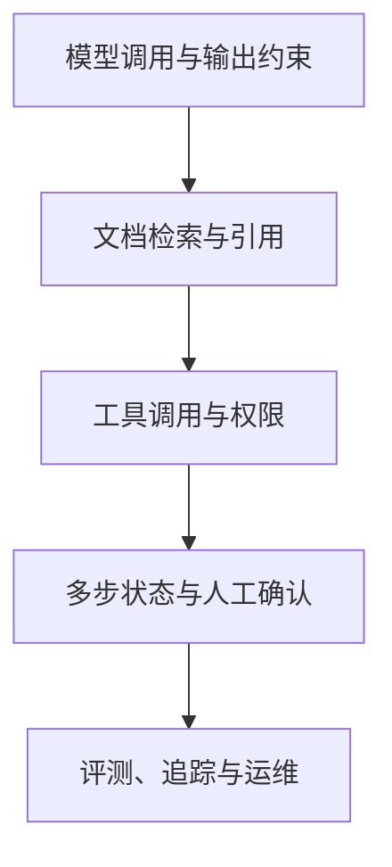

# 12. Agent 入门怎么学？从零搭起知识框架

> **场景引入**：刚入门时会看到 RAG、MCP、规划、记忆等一串名词。若不知道它们怎样共同完成一次任务，面试一追问“工具失败怎么办”就容易卡住。

> 对应原稿：[12-Agent入门怎么学？从零搭起知识框架-20261021](../origanl/12-Agent入门怎么学？从零搭起知识框架-20261021.md)。原稿主要介绍课程与就业判断，几乎没有技术讲解；下面的学习路径是围绕题目补充的实践建议，并非视频中的课程大纲。

---

## 🎯 一句话定位

**入门 Agent，先理解一条任务怎样走完，再逐步给它增加检索、工具、状态和安全能力。** 不必先背完一长串名词，也不应因“风口”判断跳过基本功。

一个最小 Agent 可以描述为：接收目标 → 判断下一步 → 调用允许的工具 → 观察结果 → 决定继续或结束。模型负责处理不确定信息，程序负责权限、状态和可验证的业务规则。

---

## 💎 核心要点概览

| 学习阶段 | 要能亲手完成的事 |
| --- | --- |
| 模型基础 | 有错误处理的结构化问答接口 |
| 外部知识 | 能引用手册原文的问答 |
| 工具与状态 | 查询模拟订单并处理超时 |
| 执行安全 | 写操作前确认、校验、记录状态 |
| 评测运维 | 用失败案例回归并定位错误环节 |

---

## 🚀 核心总结

> **从一条能运行的任务链出发，每增加一项能力，就补一个失败场景和验证办法。**

---

## 一、从零开始的五层知识地图

| 阶段 | 学什么 | 最小练习 |
| --- | --- | --- |
| 1. 大模型调用 | 消息、上下文、结构化输出、错误处理 | 做一个能稳定返回 JSON 的问答接口 |
| 2. 外部知识 | 文档解析、切片、检索、引用 | 用一份手册回答问题并定位原文 |
| 3. 工具调用 | 工具参数、权限、超时、幂等 | 查询一笔模拟订单 |
| 4. 多步执行 | 任务状态、重试、取消、人工确认 | 完成“查订单→判断规则→提交申请” |
| 5. 评测与运维 | 错误归因、Trace、成本、安全 | 对一组失败案例做回归检查 |

这不是唯一的学习顺序，但每一层都建立在上一层能运行、能解释的基础上。零基础学习者还要补 HTTP、数据库和基本编程；已有后端经验的人可以把重点放在模型不确定性与工具安全边界上。

## 二、用售后助手检查学习成果

做“售后助手”时，先只回答固定问题；再让它检索售后文档并附引用；之后接入只读订单查询；最后增加退款申请，但让高风险动作先进入确认和审批。每完成一步，就保留一条失败案例和一条成功案例。

“学会 RAG”不是知道全称，而是能解释：文档从哪里来，切片怎样避免断开限制条件，检索错了怎么查，引用怎样回到原页。“学会 Agent”也不是背规划、记忆、工具，而是能画出任务执行链路并指出异常时怎么收尾。

## 三、怎样看待原稿中的就业与课程信息

原稿提到岗位机会、课程模块数量、资料字数和退款承诺。这些属于主讲人的推广陈述，**不能直接推导出就业成功率或课程适合所有人**。决定学习路径前，检查目标岗位的真实职责、自己的基础、项目能否独立完成，以及课程的最新目录和实际购买条款。

## 四、深度追问与自测

1. 模型回答错了，你如何判断是检索没找到、资料错了，还是生成阶段忽略了证据？
2. Agent 查订单是只读操作；提交退款申请会多出哪些工程要求？
3. 你能不用框架名，向同事说明一个 Agent 从目标到结果的全过程吗？

**一句话带走：学习路线要围绕能解释、能运行、能排错的完整链路组织。**

---

## 五、实践 Checklist

- [ ] 能不用框架名说明 Agent 的目标、动作、观察与结束条件。
- [ ] 有一个可运行的小项目，而非多个互不相连的 Demo。
- [ ] 每层都留有成功样例、失败样例和修复记录。
- [ ] 涉及写操作时能说明权限、确认与幂等。

## 六、总结（一句话带走）

> **学会 Agent 的标准，是能完成并排查一条真实任务链。**
