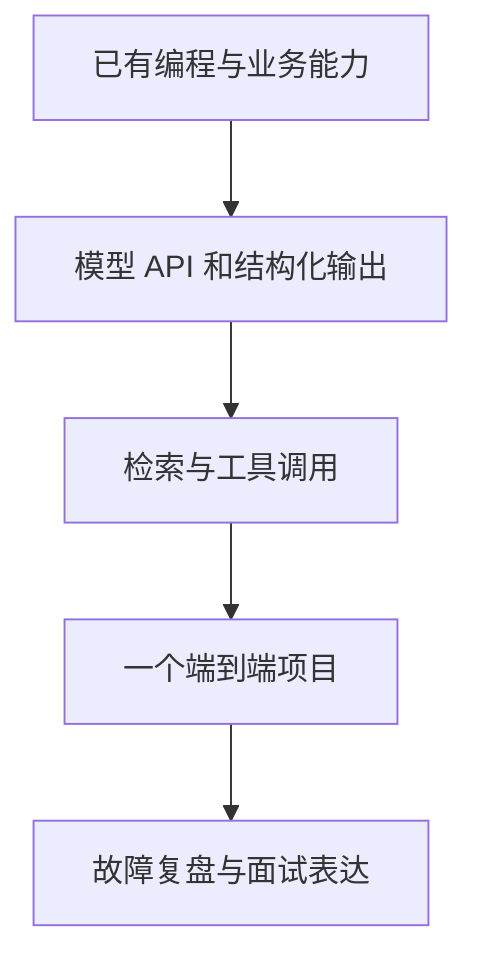

# 120. 从传统开发转向 Agent：复用已有工程能力

> **场景引入**：一位后端开发者准备做订单问答 Agent，已有的 API、鉴权和故障处理经验正好可用于工具接入和上线治理。

> 对应[原始材料](../origanl/120-转型大模型必看：手把手带你做Agent.md)。原稿为课程推广，本文保留“基础、项目、复盘”的学习主线。

---

## 🎯 一句话定位

用现有软件工程能力搭建可靠边界，再补模型调用、检索、上下文与评估。

## 💎 核心要点概览

| 阶段 | 学什么 | 交付物 |
| --- | --- | --- |
| 基础 | 模型 API、结构化输出 | 可复现的小任务 |
| 项目 | 检索、只读工具、审批 | 端到端订单问答 |
| 复盘 | 失败样例、追踪、评估 | 可解释的改进证据 |

## 🚀 核心总结

> 从一个真实业务任务起步，把权限、状态和可靠性设计贯穿每次迭代。

---

## 一、起点不是从零

后端开发熟悉 API、数据库、鉴权和故障处理，这些恰是 Agent 上线所需能力。新知识主要是模型调用、上下文、检索与概率性输出。把已有工程经验用在真实业务任务上，比只背框架名更有价值。

选一个订单问答项目：第一版只答制度；第二版接只读订单 API；第三版处理退款审批。每版写下失败案例、修改原因和验证结果。可以请学习助手解释错误或模拟追问，但必须亲自查看 trace 与代码，不能把模型给的答案当作项目事实。

面试表达围绕“用户问题—架构选择—风险控制—评估证据”，而不是报名课程或复制项目。课程价格、售后与就业承诺不影响技术能力判断。

**面试口述：**“我把已有后端的权限、状态和可靠性能力带入 Agent 项目，再补模型、检索与工具循环，并用真实失败样例驱动迭代。”

**自检：**已有后端鉴权经验，接入 Agent 后哪些权限检查仍必须保留？

---

## 二、落地 Checklist

- [ ] 选一个具体业务任务，定义成功条件和失败样例。
- [ ] 从只读工具逐步增加写操作，沿用业务服务鉴权和审批。
- [ ] 保存 trace、评估结果与改动原因，形成可复述的项目经验。

## 三、总结（一句话带走）

> **Agent 开发是在已有工程基础上加入模型能力，权限与可靠性仍要由系统保证。**
