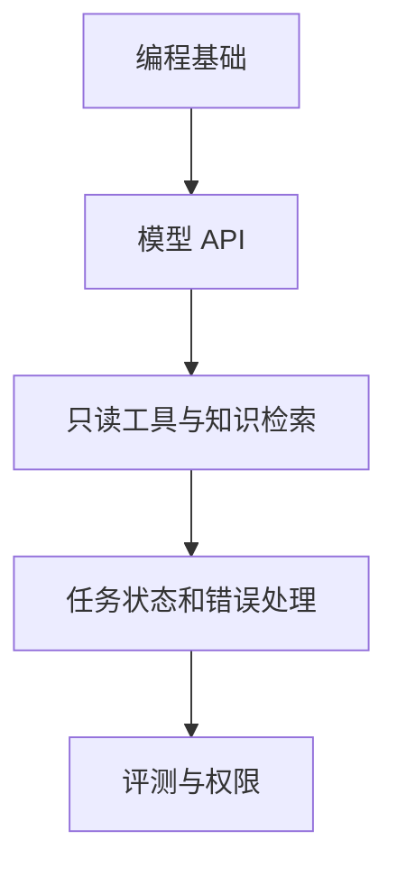

# 121. 零基础做 Agent 项目：先补必要前置

> **场景引入**：新手想直接做自动退款 Agent，却还分不清接口的 401 和 500。先补鉴权与故障处理，项目才能安全推进。

> 对应[原始材料](../origanl/121-零基础学Agent，带你做实战项目.md)。原稿为课程推广，“零基础可直接做可上线项目”不应被理解为无需编程与安全基础。

---

## 🎯 一句话定位

从编程与 HTTP 基础起步，按只读问答、受控工具、写入审批逐步构建 Agent。

## 💎 核心要点概览

| 阶段 | 重点 | 验收 |
| --- | --- | --- |
| 前置 | 编程、HTTP、JSON、数据库 | 能解释接口错误 |
| 模型 | API、Prompt、工具调用 | 能跑通只读闭环 |
| 工程 | 状态、权限、评测 | 能处理真实失败 |

## 🚀 核心总结

> 每增加一项能力，都应先能解释输入、输出与失败边界。

---

## 一、三段路径

先学函数、HTTP、JSON、数据库基本概念和错误处理；再学模型 API、Prompt、token 与工具调用；最后做一个带真实资料的小项目。前后端开发者可跳过熟悉部分，但仍需补模型和评测。

第一版客服 Agent 不接退款，只回答规则并给出处。第二版接测试订单 API，处理找不到订单和无权限。第三版模拟申请提交，加入确认、幂等与失败对账。每个阶段能用自己语言解释输入、输出和失败边界，才进入下一阶段。

“能跑起来”与“可上线”之间还隔着脱敏、权限、审计、监控和回归评测；不应因课程版本数量或营销案例忽略这些工作。

**面试口述：**“我先补 HTTP 与业务状态基础，再做模型调用、检索和工具，项目从只读到受控写入逐步验收。”

**自检：**还不懂 API 返回 401 和 500 的区别，直接做自动退款会遇到什么风险？

---

## 二、落地 Checklist

- [ ] 先掌握 HTTP、数据库与错误处理，再接业务写接口。
- [ ] 项目按只读到受控写入分阶段验收。
- [ ] 每阶段记录权限、超时、重复请求和数据脱敏用例。

## 三、总结（一句话带走）

> **能运行只是起点，能处理异常和权限才接近真实项目。**
