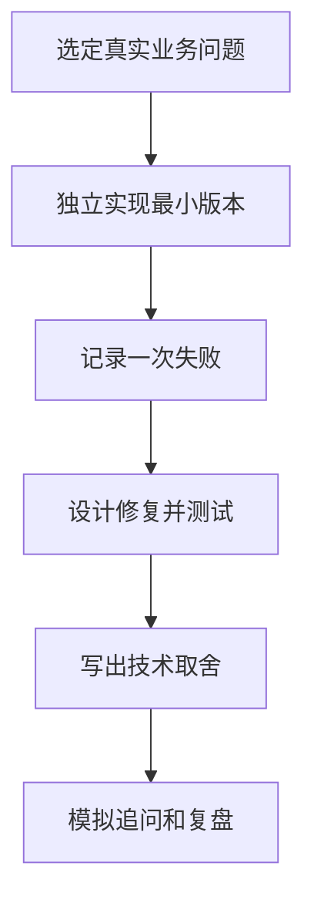

# 122. 转行 Agent：如何判断项目经历是否真实

> **场景引入**：简历写了“完成企业级 Agent”，面试时却只有截图，说不出一次检索失败的原因。真实项目经历需要可复现的过程证据。

> 对应[原始材料](../origanl/122-零基础转行AI%20Agent开发实战.md)。原稿展示薪资与涨幅个案，不能作为普遍就业结果。

---

## 🎯 一句话定位

项目能力由代码、故障轨迹、设计取舍和评测记录证明，而非课程名称或宣传个案。

## 💎 核心要点概览

| 证据 | 能说明什么 | 追问示例 |
| --- | --- | --- |
| 可运行代码 | 真实实现范围 | 哪部分由你完成？ |
| 失败轨迹 | 排障能力 | 旧规则为何被召回？ |
| 评测记录 | 改动是否有效 | 修复后错误率如何变？ |

## 🚀 核心总结

> 面试准备要围绕自己解决过的问题和可验证的结果展开。

---

## 一、项目经历的证据

一个能经得起面试追问的 Agent 项目，应有可运行代码、测试数据、架构边界、失败案例和评测记录。课程项目可以用于练习，但仅复制最终代码不能说明独立设计能力。面试官更可能追问：为什么规则用 RAG，订单用 API？接口超时怎么处理？谁有退款权限？

以电商售后为例，准备一条完整的工单轨迹：用户问题、检索片段、订单工具参数、最终答复、业务状态。再准备至少一个失败轨迹，例如旧规则被召回或物流 API 超时，说明你如何定位和修复。简历只写自己实际完成的部分，避免把课程功能全算作个人成果。

求职前先查看目标岗位的真实 JD，匹配语言、框架和业务经验；工资与 offer 受地区、经验和市场影响，不应由个别宣传案例推断。

**面试口述：**“我用同一个项目展示问题定义、实现、故障复现和评测，能说明每个组件为什么存在，以及哪些部分由业务服务兜底。”

**自检：**项目只有最终截图，没有失败样例和代码提交历史，能证明哪些能力？

---

## 二、落地 Checklist

- [ ] 保留代码、测试数据、架构图和提交记录。
- [ ] 准备至少一个失败轨迹及修复后的回归证据。
- [ ] 简历明确个人实际负责范围和技术取舍。

## 三、总结（一句话带走）

> **能复现故障、说明修复，项目经历才经得起追问。**
