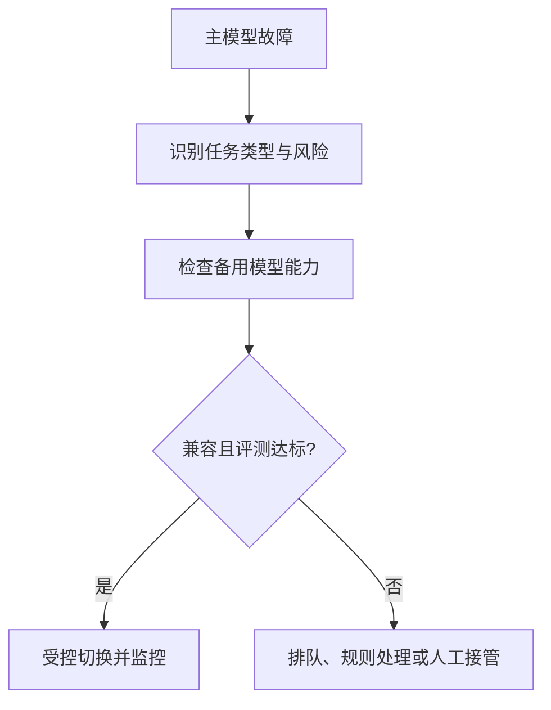

# 123. 模型网关降级：先验证能力兼容

> **场景引入**：主模型超时后网关切到便宜模型，备用模型却不支持函数调用，自动退款流程就无法按原路径执行。

> 对应[原始材料](../origanl/123-大模型网关降级避坑：别盲目切便宜模型.md)。

---

## 🎯 一句话定位

模型降级必须按任务检查能力、质量、时延和数据边界，不能只按价格排序。

## 💎 核心要点概览

| 检查项 | 关键问题 | 不满足时 |
| --- | --- | --- |
| 工具与输出 | schema 和结构化输出兼容吗 | 停止自动执行 |
| 质量与时延 | 任务评测和 SLO 达标吗 | 排队或人工接管 |
| 数据边界 | 允许发往备用服务吗 | 禁止切换 |

## 🚀 核心总结

> 安全降级是经过任务评测的预案，不是故障时临时换一个便宜模型。

---

## 一、问题

主模型超时后直接切到最便宜模型，看似可用性提高；若备用模型不支持当前工具 schema、上下文长度或输出约束，任务可能从“稍慢”变成“错误执行”。降级需要按任务和风险做能力匹配，而不是按价格排序。

## 二、检查六项

上下文是否装得下；工具调用格式与参数是否兼容；结构化输出是否受支持；该任务的评测质量是否达标；延迟是否满足 SLO；数据是否允许发送到备用服务。退款、发布等高风险动作即使切换模型，也应由独立业务权限和审批兜底。

网关要区分可重试超时与已经执行的工具副作用。若模型调用中包含写工具，不能因为主模型超时就在备用模型上重新跑整个流程；先查询已发生的动作。切换后记录模型版本、触发原因和质量指标，达到错误阈值自动停止降级。

**面试口述：**“备用模型必须经过任务级兼容和质量评测。降级策略同时考虑风险、上下文、工具、输出、时延和数据边界；无法安全切换时宁可限流或转人工。”

**自检：**备用模型能聊天但不支持函数调用，可以承接自动退款任务吗？

---

## 三、落地 Checklist

- [ ] 为每类任务列出备用模型的能力、质量与延迟门槛。
- [ ] 写工具超时后先查副作用状态，避免整段流程重复执行。
- [ ] 记录触发原因、模型版本与错误率，超阈值停止降级。

## 四、总结（一句话带走）

> **备用模型只有在当前任务上经过验证，才算真正的降级方案。**
