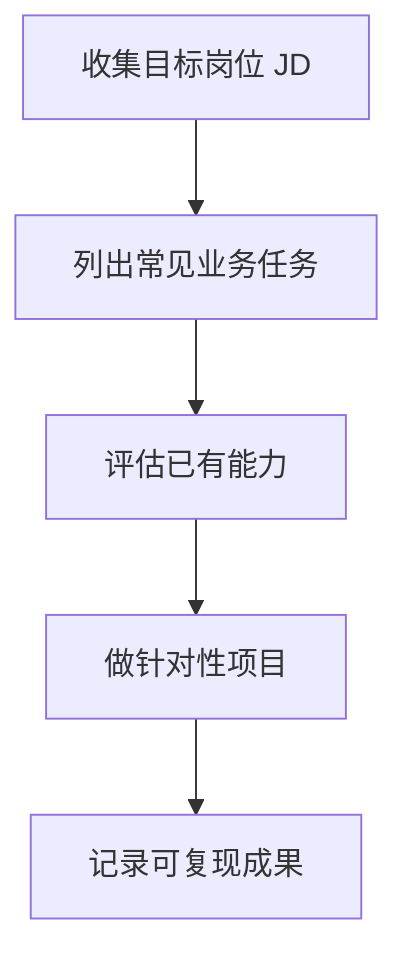

# 124. 进入 Agent 开发：用岗位任务定位能力缺口

> **场景引入**：两个岗位都写“Agent 开发”，一个重知识检索，一个重支付风控。求职准备应从具体岗位任务反推能力。

> 对应[原始材料](../origanl/124-如何进入agent开发行业？.md)。原稿为课程销售，对岗位缩减和行业前景的概括未给数据，本文不据此做就业预测。

---

## 🎯 一句话定位

先分析目标岗位的实际任务，再选择学习内容和可展示的项目证据。

## 💎 核心要点概览

| 岗位侧重 | 主要能力 | 可展示成果 |
| --- | --- | --- |
| 知识问答 | 文档处理、检索、引用 | 错召回排障记录 |
| 业务集成 | API、状态、鉴权 | 受控工具调用链路 |
| 平台治理 | 评测、监控、安全 | 质量与故障报表 |

## 🚀 核心总结

> 用岗位需求和项目证据定位能力差距，避免只按热门技术名词准备。

---

## 一、先看岗位做什么

Agent 开发岗位可能偏模型应用、后端平台、知识检索、业务集成或评测安全。收集目标岗位的 JD，按实际任务分类：接 API、处理文档、设计状态流程、实现工具权限、排障和评估。不同岗位的语言与框架要求不同，不存在一套课程覆盖全部职位。

后端开发可优先把鉴权、幂等和可观测性用于模型工具；前端开发可做审批界面、流式交互与状态展示；零基础者先补编程、HTTP、数据库和测试。无论方向，都要能解释模型调用与真实业务状态之间的边界。

用一个小项目证明能力：从用户请求到工具结果、失败处理、最终业务验收全链路可追踪。面试时用具体问题与指标说明自己做了什么。

**面试口述：**“我先按目标岗位拆解任务，用已有工程优势切入，再补模型、检索、Agent Loop 与评测，用项目证据验证能力。”

**自检：**同样写 Agent，知识库岗位和支付风控岗位最重视的能力会一样吗？

---

## 二、落地 Checklist

- [ ] 收集目标岗位 JD，归纳重复出现的任务与工程要求。
- [ ] 对照已有能力，选择一个能覆盖关键任务的小项目。
- [ ] 准备实现、失败处理与验收证据，说明个人贡献。

## 三、总结（一句话带走）

> **看岗位要解决什么问题，再决定学什么、做什么项目。**
