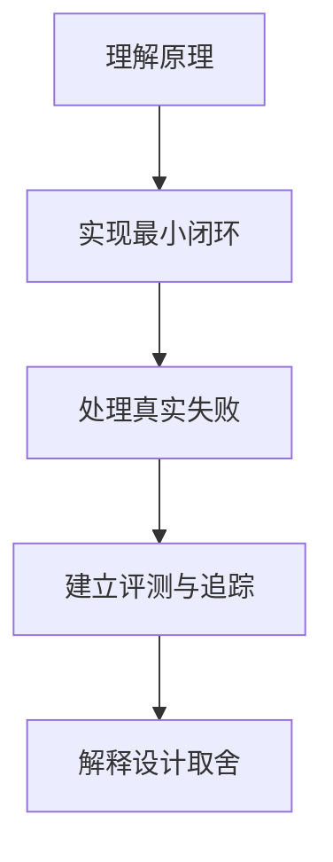

# 125. 学 Agent 应得到哪些可验证能力

> **场景引入**：看完一套课程后，能复述 RAG 定义，却定位不了一次旧制度错召回。学习成果需要用实际任务验收。

> 对应[原始材料](../origanl/125-通过这套大模型课你能得到什么？.md)。原稿介绍课程素材和购买理由；本文把“学到什么”改为独立验收标准。

---

## 🎯 一句话定位

用可运行项目、失败分析和评测证据检验 Agent 能力。

## 💎 核心要点概览

| 能力 | 验收方式 |
| --- | --- |
| 模型与检索 | 能说明输入、证据和引用 |
| 工具与状态 | 能处理参数、超时、重复请求 |
| 评测与追踪 | 能用失败样例说明改进 |

## 🚀 核心总结

> 学过多少知识点不如能否独立设计、排障和验证。

---

## 一、五项成果

能解释模型输入输出与 token；能把文档做成带来源的检索问答；能接工具并处理参数、超时和权限；能维护任务状态、停止条件与恢复；能用评测集和 trace 证明质量。这些是可以展示和检查的能力，比课程知识点数量更有意义。

检验方式：给自己一份陌生业务需求，能在限定时间内画出数据流、区分模型与业务服务职责、写出风险用例，再做出最小可运行版本。若只会复述课程动画，却说不清接口 500、旧文档和重复写入怎么办，说明还需项目练习。

技术持续变化，保留“输入、状态、权限、验证”的基本问题框架，再查最新官方文档更新具体 API。购买任何课程都不能替代独立调试和复盘。

**面试口述：**“我以可运行项目和失败分析检验学习成果，不以看完多少视频为标准。能解释每个组件的业务理由及验证证据，才算掌握。”

**自检：**‘学过 RAG’和‘能定位一次错召回’有什么差别？

---

## 二、落地 Checklist

- [ ] 用陌生业务需求独立画出数据流和权限边界。
- [ ] 实现最小闭环，记录一例真实失败和修复过程。
- [ ] 用回归样例与 trace 验证改动，而不是只看演示效果。

## 三、总结（一句话带走）

> **能解释并修复真实失败，才算把知识变成能力。**
