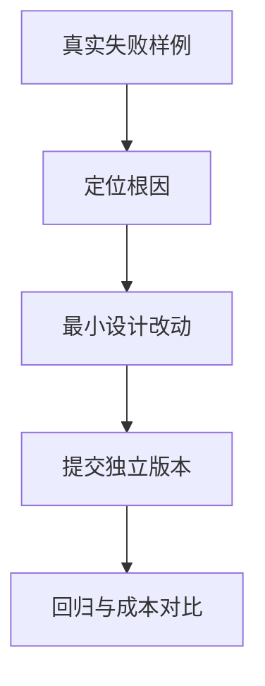

# 126. 企业级 Agent 项目：每个版本都回答一个业务问题

> **场景引入**：项目有 40 次提交，却没有权限校验和故障恢复。版本数量本身不能证明它达到企业使用要求。

> 对应[原始材料](../origanl/126-40个版本带你开发企业级Agent.md)。原稿是课程推广；“40 个版本”是教学形式，不是企业级成熟度指标。

---

## 🎯 一句话定位

每版围绕一个明确业务故障改动，并用回归证据验证收益。

## 💎 核心要点概览

| 版本问题 | 可能能力 | 验收证据 |
| --- | --- | --- |
| 规则答错 | 版本过滤与引用 | 旧规则不再被用 |
| 重复退款 | 幂等与状态查询 | 重试不重复写 |
| 线上难排障 | trace 与版本记录 | 能复现一次失败 |

## 🚀 核心总结

> 企业级质量看业务正确性、权限、恢复与可观测性，不看提交次数。

---

## 一、版本怎么规划

以电商客服为例，版本 1 解决规则问答，版本 2 解决订单实时查询，版本 3 解决退款审批，版本 4 解决重复请求，版本 5 解决线上追踪。每个版本先写清失败现象，再决定增加哪项能力，最后用旧用例与新用例一起验证。

“企业级”要看权限、可观测、故障恢复和业务正确性。一个版本即使引入 LangGraph 或 RAG，也不自动达到上线标准。保留版本差异说明，记录模型、提示、知识库和工具 schema 的版本，方便复现效果变化。

模拟面试可围绕具体提交追问：“为什么不用规则？”“重试会不会重复退款？”“怎么证明这次改动有效？”如果答不上来，应回到代码和 trace，而不是背课程讲义。

**面试口述：**“我用业务故障驱动版本，每版只解决一个主要风险，并有回归证据。企业级质量来自权限、状态、恢复与评测，不来自版本数量。”

**自检：**项目有 40 个 commit，却没有测试和故障处理，能称为企业级吗？

---

## 二、落地 Checklist

- [ ] 每版先定义故障、根因和验收条件。
- [ ] 留存模型、提示、知识库和工具 schema 的版本信息。
- [ ] 新旧用例一起回归，并比较质量、成本与延迟。

## 三、总结（一句话带走）

> **用业务问题驱动版本，用回归证据证明版本有效。**
