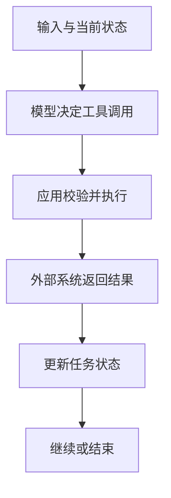

# 127. 抽象概念怎么学：先画状态变化

> **场景引入**：一张 Agent 流程图只画“模型调用工具→回答”，却没画工具结果回到模型，也没画失败分支。图能帮助发现理解缺口。

> 对应[原始材料](../origanl/127-大模型Agent太抽象？动画讲解轻松学.md)。原稿是动画课程宣传；本文把“用图理解运行机制”转成实际练习。

---

## 🎯 一句话定位

学习 Agent 概念时，先画清输入、状态、执行者和停止条件，再用异常场景检验。

## 💎 核心要点概览

| 问题 | 要画出的内容 |
| --- | --- |
| 输入是什么 | 用户请求与可用资料 |
| 状态在哪 | 应用保存的任务状态 |
| 谁执行动作 | 工具与业务服务 |
| 何时停止 | 成功、失败、超时和人工接管 |

## 🚀 核心总结

> 能解释图上每条边的执行者和失败处理，才算真正理解流程。

---

## 一、一张图回答四问

每学一个 Agent 概念，画出输入是什么、状态由谁保存、谁执行外部动作、何时停止。例如工具调用：模型生成工具请求，应用校验并执行，工具结果回到下一轮模型输入；业务系统才是动作的最终事实来源。

看懂图后做“改条件”练习：工具超时会走哪条边？用户撤销授权后还能继续吗？同一请求重试会不会重复写？这样的追问能发现图中缺失的错误分支。动画是帮助建立直觉的媒介，最终要用日志和测试确认流程真的如此运行。

复述技术时避免背一长串名词。先说问题，再说数据流与边界，最后给出失败处理。框架和产品版本会变，这种讲法仍适用。

**面试口述：**“我先画状态和控制流，再用故障场景检查每条边。能说明工具由谁执行、结果如何反馈、失败何时终止，才算理解 Agent Loop。”

**自检：**图中只有‘模型调用工具→回答’，缺少哪条关键反馈路径？

---

## 二、落地 Checklist

- [ ] 为每个概念画输入、状态、动作和停止条件。
- [ ] 增加超时、拒绝、撤销授权、重复请求等异常分支。
- [ ] 用日志和测试核对流程图与实际运行是否一致。

## 三、总结（一句话带走）

> **画状态变化，再沿失败路径追问，比背名词更容易理解 Agent。**
