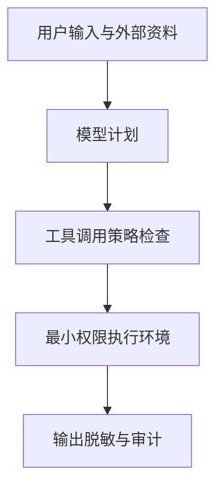

# 128. 防止 Agent 删库：护栏必须在执行层

> **场景引入**：恶意文档诱导模型生成 `DROP TABLE`。如果数据库账号只有只读权限，这个危险建议无法执行。

> 对应[原始材料](../origanl/128-提示词防不住AI删库！教你建系统级护栏.md)。

---

## 🎯 一句话定位

提示词负责提醒，工具权限、数据库权限和业务审批负责阻断危险动作。

## 💎 核心要点概览

| 位置 | 作用 | 例子 |
| --- | --- | --- |
| 工具入口 | 校验身份和参数 | 仅开放只读查询 |
| 数据库 | 限制实际权限 | 账号无 `DROP` 权限 |
| 业务流程 | 管控高风险写入 | 审批、参数绑定、审计 |

## 🚀 核心总结

> 越靠近真实副作用，约束越要由确定性的系统执行。

---

## 一、核心原则

“不要删除数据库”写在提示词里只能提醒模型，不能限制数据库账号权限。真正的防线是工具服务和数据库层：模型即使提出删除请求，也没有相应权限，或被业务校验与审批拒绝。

## 二、五个位置

输入层识别不可信资料并标记来源；运行层限制步骤、时间和预算；工具层校验身份、资源、参数及业务规则；输出层检查敏感信息和关键结论；环境层限制数据库账号、网络与文件权限。越靠近实际副作用，校验越应确定性。对“删库”这类操作，最有效的是数据库凭证根本没有 `DROP` 权限，而不是把关键词加入黑名单。

以数据库问答助手为例，提供只读查询接口，不暴露通用 SQL 执行器；查询还要按用户权限限制表和行。若确实需要变更数据，单独定义受限业务接口、审批、参数绑定和审计。提示词注入测试应证明外部文档不能提升工具权限。

**面试口述：**“Prompt 是软约束，执行层是硬边界。我把工具按风险拆开，数据库用最小权限账号，写动作走业务接口和审批，运行环境与输出再做兜底。”

**自检：**模型被恶意文档诱导生成 `DROP TABLE`，只读账号会怎样？

---

## 三、落地 Checklist

- [ ] 不向问答 Agent 暴露通用 SQL 执行器。
- [ ] 数据库凭证只授予任务需要的表、行与操作权限。
- [ ] 写动作走受限业务接口，附审批、审计与注入测试。

## 四、总结（一句话带走）

> **让危险指令即使生成，也越不过执行层权限。**
