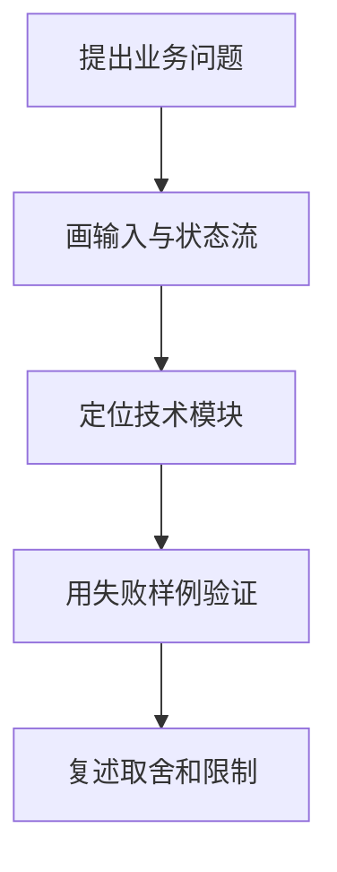

# 129. 用“问题—流程—证据”理解 Agent

> **场景引入**：客服总引用过期退款期限。先沿文档入库、版本过滤、检索和回答链路找到错误，再决定用哪个组件修复。

> 对应[原始材料](../origanl/129-大模型Agent太难？动画图解带你学透.md)。原稿是课程宣传，行业类比和资料数量不能当成技术判断依据。

---

## 🎯 一句话定位

以真实问题串起流程，再用失败样例和评测证据理解 Agent 技术。

## 💎 核心要点概览

| 步骤 | 提问 | 产物 |
| --- | --- | --- |
| 找问题 | 用户遇到什么错误 | 具体失败样例 |
| 画流程 | 错误在哪一环出现 | 数据流与状态图 |
| 找证据 | 修复是否有效 | trace 和回归结果 |

## 🚀 核心总结

> 先说明技术解决了哪个具体瓶颈，再判断是否值得引入。

---

## 一、三步学习法

先找一个具体问题，如“客服为什么会答错现行退款期限”；再画流程：文档入库、版本过滤、检索、模型回答、引用核验；最后找证据：一次真实错误的检索结果与修复后的回归记录。这样比单独背“RAG、Skill、Harness”更容易迁移到新技术。

新的 Agent 技术出现时也用同一套问题检查：它解决哪个瓶颈？改变了哪条数据流？新增了什么故障模式？能否通过现有评测集证明收益？这样既能跟上变化，也不会被热门名字牵着走。

学习产物应是一张链路图、一个小项目、若干失败样例和一份评估表。能清楚解释“为什么在这里用这个组件”比复述动画或课程章节更重要。

**面试口述：**“我用真实问题串起技术流程，再以 trace 和评测数据检验设计。遇到新框架先看它解决的具体瓶颈和新增风险。”

**自检：**只会说‘用了 Skill’，却说不出它减少了什么错误，这项技术选择有证据吗？

---

## 二、落地 Checklist

- [ ] 选择一个可复现的业务错误作为学习入口。
- [ ] 画出输入、状态、工具、输出和证据链。
- [ ] 记录引入组件前后的质量、延迟和新故障模式。

## 三、总结（一句话带走）

> **从问题走到流程，再用证据判断技术是否有用。**
