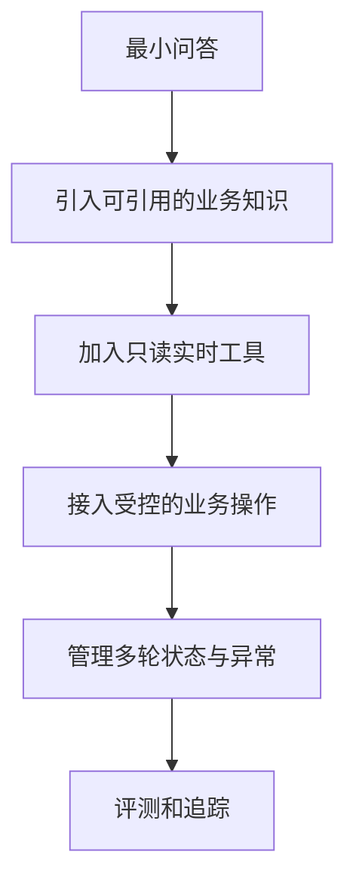

# 13. 想转 AI 方向？Agent 开发可以这样起步

> **场景引入**：想做 AI 项目却不知道从哪儿开始。与其同时搭 RAG、工具和多 Agent，不如先解决售后问答这一个可验证的问题。

> 对应原稿：[13-想转AI方向？Agent开发可以这样起步-20261021](../origanl/13-想转AI方向？Agent开发可以这样起步-20261021.md)。原稿以电商客服课程为例；本文提炼可独立实践的项目学习方法。

---

## 🎯 一句话定位

**用一个真实业务场景串起知识点，比孤立地刷框架教程更容易理解“什么时候用什么”。** 但项目不是把几个组件都接上就结束，还要能解释问题、边界和验证结果。

---

## 💎 核心要点概览

| 版本 | 先解决的问题 |
| --- | --- |
| 问答 | 售后规则从哪里来，能否引用原文 |
| 实时查询 | 订单状态不能从静态知识库猜测 |
| 写操作 | 退款申请需要权限、确认和幂等 |
| 长任务 | 状态、取消和失败恢复要可追踪 |
| 评测 | 证明每次新增能力确实解决了问题 |

---

## 🚀 核心总结

> **先让小项目暴露真实缺口，再按缺口增加技术能力。**

---

## 一、选一个足够小的起点

以电商售后为例，从“根据公开售后规则回答问题”开始。先收集十个真实问法，记录正确答案所在条款。完成后再逐步加能力：

1. **静态规则问答：**接入 RAG，检索制度并带引用，处理“没找到依据”的情况。
2. **实时订单查询：**通过只读工具获取订单和物流数据，不让模型凭空编造状态。
3. **退款申请：**把模型的意图判断与业务执行拆开，加入权限、确认、幂等和审批。
4. **多轮任务：**保存当前订单、已确认信息和执行状态，支持失败恢复与取消。
5. **评测与追踪：**记录每一步输入、工具结果和最终答案，建立固定问题集。

## 二、每个版本记录四件事

| 项目 | 示例 |
| --- | --- |
| 发现的问题 | 模型不知道店铺最新退货期限 |
| 加入的能力 | 检索当前生效的售后规则 |
| 没有选择的做法 | 不把规则直接写死在提示词中，以免更新困难 |
| 验证方法 | 用有期限、无期限、例外条款的问题回归测试 |

这样学完后，面试中的“为什么用 RAG”“工具超时怎么办”“退款凭什么让模型操作”等问题都有具体答案。只复制最终代码，即使能运行，也很难解释这些决策。

## 三、按背景调整起步方式

- **零基础：**先补语言、HTTP、数据库、JSON，再做最小问答和只读工具。
- **已有后端经验：**重点练模型输出校验、检索质量、工具权限与长任务状态。
- **已有 AI 理论基础：**尽快做端到端项目，把评测、失败处理和观测补上。

原稿中的课时、版本数、资料数量与购买承诺属于特定课程信息，不能代替对学习效果的验证。真正可写进简历的是你亲自设计、实现并能解释的部分。

## 四、深度追问与自测

1. 用户问“我的快递到哪了”，为什么只接 RAG 不够？
2. 为什么退款不能沿用查询订单的权限方式？
3. 每增加一个技术组件，你能否指出它解决了哪个已发生的问题？

**一句话带走：先让项目暴露问题，再用合适的技术解决问题。**

---

## 五、实践 Checklist

- [ ] 已选定具体用户任务和可观察的完成标准。
- [ ] 每增加一个组件，都能说明它修复了哪种失败。
- [ ] 项目含只读和高风险写入的权限区分。
- [ ] 有失败样例、版本记录和可复现的验证过程。

## 六、总结（一句话带走）

> **做小而完整的项目，比堆出庞大但无法解释的技术栈更有价值。**
