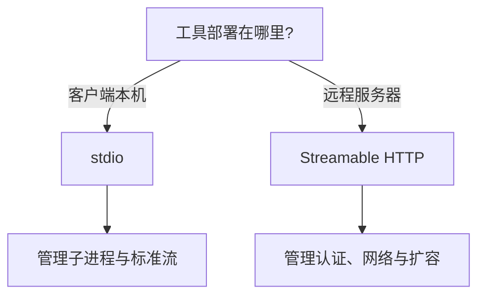

# 130. MCP 传输：stdio 还是 Streamable HTTP

> **场景引入**：本地编辑器要启动一个文件工具；团队又想让多个远程客户端共用同一服务。两种部署位置通常对应不同传输选择。

> 对应[原始材料](../origanl/130-MCP开发：stdio和HTTP怎么选.md)。协议版本会变化，部署前以 [MCP SDK 传输文档](https://php.sdk.modelcontextprotocol.io/run/) 为准。

---

## 🎯 一句话定位

本机宿主启动子进程常用 `stdio`，远程共享服务常用 Streamable HTTP；选型还要看安全和运维边界。

## 💎 核心要点概览

| 维度 | stdio | Streamable HTTP |
| --- | --- | --- |
| 部署 | 本地子进程 | 远程独立服务 |
| 通信 | 标准输入输出 | HTTP 请求与响应 |
| 重点 | 进程权限、stdout 纯净 | TLS、鉴权、限流与扩容 |

## 🚀 核心总结

> 先确定工具在哪运行、由谁启动、谁能访问，再选传输。

---

## 一、结论

客户端在本机启动工具子进程，选 `stdio` 往往最简单；多个远程客户端访问同一个服务，选 Streamable HTTP。两者承载同类 MCP 能力，主要差在部署、身份认证、运维和连接生命周期。

`stdio` 通过标准输入输出交换协议消息，调试日志应走 stderr，避免污染协议流；本地权限由启动进程继承，因此仍要限制文件访问。HTTP 适合远程共享与独立部署，要处理 TLS、鉴权、Origin/Host 校验、限流和可观测。是否有会话、怎样扩容还取决于使用的 MCP 协议版本与 SDK，不应笼统说“HTTP 一定有状态”。

**面试口述：**“本地由宿主启动的工具用 stdio，远程共享服务用 Streamable HTTP。选型看部署与安全边界，HTTP 还要考虑版本兼容、认证和容量。”

**自检：**本地 stdio 服务把调试日志打印到 stdout，会发生什么？

---

## 二、落地 Checklist

- [ ] 明确本地或远程部署及客户端数量。
- [ ] stdio 日志写 stderr，并限制子进程权限。
- [ ] HTTP 配置 TLS、鉴权、Origin/Host 校验和容量监控。

## 三、总结（一句话带走）

> **传输选择取决于部署与权限边界，不能只看接口写法。**
