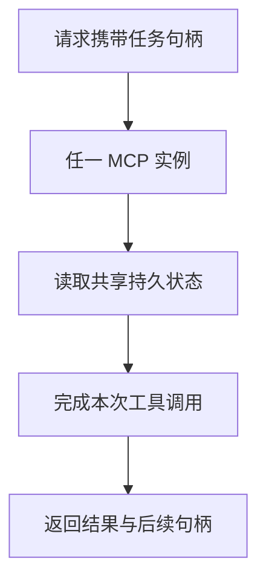

# 132. MCP 无状态：协议请求与业务任务分开

> **场景引入**：文件处理第一步返回 `job_id`，下一次请求落到另一台实例。只要共享状态可查，这个任务仍能继续。

> 对应[原始材料](../origanl/132-新版MCP协议核心：到底什么是无状态？.md)。[MCP 2026-07-28 官方说明](https://blog.modelcontextprotocol.io/posts/2026-07-28/)介绍了无状态协议核心；旧版本的会话行为不同，需按协商版本实现。

---

## 🎯 一句话定位

协议无状态指请求不依赖某台实例的隐藏会话内存，业务状态仍可持久保存并用显式句柄访问。

## 💎 核心要点概览

| 层次 | 保存什么 | 注意点 |
| --- | --- | --- |
| 协议调用 | 本次请求信息 | 不依赖固定实例 |
| 业务任务 | 进度与结果 | 存数据库或任务服务 |
| 任务句柄 | 关联状态的 ID | 绑定用户、有效期和权限 |

## 🚀 核心总结

> 无状态并非无记忆，而是把跨请求状态显式化、持久化。

---

## 一、无状态的意思

协议层不依赖“上次请求被哪台服务器处理”的隐藏内存，下一次请求可由另一台实例处理。**业务仍可有长期状态**：文件处理进度、审批任务和外部作业保存在数据库或任务服务，并用显式句柄引用。无状态不等于把全部历史塞进每次请求。

例如第一步上传文件，服务返回 `job_id`；第二步调用 `process_file(job_id)`。任一实例都能根据该 ID 读取任务记录并继续。句柄应随机、短期有效并绑定用户/租户，不能仅凭知道 ID 就访问其他人的文件。对于长任务，还需显式状态、取消和过期清理。

旧版 Streamable HTTP 曾有会话 ID，新版核心调整不能简单套到所有客户端。迁移时检查所用 SDK 的协议版本、发现机制和旧客户端兼容策略。

**面试口述：**“无状态指协议调用不依赖某台服务实例的会话内存；跨轮业务状态用数据库和显式任务句柄管理，调用时再次鉴权。版本兼容需按实际 MCP 协议处理。”

**自检：**服务仅在进程全局变量保存 `current_file`，扩容后会出什么问题？

---

## 二、落地 Checklist

- [ ] 根据协商的 MCP 协议版本实现对应会话行为。
- [ ] 长任务进度存共享持久层，请求携带显式任务句柄。
- [ ] 句柄按用户鉴权，并设置过期、取消和清理机制。

## 三、总结（一句话带走）

> **实例可以换，任务状态要能凭受控句柄安全找回来。**
