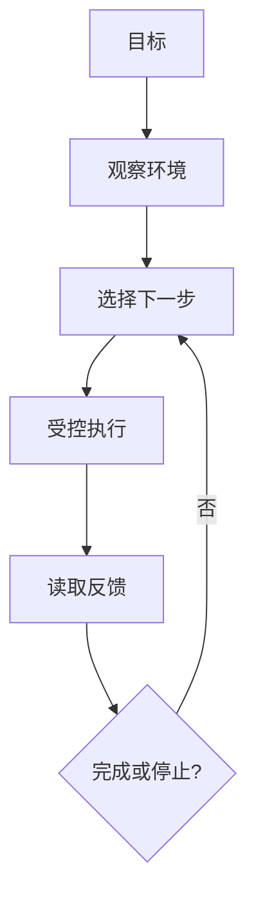

# 133. 判断一个系统是否有 Agent 特征

> **场景引入**：产品宣称“自主调查企业”，实际只是固定脚本套聊天界面。看它能否根据新线索选择下一步，比看名称更有用。

> 对应[原始材料](../origanl/133-别被骗了！这才是真正的Agent.md)。Agent 没有唯一公认的产品边界，重点是把控制权和执行能力讲清楚。

---

## 🎯 一句话定位

从目标、运行时决策、受控动作和反馈验证来描述系统的 Agent 特征。

## 💎 核心要点概览

| 问题 | 观察证据 |
| --- | --- |
| 是否有目标 | 可判定的任务完成条件 |
| 是否动态决策 | 新观察会改变下一步 |
| 是否执行并验证 | 有工具记录和外部结果 |

## 🚀 核心总结

> 术语边界可讨论，控制权、权限和完成证据必须说清楚。

---

## 一、三个判断问题

系统是否有明确目标？是否能根据新观察选择下一步？是否有能力在权限范围内执行动作并核验结果？具备这些特征的系统更接近 Agent；只会根据固定模板回答问题，更接近聊天助手或单次模型调用。

“调查合作公司”可能需要按新线索继续查工商、新闻和财务资料，属于动态任务；“把 CSV 转成 JSON”路径固定，不必引入自主循环。但也不能把“只调用一次工具”绝对排除在 Agent 之外，行业术语使用不同。真正值得比较的是动态决策带来的收益、风险与成本。

产品宣称“自主”时应要求看 trace、权限、停止条件和外部完成证据。模型说“已完成”不等于业务已成功；高风险动作也不应因系统叫 Agent 就免去审批。

**面试口述：**“我从目标、运行时决策、动作反馈和完成验证描述 Agent，而不是只看是否用了大模型或工具。术语边界可讨论，工程边界必须清楚。”

**自检：**一个固定脚本套聊天界面，是否一定能根据新观察改计划？

---

## 二、落地 Checklist

- [ ] 展示一次根据新信息改变后续步骤的 trace。
- [ ] 标出哪些步骤由模型决定，哪些由程序固定。
- [ ] 用外部系统结果验证完成，记录权限和停止条件。

## 三、总结（一句话带走）

> **看真实控制流和结果证据，才能判断系统具备哪些 Agent 能力。**
